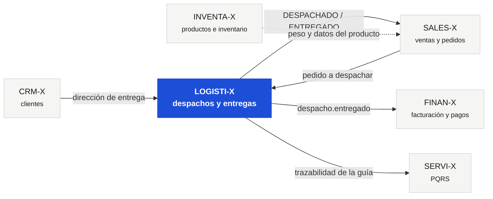
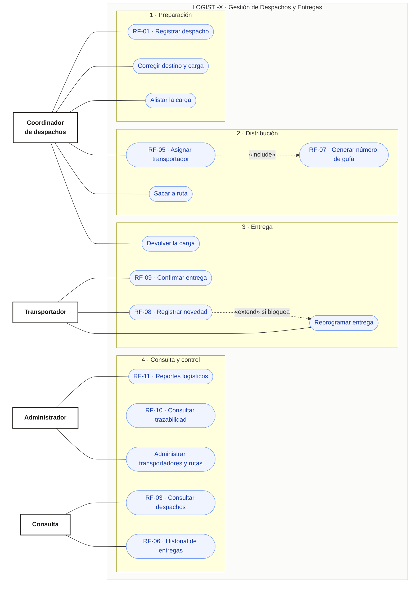
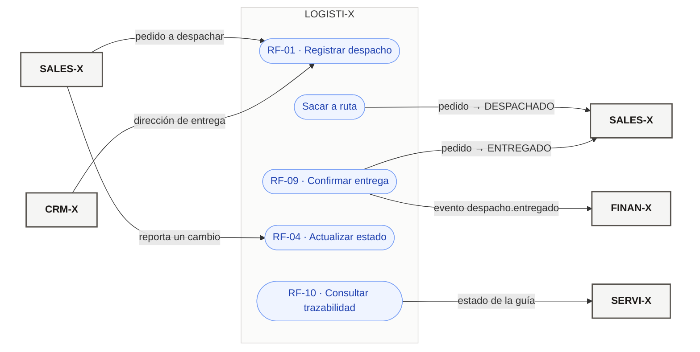
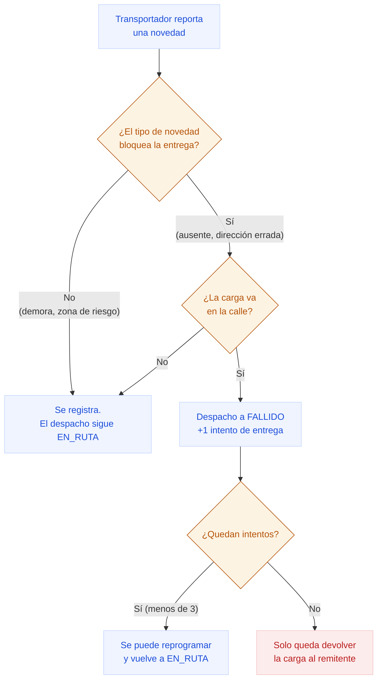
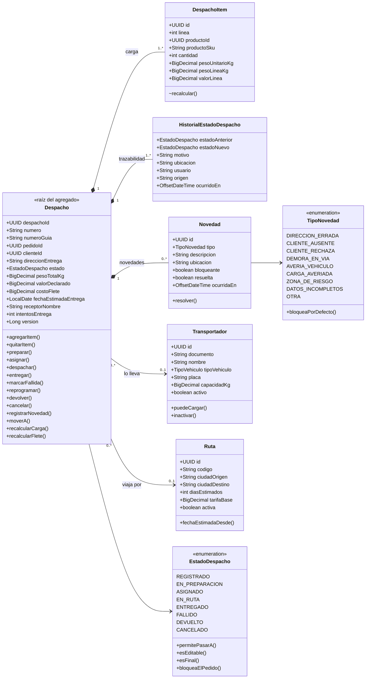
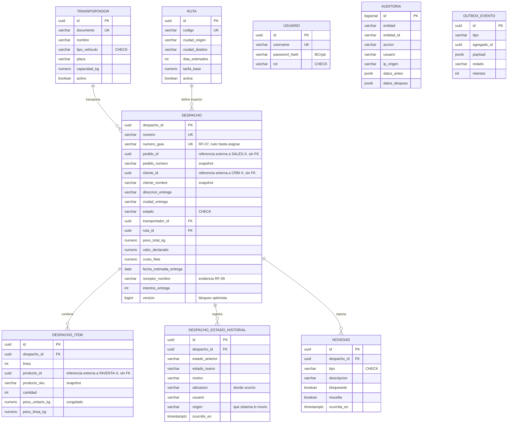
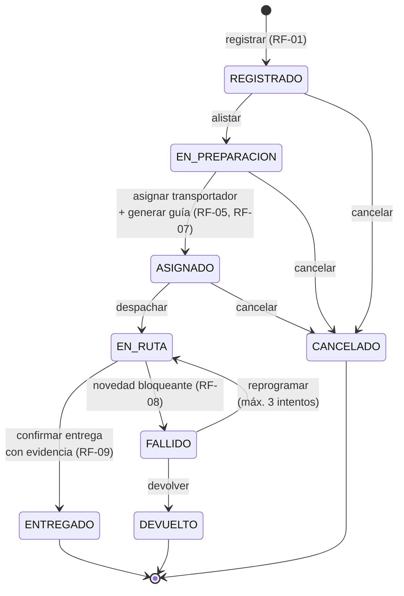
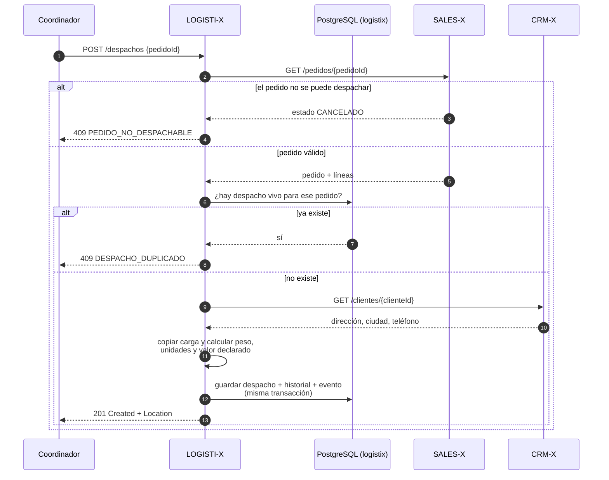
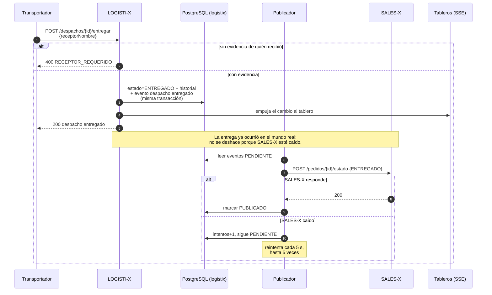

# 02 · Modelo de la solución

**Semana 2** — cierre 28 de agosto de 2026
Casos de uso · modelo de dominio · modelo de datos · máquina de estados · secuencias

> Los diagramas de este documento están también como imagen en
> `docs/diagramas/` (PNG a 2x), listos para pegar en la presentación.

---

## 1. Contexto: dónde encaja LOGISTI-X en INTEGRAX

Antes de los casos de uso hay que ver la frontera. LOGISTI-X es el eslabón
entre la venta y el cliente: recibe el pedido de SALES-X y le devuelve el
resultado de la entrega.

**Lo que se lee en este diagrama:** LOGISTI-X no le pide nada a INVENTA-X.
El peso y el nombre del producto llegan dentro del pedido de SALES-X, que es
quien ya los consultó. Un sistema menos al que llamar es un sistema menos que
puede estar caído.

---

## 2. Casos de uso

### 2.1 Diagrama general

El sistema tiene veinte casos de uso de negocio y cuatro de soporte técnico.
Aquí se presentan agrupados en dos diagramas para que se lean: primero **quién
hace qué** (actores humanos) y después **qué le pide LOGISTI-X a los otros
microproyectos y qué le piden a él**. Los cuatro casos de uso centrales están
detallados más abajo; **la especificación completa de los veinte, con flujos
alternos, excepciones y trazabilidad, está en
[`08-casos-de-uso.md`](08-casos-de-uso.md)**.

#### Actores humanos

#### Sistemas que participan

### 2.2 Caso de uso central: **Registrar despacho** (RF-01, RF-02)

| | |
|---|---|
| **Identificador** | CU-01 |
| **Actor principal** | Coordinador de despachos |
| **Actores de apoyo** | SALES-X, CRM-X |
| **Precondición** | El pedido existe en SALES-X y está CONFIRMADO o FACTURADO |
| **Postcondición** | Despacho en REGISTRADO, con la carga y la dirección copiadas, y evento `despacho.creado` en la bandeja de salida |

**Flujo principal**

1. El coordinador solicita `POST /api/v1/despachos` con el `pedidoId`.
2. LOGISTI-X pide el pedido a **SALES-X**.
3. Verifica que el estado del pedido admita despacho (RN-09).
4. Verifica que ese pedido no tenga ya un despacho vivo (RN-08).
5. Pide a **CRM-X** los datos de entrega del cliente del pedido.
6. Copia dirección, ciudad y teléfono como *snapshot*.
7. Copia la carga del pedido línea por línea y calcula peso, unidades y valor
   declarado en el servidor (RN-11).
8. Guarda el despacho con consecutivo `DES-2026-000001` y registra el primer
   movimiento del historial.
9. Inserta el evento `despacho.creado` en la bandeja de salida, **en la misma
   transacción**.
10. Responde 201 con la cabecera `Location` y el despacho creado.

**Flujos alternos**

| # | Situación | Respuesta |
|---|---|---|
| A1 | El pedido no existe en SALES-X | 502 `PEDIDO_NO_ENCONTRADO` |
| A2 | El pedido está CANCELADO o en BORRADOR | 409 `PEDIDO_NO_DESPACHABLE` |
| A3 | El pedido ya tiene un despacho vivo | 409 `DESPACHO_DUPLICADO` |
| A4 | El cliente no tiene dirección en CRM-X y tampoco viene en la solicitud | 409 `DIRECCION_REQUERIDA` |
| A5 | SALES-X o CRM-X no responden | 502, y **no se guarda nada** |
| A6 | Se pide despachar un producto ajeno al pedido | 409 `PRODUCTO_AJENO_AL_PEDIDO` |
| A7 | Se piden más unidades de las del pedido | 409 `CANTIDAD_SUPERA_PEDIDO` |

### 2.3 Caso de uso: **Asignar transportador y generar guía** (RF-05 + RF-07)

| | |
|---|---|
| **Identificador** | CU-02 |
| **Actor principal** | Coordinador de despachos |
| **Precondición** | El despacho está en EN_PREPARACION y tiene carga |
| **Postcondición** | Despacho ASIGNADO, con guía, ruta, fecha prometida y flete calculado |

**Flujo principal**

1. El coordinador solicita `POST /despachos/{id}/asignar` con el transportador.
2. LOGISTI-X verifica que el transportador esté activo (RN-14).
3. Verifica que la carga quepa en el vehículo (RN-12).
4. Si no se indicó ruta, elige la ruta activa más rápida hacia la ciudad de
   destino.
5. **Genera el número de guía** con dígito de verificación, si no tenía (RN-03).
6. Calcula la fecha prometida con los días estimados de la ruta.
7. Calcula el flete: tarifa base + tarifa de la ruta + costo por kilogramo.
8. Mueve el despacho a ASIGNADO y registra el movimiento.

**Flujos alternos**

| # | Situación | Respuesta |
|---|---|---|
| B1 | El transportador está inactivo | 409 `TRANSPORTADOR_INACTIVO` |
| B2 | La carga supera la capacidad del vehículo | 409 `CAPACIDAD_INSUFICIENTE` |
| B3 | El despacho ya está ASIGNADO | Se reasigna, **conservando la guía**, y queda en la trazabilidad |
| B4 | No hay ruta activa hacia esa ciudad | Se asigna sin ruta y la fecha queda a cargo del coordinador |

### 2.4 Caso de uso: **Confirmar entrega** (RF-09)

| | |
|---|---|
| **Identificador** | CU-03 |
| **Actor principal** | Transportador |
| **Precondición** | El despacho está EN_RUTA |
| **Postcondición** | Despacho ENTREGADO con evidencia; evento `despacho.entregado` en la bandeja de salida; SALES-X marca el pedido ENTREGADO |

**Flujo principal**

1. El transportador solicita `POST /despachos/{id}/entregar` con el nombre de
   quien recibió.
2. LOGISTI-X exige esa evidencia; sin ella rechaza (RN-05).
3. Mueve el despacho a ENTREGADO y guarda receptor, documento y hora.
4. Inserta el evento `despacho.entregado` en la bandeja de salida.
5. El publicador, **fuera de la transacción**, le reporta a SALES-X que el
   pedido quedó ENTREGADO y reintenta si SALES-X está caído.

**Flujos alternos**

| # | Situación | Respuesta |
|---|---|---|
| C1 | No se indica quién recibió | 400 `RECEPTOR_REQUERIDO` |
| C2 | El despacho no está EN_RUTA | 409 `TRANSICION_INVALIDA` |
| C3 | SALES-X está caído al reportar | La entrega **queda firme**; el aviso se reintenta solo |

### 2.5 Caso de uso: **Registrar novedad** (RF-08)

| | |
|---|---|
| **Identificador** | CU-04 |
| **Actor principal** | Transportador |
| **Precondición** | El despacho no está en un estado final |
| **Postcondición** | Novedad registrada; si es bloqueante y la carga iba en ruta, el despacho queda FALLIDO con un intento más |

---

## 3. Modelo de dominio (diagrama de clases)

**Por qué `Despacho` es la raíz del agregado.** Nadie de afuera toca una línea
de carga ni una novedad directamente: se agregan, cambian o quitan *a través
del despacho*, y cada una de esas operaciones termina en `recalcularCarga()`.
Es imposible dejar el despacho con carga nueva y peso viejo, que es el bug
clásico de este dominio. Y una novedad bloqueante **tiene** que cambiar el
estado del despacho en el mismo acto: si se pudiera registrar suelta, el
sistema diría "en ruta" de algo que lleva dos días parado.

**Por qué `Transportador` y `Ruta` no son parte del agregado.** Viven más que
el despacho y se comparten entre miles: son entidades propias, con su propio
ciclo de vida, y por eso se referencian, no se contienen.

---

## 4. Modelo de datos

### Lo que NO está en este modelo, y es a propósito

No hay tabla `cliente`, ni `producto`, ni `pedido`. `cliente_id`, `producto_id`
y `pedido_id` son **referencias externas sin llave foránea**, porque esas
entidades viven en la base de datos de CRM-X, INVENTA-X y SALES-X. Ver
[ADR-002](adr/ADR-002-una-base-por-microproyecto.md) y
[ADR-003](adr/ADR-003-referencias-externas-sin-fk.md).

A cambio de perder la llave foránea se gana independencia, y se paga con dos
cosas que sí están implementadas: **validación por API** al registrar el
despacho y **copia local (snapshot)** de los datos que se usaron. Una guía ya
impresa no puede cambiar porque mañana corrijan un maestro ajeno.

`transportador` y `ruta` **sí** llevan llave foránea: son entidades de esta
casa.

### Decisiones de tipos

| Decisión | Motivo |
|---|---|
| `numeric(14,2)` para el dinero | `float`/`double` acumulan error; un flete descuadrado cuesta horas de conciliación |
| `numeric(10,3)` para el peso | La unidad comercial de la paquetería es el gramo: 0,250 kg × 800 unidades = 200 kg exactos |
| `timestamptz` y no `timestamp` | Guarda el instante real; evita el lío del horario cuando hay más de una zona |
| `varchar` + `CHECK` en vez de `ENUM` nativo | Agregar un estado nuevo no exige `ALTER TYPE`, y mapea directo al `enum` de Java |
| `jsonb` para auditoría y eventos | La forma del documento cambia con el tiempo; `jsonb` además es consultable |
| Identificador asignado por la aplicación | Un `Despacho` recién construido ya tiene identidad; se puede probar sin base de datos |
| Índice único **parcial** sobre `pedido_id` | Un pedido no puede tener dos despachos vivos, pero sí varios cerrados ([ADR-009](adr/ADR-009-un-despacho-vivo-por-pedido.md)) |

---

## 5. Máquina de estados

| Estado | Editable | Carga en poder del transportador | Quién lo produce |
|---|---|---|---|
| REGISTRADO | ✅ | — | Coordinador |
| EN_PREPARACION | ✅ | — | Coordinador (bodega) |
| ASIGNADO | ❌ | — | Coordinador |
| EN_RUTA | ❌ | ✅ | Coordinador (salida) |
| ENTREGADO | ❌ | — | Transportador |
| FALLIDO | ❌ | ✅ | Novedad bloqueante |
| DEVUELTO | ❌ | — | Coordinador |
| CANCELADO | ❌ | — | Coordinador |

**FALLIDO no es un estado final**, y ahí está la diferencia con un Excel de
despachos: "no se pudo entregar hoy" no es lo mismo que "se perdió la venta".
De FALLIDO se sale reprogramando —hasta tres intentos— o devolviendo.

La tabla vive en `EstadoDespacho.TRANSICIONES` y está probada movimiento por
movimiento en `MaquinaEstadosTest`, incluidos los que **no** se permiten
(cancelar algo que ya salió a ruta, entregar sin haber despachado, resucitar
un despacho cerrado).

---

## 6. Secuencia: registrar un despacho

## 7. Secuencia: entrega y aviso a SALES-X

Esta es la secuencia que explica por qué el aviso va por bandeja de salida y
no por llamada directa.

---

Anterior: [01 · Análisis y requisitos](01-analisis-y-requisitos.md) ·
Siguiente: [03 · Arquitectura](03-arquitectura.md)
