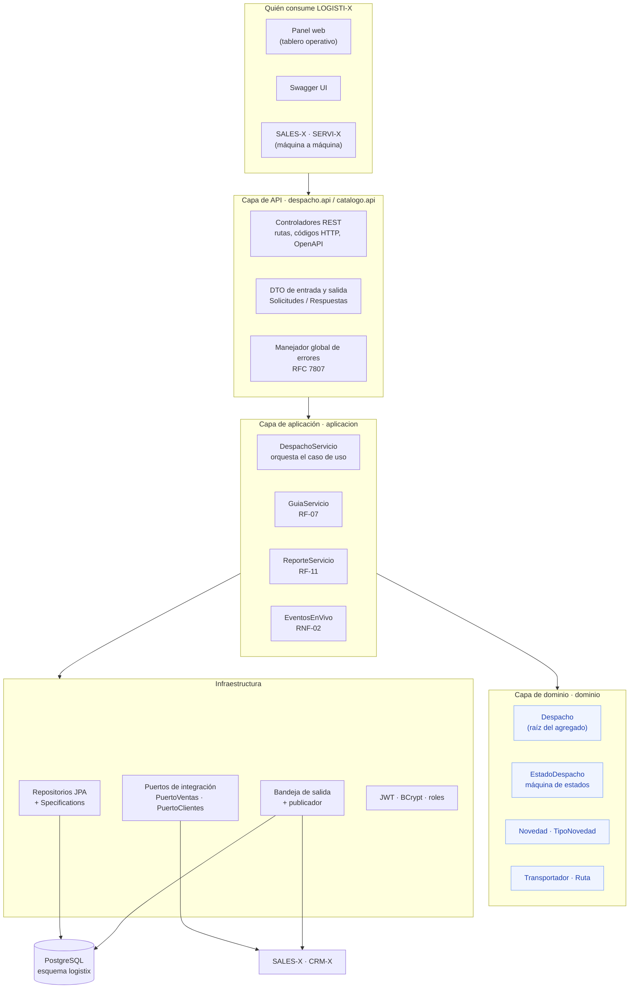
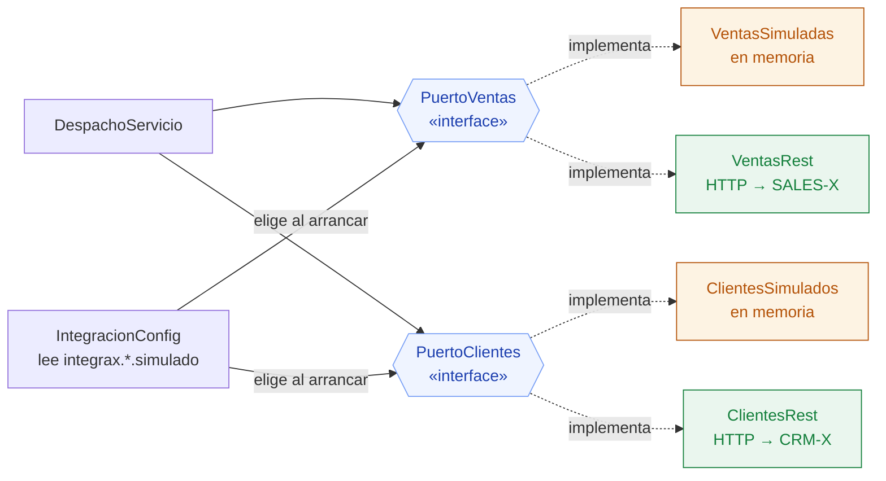
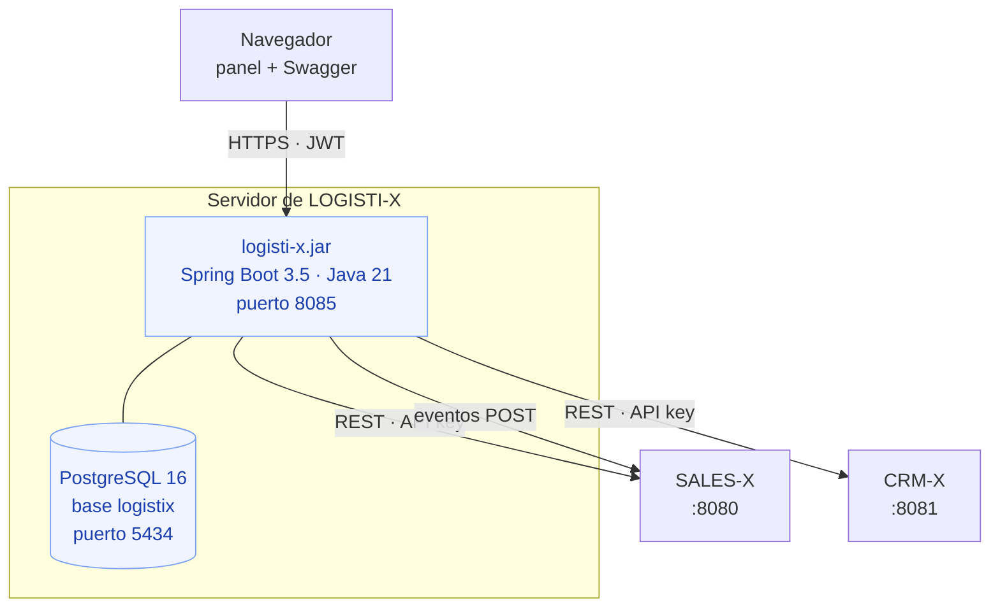

# 03 · Arquitectura

**Semana 3** — cierre 4 de septiembre de 2026
Arquitectura, capas, integración, seguridad y rendimiento

---

## 1. Arquitectura por capas



**La regla que sostiene el diagrama: las flechas van hacia adentro.** La API
conoce la aplicación, la aplicación conoce el dominio, y el dominio no conoce a
nadie. `Despacho` no sabe que existe HTTP, ni JSON, ni PostgreSQL. Por eso
`MaquinaEstadosTest` y `CalculoCargaTest` corren en milisegundos sin levantar
Spring: prueban clases que se construyen con `new`.

| Capa | Paquete | Qué decide | Qué NO hace |
|---|---|---|---|
| API | `despacho.api`, `catalogo.api` | Rutas, códigos HTTP, validación de forma, permisos por rol | Ninguna regla de negocio |
| Aplicación | `*.aplicacion` | Con quién hay que hablar, en qué orden, qué se audita y qué evento se publica | No calcula pesos ni valida transiciones |
| Dominio | `*.dominio` | Qué es válido: estados, carga, evidencia, capacidad | No sabe de HTTP ni de base de datos |
| Infraestructura | `*.repositorio`, `integracion`, `seguridad` | Cómo se persiste y cómo se habla con otros | No decide reglas |

## 2. Puertos y adaptadores

La integración con los demás microproyectos entra por **interfaces**, no por
clases concretas. Esa es la pieza que permite construir sin esperar a nadie.



Pasar de los dobles a los sistemas reales es cambiar **una propiedad**:

```yaml
integrax:
  ventas:
    simulado: false
    url-base: https://sales-x.integrax.co
```

Ni una línea del dominio se toca. Ver
[ADR-006](adr/ADR-006-dobles-de-prueba.md).

## 3. Despliegue



**Cada microproyecto tiene su propia base de datos** y ningún otro se conecta
a ella. Es la decisión que ordena todo el proyecto ([ADR-002](adr/ADR-002-una-base-por-microproyecto.md)):
si los seis compartieran una base, la asignatura perdería su objeto, que es
evaluar que los sistemas se hablen por servicios.

## 4. Cómo se comunican los sistemas

Hay dos caminos, y cada uno se usa donde corresponde:

| Camino | Cuándo | Ejemplo |
|---|---|---|
| **Llamada REST síncrona** | Se necesita el dato *ahora* para decidir | Registrar despacho: sin el pedido de SALES-X no hay nada que despachar |
| **Evento por bandeja de salida** | Hay que *avisar* de algo que ya pasó | La carga salió: SALES-X debe enterarse, pero el camión no vuelve si SALES-X está caído |

Esa distinción es la diferencia entre un sistema que se cae en cadena y uno
que aguanta. Detalle en [04 · Contratos de integración](04-contratos-integracion.md)
y en [ADR-008](adr/ADR-008-aviso-a-sales-x.md).

## 5. Manejo de errores

Todos los errores salen en **Problem Details (RFC 7807)**, con un campo
`codigo` estable que los otros equipos pueden usar en su lógica:

```json
{
  "type": "about:blank",
  "title": "Regla de negocio",
  "status": 409,
  "detail": "El pedido PED-2026-000001 ya tiene el despacho DES-2026-000001 en estado EN_RUTA.",
  "codigo": "DESPACHO_DUPLICADO",
  "instance": "/api/v1/despachos"
}
```

| Situación | HTTP | De dónde sale |
|---|---|---|
| Cuerpo inválido (falta un campo, cantidad en cero) | 400 | Validación de los DTO |
| No autenticado | 401 | Filtro JWT |
| Autenticado sin permiso | 403 | `@PreAuthorize` |
| No existe el despacho, la guía o el transportador | 404 | `RecursoNoEncontradoException` |
| Regla de negocio rota | 409 | `ReglaNegocioException` |
| Dos usuarios editando el mismo despacho | 409 | Bloqueo optimista de JPA |
| SALES-X o CRM-X caídos o rechazando | 502 | `IntegracionException` |

**El detalle que importa:** un fallo de otro microproyecto es **502**, no 500.
500 significaría "LOGISTI-X está roto"; 502 dice la verdad — "yo estoy bien,
el de al lado no responde" — y eso cambia a quién se llama a las 2 a. m.

## 6. Seguridad (RNF-05)

| Medida | Cómo |
|---|---|
| Autenticación | JWT firmado HS384, vigencia configurable |
| Contraseñas | BCrypt con factor 10; nunca en texto plano ni en migraciones |
| Autorización | Cinco roles + `@PreAuthorize` por operación |
| Todo cerrado por defecto | Se listan las rutas públicas; lo que no esté ahí exige token |
| Secretos | Solo por variable de entorno; la aplicación no arranca sin `LOGISTIX_JWT_SECRETO` |
| Inyección SQL | Consultas por parámetros y `Specification`; jamás concatenación |
| Fuga de información | Sin traza de error al cliente; el mismo mensaje para usuario inexistente y contraseña mala |
| Auditoría | Usuario e IP tomados del contexto, nunca del cuerpo de la petición |

| Rol | Puede |
|---|---|
| `ADMIN` | Todo, incluida la auditoría y el maestro |
| `COORDINADOR` | Registrar, alistar, asignar, despachar, cancelar, devolver |
| `TRANSPORTADOR` | Confirmar entregas, reportar novedades, reprogramar |
| `CONSULTA` | Solo lectura |
| `SISTEMA` | Integración máquina a máquina (cambios de estado desde otro sistema) |

**La excepción documentada:** el canal en vivo (`GET /despachos/eventos`)
acepta el token como parámetro `access_token`, porque el `EventSource` del
navegador no permite enviar cabeceras. Se limita a esa ruta a propósito: un
token en la URL queda en los registros del servidor, así que no se admite como
forma general de autenticación.

## 7. Rendimiento (RNF-04)

| Riesgo | Qué se hizo |
|---|---|
| Consultas N+1 al listar | `join fetch` en las cargas del despacho |
| Reportes lentos | Se agregan en SQL (`group by`), no en memoria |
| Filtros sin índice | Índices en estado, pedido, cliente, transportador, ciudad y fecha |
| Listados sin límite | Paginación obligatoria, máximo 100 por página |
| Un sistema externo colgado | Timeouts de 2 s (conexión) y 3 s (lectura) |
| Sondeo del tablero | Server-Sent Events: el servidor empuja, el navegador no pregunta |
| Concurrencia entre coordinador y transportador | Bloqueo optimista con `@Version` |

## 8. Decisiones de arquitectura (ADR)

| ADR | Decisión |
|---|---|
| [ADR-001](adr/ADR-001-java-spring-boot.md) | Java 21 + Spring Boot 3.5 |
| [ADR-002](adr/ADR-002-una-base-por-microproyecto.md) | Una base de datos por microproyecto |
| [ADR-003](adr/ADR-003-referencias-externas-sin-fk.md) | Referencias externas sin llave foránea + snapshot |
| [ADR-004](adr/ADR-004-dinero-y-peso.md) | `BigDecimal` para dinero (2 dec.) y peso (3 dec.) |
| [ADR-005](adr/ADR-005-maquina-de-estados.md) | Máquina de estados en el dominio |
| [ADR-006](adr/ADR-006-dobles-de-prueba.md) | Puertos con dobles de prueba |
| [ADR-007](adr/ADR-007-outbox-de-eventos.md) | Bandeja de salida transaccional |
| [ADR-008](adr/ADR-008-aviso-a-sales-x.md) | Avisar a SALES-X por outbox, no por compensación |
| [ADR-009](adr/ADR-009-un-despacho-vivo-por-pedido.md) | Índice único parcial por pedido |
| [ADR-010](adr/ADR-010-guia-con-digito-verificacion.md) | Guía con dígito de verificación |
| [ADR-011](adr/ADR-011-tiempo-real-con-sse.md) | Tiempo real con SSE y no con sondeo |

---

Anterior: [02 · Modelo de la solución](02-modelo-de-la-solucion.md) ·
Siguiente: [04 · Contratos de integración](04-contratos-integracion.md)
