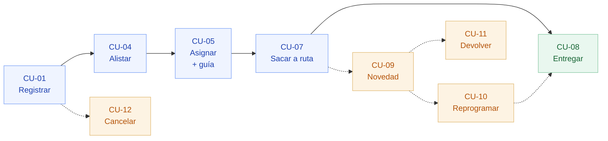

# 08 · Especificación de casos de uso

**LOGISTI-X — Gestión de Despachos y Entregas** · microproyecto 2.5 de INTEGRAX

Electiva Profesional II · Integración de Aplicaciones y Sistemas — Corporación Universitaria Unisabaneta

Entrega definitiva: viernes 18 de septiembre de 2026

> Este documento amplía la sección 2 de `02-modelo-de-la-solucion.md`. Allí se
> presentaron los cuatro casos de uso centrales para explicar el modelo; aquí
> están **los veinte, completos**, cada uno con su flujo principal, sus flujos
> alternos, el servicio REST que lo realiza, los roles que lo pueden ejecutar,
> las reglas de negocio que lo gobiernan y la prueba automática que lo verifica.
>
> Regla que se siguió al escribirlo: **ningún caso de uso describe algo que el
> sistema no haga**. Cada uno se contrastó contra el código (`DespachoServicio`,
> `Despacho`, `CatalogoServicio`) y contra las 99 pruebas en verde.

---

## 1. Cómo se lee este documento

Cada caso de uso trae una ficha y tres bloques:

| Parte | Qué contiene |
|---|---|
| **Ficha** | Identificador, RF cubiertos, actores, disparador, precondiciones, postcondiciones, servicio REST, roles, reglas aplicadas, prioridad y prueba que lo verifica |
| **Flujo principal** | La secuencia cuando todo sale bien, numerada |
| **Flujos alternos** | Variantes válidas del camino feliz |
| **Excepciones** | Lo que el sistema rechaza, con el código de error y el HTTP que devuelve |

**Códigos de error.** LOGISTI-X no devuelve mensajes sueltos: cada rechazo trae
un código estable (`PEDIDO_NO_DESPACHABLE`, `RECEPTOR_REQUERIDO`, …) en una
respuesta *Problem Details* (RFC 7807). Ese código es lo que otro microproyecto
puede interpretar; el texto es para el humano.

**Cómo se traduce cada fallo a HTTP.** El manejador global de errores es uno
solo y siempre aplica la misma regla:

| Origen del fallo | HTTP | Código |
|---|---|---|
| El recurso no existe | 404 | `DESPACHO_NO_ENCONTRADO`, `GUIA_NO_ENCONTRADA`, `TRANSPORTADOR_NO_ENCONTRADO`, … |
| Una regla de negocio lo impide | 409 | El código de la regla (`TRANSICION_INVALIDA`, `CAPACIDAD_INSUFICIENTE`, …) |
| El cuerpo de la petición no cumple el contrato | 400 | `VALIDACION`, `CUERPO_ILEGIBLE`, `PARAMETRO_INVALIDO` |
| Otro microproyecto falla o no responde | 502 | `PEDIDO_NO_ENCONTRADO`, `VENTAS_INALCANZABLE`, `CRM_INALCANZABLE`, … |
| Falta token o el rol no alcanza | 401 / 403 | `NO_AUTENTICADO`, `ACCESO_DENEGADO` |
| Dos usuarios tocan el mismo despacho a la vez | 409 | `CONFLICTO_CONCURRENCIA` |

Un fallo de validación se detecta **antes** que la regla de negocio: si el campo
falta, la respuesta es 400 `VALIDACION`; si llega presente pero vacío, lo atrapa
el dominio y la respuesta es 409 con el código de la regla.

**Convención de estados.** REGISTRADO → EN_PREPARACION → ASIGNADO → EN_RUTA →
ENTREGADO, con las salidas FALLIDO, DEVUELTO y CANCELADO. La tabla completa de
transiciones está en `02-modelo-de-la-solucion.md`, sección 5.

---

## 2. Actores

### 2.1 Actores humanos

| Actor | Rol técnico (JWT) | Qué puede hacer |
|---|---|---|
| **Coordinador de despachos** | `COORDINADOR` | Registra, corrige, alista, asigna, saca a ruta, reprograma, devuelve y cancela |
| **Transportador** | `TRANSPORTADOR` | Confirma entregas, reporta novedades y reprograma su propia ruta |
| **Administrador** | `ADMIN` | Todo lo anterior + maestro de transportadores y rutas + auditoría |
| **Consulta** | `CONSULTA` | Solo lectura: despachos, historial, trazabilidad y reportes |

### 2.2 Actores de sistema

| Actor | Rol técnico | Relación con LOGISTI-X |
|---|---|---|
| **SALES-X** | `SISTEMA` | *Proveedor*: entrega el pedido y sus líneas. *Consumidor*: recibe DESPACHADO y ENTREGADO |
| **CRM-X** | — | *Proveedor*: dirección, ciudad y teléfono de entrega del cliente |
| **SERVI-X** | `SISTEMA` | *Consumidor*: consulta trazabilidad de la guía al atender una PQRS |
| **FINAN-X** | — | *Consumidor*: escucha el evento `despacho.entregado` para cerrar el ciclo de cobro |

**Por qué los sistemas también son actores.** El enunciado exige que cada
microproyecto sea «consumidor y/o proveedor de servicios de los demás». Si los
sistemas externos no aparecen como actores, los casos de uso describen un
programa aislado y la integración queda sin especificar — que es justo lo que
evalúa la asignatura.

---

## 3. Mapa de casos de uso

**El orden en que se encadenan** los casos de uso del ciclo de vida del
despacho. Las líneas punteadas son los caminos que solo se recorren cuando algo
sale mal en la calle.

Los diagramas de casos de uso con actores —quién ejecuta cada uno y qué
microproyecto participa— están en `02-modelo-de-la-solucion.md`, sección 2.1, y
como imagen en `docs/diagramas/02` y `03`.

### 3.1 Índice de casos de uso

**Paquete 1 · Preparación del despacho**

| ID | Caso de uso | RF | Actor principal | Servicio REST |
|---|---|---|---|---|
| CU-01 | Registrar despacho | RF-01, RF-02 | Coordinador | `POST /despachos` |
| CU-02 | Corregir el destino del despacho | RF-01 | Coordinador | `PATCH /despachos/{id}` |
| CU-03 | Ajustar la carga del despacho | RF-01 | Coordinador | `POST/PUT/DELETE /despachos/{id}/items` |
| CU-04 | Alistar la carga | RF-04 | Coordinador | `POST /despachos/{id}/preparar` |

**Paquete 2 · Distribución**

| ID | Caso de uso | RF | Actor principal | Servicio REST |
|---|---|---|---|---|
| CU-05 | Asignar transportador y generar guía | RF-05, RF-07 | Coordinador | `POST /despachos/{id}/asignar` |
| CU-06 | Consultar e imprimir la guía | RF-07 | Coordinador | `GET /despachos/{id}/guia` |
| CU-07 | Sacar la carga a ruta | RF-04 | Coordinador | `POST /despachos/{id}/despachar` |

**Paquete 3 · Entrega en calle**

| ID | Caso de uso | RF | Actor principal | Servicio REST |
|---|---|---|---|---|
| CU-08 | Confirmar entrega | RF-09 | Transportador | `POST /despachos/{id}/entregar` |
| CU-09 | Registrar novedad de transporte | RF-08 | Transportador | `POST /despachos/{id}/novedades` |
| CU-10 | Reprogramar la entrega | RF-04 | Transportador | `POST /despachos/{id}/reprogramar` |
| CU-11 | Devolver la carga al remitente | RF-04 | Coordinador | `POST /despachos/{id}/devolver` |
| CU-12 | Cancelar el despacho | RF-04 | Coordinador | `POST /despachos/{id}/cancelar` |

**Paquete 4 · Consulta y control**

| ID | Caso de uso | RF | Actor principal | Servicio REST |
|---|---|---|---|---|
| CU-13 | Consultar despachos | RF-03 | Consulta | `GET /despachos` y variantes |
| CU-14 | Consultar trazabilidad | RF-10 | SERVI-X / Consulta | `GET /despachos/{id}/trazabilidad` |
| CU-15 | Consultar historial de entregas | RF-06 | Consulta | `GET /despachos/{id}/historial` |
| CU-16 | Generar reporte logístico | RF-11 | Administrador | `GET /reportes/logistica` |

**Paquete 5 · Administración e integración**

| ID | Caso de uso | RF | Actor principal | Servicio REST |
|---|---|---|---|---|
| CU-17 | Administrar transportadores | RF-05 | Administrador | `/transportadores` |
| CU-18 | Administrar rutas de entrega | RF-05 | Administrador | `/rutas` |
| CU-19 | Reportar cambio de estado desde otro sistema | RF-04 | SALES-X | `POST /despachos/{id}/estado` |
| CU-20 | Diagnosticar la integración | RNF-08 | Administrador | `GET /integracion/diagnostico` |

Los casos de uso de soporte técnico —autenticarse, seguir el tablero en vivo,
consultar la auditoría y cerrar una novedad— están en la sección 5.

---

## 4. Especificación de los casos de uso

### CU-01 · Registrar despacho

| Campo | Valor |
|---|---|
| **Identificador** | CU-01 |
| **Requisitos** | RF-01 (registrar despachos), RF-02 (asociar despachos a pedidos) |
| **Actor principal** | Coordinador de despachos |
| **Actores de apoyo** | SALES-X (pedido), CRM-X (dirección de entrega) |
| **Disparador** | Un pedido queda confirmado en SALES-X y hay que sacarlo de bodega |
| **Precondiciones** | El usuario está autenticado con rol ADMIN o COORDINADOR · El pedido existe en SALES-X en estado CONFIRMADO, FACTURADO o DESPACHADO · Ese pedido no tiene otro despacho vivo |
| **Postcondición de éxito** | Despacho creado en estado REGISTRADO con número interno `DES-2026-000001`, la carga copiada del pedido, la dirección congelada como *snapshot*, el primer movimiento en el historial y el evento `despacho.creado` en la bandeja de salida |
| **Postcondición de fallo** | **No se guarda nada**: la creación es una sola transacción |
| **Servicio REST** | `POST /api/v1/despachos` → 201 Created + cabecera `Location` |
| **Roles** | ADMIN, COORDINADOR |
| **Reglas aplicadas** | RN-08 (un despacho vivo por pedido), RN-09 (estados despachables), RN-11 (el servidor calcula la carga), RN-13 (no despachar más de lo vendido) |
| **Prioridad** | Alta — es el caso de uso que abre el ciclo |
| **Verificado en** | `FlujoDespachoTest.flujoCompleto`, `pedidoCanceladoNoSeDespacha`, `noSeDespachaDosVecesElMismoPedido`, `noSeDespachaMasDeLoVendido`, `productoAjenoAlPedido` |

**Flujo principal**

1. El coordinador envía `POST /api/v1/despachos` con el `pedidoId` y, si quiere, una dirección distinta a la del cliente y las líneas a despachar.
2. LOGISTI-X pide el pedido a **SALES-X** por `PuertoVentas`.
3. Comprueba que el estado del pedido esté en la lista de estados despachables, que llega de configuración (`integrax.ventas.estados-despachables`) y no del código.
4. Comprueba que ese pedido no tenga ya un despacho vivo.
5. Pide a **CRM-X** los datos del cliente del pedido.
6. Resuelve el destino: lo que venga en la solicitud manda sobre lo de CRM-X, y lo copia como *snapshot* (dirección, ciudad, departamento, teléfono).
7. Copia la carga: si la solicitud no trae líneas, copia el pedido completo; si las trae, valida cada una contra el pedido.
8. Calcula en el servidor el peso total (escala de gramos), las unidades y el valor declarado.
9. Asigna el consecutivo interno `DES-<año>-<6 dígitos>` y registra el primer movimiento del historial.
10. Inserta el evento `despacho.creado` en la bandeja de salida, **dentro de la misma transacción**.
11. Responde `201 Created` con el despacho y la cabecera `Location`.

**Flujos alternos**

| # | Situación | Comportamiento |
|---|---|---|
| A1 | La solicitud no trae líneas de carga | Se despacha el pedido completo — es el caso normal y evita transcribir a mano lo que ya está en SALES-X |
| A2 | La solicitud trae dirección de entrega propia | Esa dirección manda sobre la de CRM-X (entrega a una sucursal, obra o punto distinto) |
| A3 | La solicitud trae solo algunas líneas | Se registra un despacho parcial; las unidades restantes quedan para otro despacho posterior del mismo pedido |
| A4 | La línea trae peso unitario | Ese peso manda sobre el del pedido (verificado en `pesoDeLaSolicitud`): en bodega se pesa la caja real |

**Excepciones**

| # | Situación | Código | HTTP |
|---|---|---|---|
| E1 | El pedido no existe en SALES-X | `PEDIDO_NO_ENCONTRADO` | 502 |
| E2 | El pedido está CANCELADO o en BORRADOR | `PEDIDO_NO_DESPACHABLE` | 409 |
| E3 | El pedido ya tiene un despacho vivo | `DESPACHO_DUPLICADO` | 409 |
| E4 | El cliente no tiene dirección en CRM-X ni viene en la solicitud | `DIRECCION_REQUERIDA` | 409 |
| E5 | SALES-X o CRM-X no responden dentro del *timeout* | `VENTAS_INALCANZABLE` / `CRM_INALCANZABLE` | 502 |
| E5b | El cliente del pedido no existe en CRM-X | `CLIENTE_NO_ENCONTRADO` | 502 |
| E6 | Se pide despachar un producto que no está en el pedido | `PRODUCTO_AJENO_AL_PEDIDO` | 409 |
| E7 | Se piden más unidades de las que tiene el pedido | `CANTIDAD_SUPERA_PEDIDO` | 409 |

---

### CU-02 · Corregir el destino del despacho

| Campo | Valor |
|---|---|
| **Identificador** | CU-02 |
| **Requisitos** | RF-01 |
| **Actor principal** | Coordinador de despachos |
| **Disparador** | El cliente llama a corregir la dirección o a dejar un punto de referencia antes de que salga el camión |
| **Precondiciones** | El despacho está en REGISTRADO o EN_PREPARACION |
| **Postcondición de éxito** | Destino actualizado y el cambio registrado en auditoría con el antes y el después |
| **Servicio REST** | `PATCH /api/v1/despachos/{despachoId}` |
| **Roles** | ADMIN, COORDINADOR |
| **Reglas aplicadas** | RN-01 (solo se modifica lo que no tiene guía impresa) |
| **Prioridad** | Media |
| **Verificado en** | `CalculoCargaTest.asignadoNoSeEdita` |

**Flujo principal**

1. El coordinador envía los campos que cambian: dirección, ciudad, departamento, referencia, teléfono u observaciones.
2. LOGISTI-X verifica que el despacho siga siendo editable.
3. Actualiza solo los campos enviados y guarda el estado anterior y el nuevo en la tabla de auditoría.
4. Devuelve el despacho actualizado.

**Excepciones**

| # | Situación | Código | HTTP |
|---|---|---|---|
| E1 | El despacho ya está ASIGNADO, EN_RUTA o cerrado | `DESPACHO_NO_EDITABLE` | 409 |
| E2 | El despacho no existe | `DESPACHO_NO_ENCONTRADO` | 404 |

> **Por qué no se puede corregir después.** Desde ASIGNADO existe una guía
> impresa y un rótulo pegado en la caja. Cambiar la dirección en la base de
> datos y no en el rótulo es peor que no poder cambiarla: la carga llega a un
> lado y el sistema dice otro. Si la dirección cambió de verdad, el camino es
> cancelar y registrar un despacho nuevo.

---

### CU-03 · Ajustar la carga del despacho

| Campo | Valor |
|---|---|
| **Identificador** | CU-03 |
| **Requisitos** | RF-01 |
| **Actor principal** | Coordinador de despachos |
| **Actor de apoyo** | SALES-X (para validar contra el pedido) |
| **Disparador** | En bodega falta una referencia, sobra otra, o hay que partir el envío |
| **Precondiciones** | El despacho está en REGISTRADO o EN_PREPARACION |
| **Postcondición de éxito** | Carga modificada y peso, unidades y valor declarado **recalculados por el servidor** |
| **Servicios REST** | `POST /despachos/{id}/items` · `PUT /despachos/{id}/items/{itemId}` · `DELETE /despachos/{id}/items/{itemId}` |
| **Roles** | ADMIN, COORDINADOR |
| **Reglas aplicadas** | RN-01, RN-11, RN-13 |
| **Prioridad** | Media |
| **Verificado en** | `CalculoCargaTest.variasLineas`, `productoRepetidoSeSuma`, `quitarLineaRecalcula`, `pesoTotalConGramos` |

**Flujo principal (agregar una línea)**

1. El coordinador envía el `productoId` y la cantidad.
2. LOGISTI-X pide el pedido a SALES-X y busca ese producto entre sus líneas.
3. Suma lo que ya está cargado de ese producto y comprueba que el total no supere lo vendido.
4. Agrega la línea —o suma la cantidad si el producto ya estaba— y renumera.
5. Recalcula peso total, unidades y valor declarado.

**Flujos alternos**

| # | Situación | Comportamiento |
|---|---|---|
| A1 | El producto ya está en la carga | No se duplica la línea: se suma la cantidad |
| A2 | Se cambia la cantidad de una línea (`PUT`) | Se recalcula la carga completa |
| A3 | Se quita una línea (`DELETE`) | Se recalcula y se renumeran las líneas restantes |

**Excepciones**

| # | Situación | Código | HTTP |
|---|---|---|---|
| E1 | El despacho ya no es editable | `DESPACHO_NO_EDITABLE` | 409 |
| E2 | El producto no pertenece al pedido | `PRODUCTO_AJENO_AL_PEDIDO` | 409 |
| E3 | La cantidad total supera la vendida | `CANTIDAD_SUPERA_PEDIDO` | 409 |
| E4 | La cantidad es cero o negativa | `VALIDACION` (la API la rechaza antes de llegar al dominio) | 400 |
| E5 | La línea indicada no existe | `ITEM_NO_ENCONTRADO` | 409 |

---

### CU-04 · Alistar la carga

| Campo | Valor |
|---|---|
| **Identificador** | CU-04 |
| **Requisitos** | RF-04 |
| **Actor principal** | Coordinador de despachos (bodega) |
| **Disparador** | La bodega empieza a separar y empacar la mercancía |
| **Precondiciones** | El despacho está en REGISTRADO y **tiene al menos una línea de carga** |
| **Postcondición de éxito** | Despacho en EN_PREPARACION, movimiento en el historial y aviso a los tableros en vivo |
| **Servicio REST** | `POST /api/v1/despachos/{despachoId}/preparar` |
| **Roles** | ADMIN, COORDINADOR |
| **Reglas aplicadas** | RN-02 (no se prepara un despacho sin carga), RN-07 (transiciones declaradas) |
| **Prioridad** | Alta |
| **Verificado en** | `CalculoCargaTest.sinCargaNoSePrepara`, `FlujoDespachoTest.flujoCompleto` |

**Flujo principal**

1. El coordinador solicita pasar el despacho a alistamiento.
2. LOGISTI-X comprueba que la carga no esté vacía.
3. Comprueba que la transición REGISTRADO → EN_PREPARACION esté permitida.
4. Mueve el estado, registra el movimiento con ubicación «Bodega» y empuja el cambio a los tableros abiertos por SSE.

**Excepciones**

| # | Situación | Código | HTTP |
|---|---|---|---|
| E1 | El despacho no tiene líneas de carga | `DESPACHO_SIN_CARGA` | 409 |
| E2 | El despacho no está en REGISTRADO | `TRANSICION_INVALIDA` | 409 |
| E3 | Ya está en EN_PREPARACION | `ESTADO_REPETIDO` | 409 |

---

### CU-05 · Asignar transportador y generar guía

| Campo | Valor |
|---|---|
| **Identificador** | CU-05 |
| **Requisitos** | RF-05 (asignar transportadores), RF-07 (generar número de guía) |
| **Actor principal** | Coordinador de despachos |
| **Disparador** | La carga está lista y hay que decidir quién la lleva |
| **Precondiciones** | El despacho está en EN_PREPARACION (o en ASIGNADO, si se reasigna) · Hay transportadores activos en el maestro |
| **Postcondición de éxito** | Despacho en ASIGNADO con transportador, ruta, **número de guía con dígito de verificación**, fecha prometida y flete calculado |
| **Servicio REST** | `POST /api/v1/despachos/{despachoId}/asignar` |
| **Roles** | ADMIN, COORDINADOR |
| **Reglas aplicadas** | RN-03 (la guía es inmutable), RN-12 (la carga cabe en el vehículo), RN-14 (transportador activo) |
| **Prioridad** | Alta |
| **Verificado en** | `FlujoDespachoTest.laCargaTieneQueCaberEnElVehiculo`, `transportadorInactivo`, `CalculoCargaTest.laGuiaEsInmutable`, `calculoDelFlete`, `GuiaTest` (20 casos) |

**Flujo principal**

1. El coordinador envía el `transportadorId` y, opcionalmente, la ruta y la fecha estimada.
2. LOGISTI-X busca el transportador en el maestro y comprueba que esté activo.
3. Comprueba que el peso de la carga quepa en la capacidad del vehículo.
4. Si no se indicó ruta, elige **la ruta activa más rápida** hacia la ciudad de destino.
5. Genera el número de guía `LGX-2026-000001-4` —consecutivo de seis dígitos y dígito de verificación módulo 11— **solo si el despacho todavía no tenía guía**.
6. Fija la fecha prometida: la indicada, o la que resulte de los días estimados de la ruta.
7. Calcula el flete: tarifa base de operación + tarifa de la ruta + costo por kilogramo × peso.
8. Mueve el despacho a ASIGNADO, registra el movimiento y avisa a los tableros.

**Flujos alternos**

| # | Situación | Comportamiento |
|---|---|---|
| B1 | El despacho ya estaba ASIGNADO (reasignación) | Se cambia el transportador **conservando la guía**; no hay cambio de estado, pero queda un movimiento de «Reasignación» en la trazabilidad |
| B2 | No hay ruta activa hacia esa ciudad | Se asigna sin ruta; la fecha prometida queda a cargo del coordinador y el flete solo lleva la tarifa base |
| B3 | Se indica una ruta concreta | Se usa esa, sin buscar la más rápida |

**Excepciones**

| # | Situación | Código | HTTP |
|---|---|---|---|
| E1 | No se indica transportador | `VALIDACION` / `TRANSPORTADOR_REQUERIDO` | 400 / 409 |
| E2 | El transportador está inactivo | `TRANSPORTADOR_INACTIVO` | 409 |
| E3 | La carga supera la capacidad del vehículo | `CAPACIDAD_INSUFICIENTE` | 409 |
| E4 | La ruta indicada está inactiva | `RUTA_INACTIVA` | 409 |
| E5 | El transportador o la ruta no existen | `TRANSPORTADOR_NO_ENCONTRADO` / `RUTA_NO_ENCONTRADA` | 404 |
| E6 | El despacho no está en EN_PREPARACION ni ASIGNADO | `TRANSICION_INVALIDA` | 409 |

> **Por qué el dígito de verificación.** La guía se dicta por teléfono y se
> teclea en una bodega ruidosa. Con módulo 11, un dígito mal tecleado o dos
> cifras transpuestas se detectan al instante en vez de terminar en una
> consulta que «no encuentra» un despacho que sí existe (`GuiaTest.digitosIntercambiados`).

---

### CU-06 · Consultar e imprimir la guía

| Campo | Valor |
|---|---|
| **Identificador** | CU-06 |
| **Requisitos** | RF-07 |
| **Actor principal** | Coordinador de despachos |
| **Disparador** | Hay que pegar el rótulo en la caja antes de cargar el vehículo |
| **Precondiciones** | El despacho tiene guía generada (está en ASIGNADO o posterior) |
| **Postcondición de éxito** | Se devuelve el número de guía, el transportador, la fecha prometida y el **rótulo listo para imprimir** |
| **Servicio REST** | `GET /api/v1/despachos/{despachoId}/guia` |
| **Roles** | Cualquier usuario autenticado |
| **Reglas aplicadas** | RN-03 |
| **Prioridad** | Media |
| **Verificado en** | `GuiaTest.rotulo`, `rotuloSinTransportador` |

**Flujo principal**

1. Se consulta la guía del despacho.
2. LOGISTI-X comprueba que ya exista guía.
3. Arma el rótulo con guía, cliente, dirección, ciudad y transportador, y lo devuelve.

**Excepciones**

| # | Situación | Código | HTTP |
|---|---|---|---|
| E1 | El despacho todavía no tiene guía | `SIN_GUIA` | 409 |
| E2 | El despacho no existe | `DESPACHO_NO_ENCONTRADO` | 404 |

---

### CU-07 · Sacar la carga a ruta

| Campo | Valor |
|---|---|
| **Identificador** | CU-07 |
| **Requisitos** | RF-04 |
| **Actor principal** | Coordinador de despachos |
| **Actor de apoyo** | SALES-X (recibe el aviso) |
| **Disparador** | El vehículo sale del centro de distribución |
| **Precondiciones** | El despacho está en ASIGNADO, con transportador y guía |
| **Postcondición de éxito** | Despacho en EN_RUTA, hora de salida registrada y evento `despacho.en_ruta` en la bandeja de salida para que SALES-X marque el pedido como DESPACHADO |
| **Servicio REST** | `POST /api/v1/despachos/{despachoId}/despachar` |
| **Roles** | ADMIN, COORDINADOR |
| **Reglas aplicadas** | RN-04 (no se sale a ruta sin guía ni transportador), RN-07 |
| **Prioridad** | Alta |
| **Verificado en** | `FlujoDespachoTest.flujoCompleto`, `noSeCancelaLoQueYaSalio` |

**Flujo principal**

1. El coordinador confirma la salida, indicando la ubicación si no es el centro de distribución.
2. LOGISTI-X comprueba que haya guía y transportador.
3. Mueve el despacho a EN_RUTA y guarda la hora de salida.
4. Inserta el evento `despacho.en_ruta` en la bandeja de salida **dentro de la transacción**.
5. Fuera de la transacción, el publicador le reporta a SALES-X que el pedido quedó DESPACHADO, con reintentos si SALES-X no responde.
6. El cambio se empuja a los tableros abiertos.

**Excepciones**

| # | Situación | Código | HTTP |
|---|---|---|---|
| E1 | El despacho no tiene guía o transportador | `DESPACHO_SIN_GUIA` | 409 |
| E2 | El despacho no está en ASIGNADO | `TRANSICION_INVALIDA` | 409 |
| E3 | SALES-X está caído al reportar | La salida **queda firme**; el aviso se reintenta solo desde la bandeja de salida |

---
### CU-08 · Confirmar entrega

| Campo | Valor |
|---|---|
| **Identificador** | CU-08 |
| **Requisitos** | RF-09 |
| **Actor principal** | Transportador |
| **Actores de apoyo** | SALES-X y FINAN-X (reciben el aviso) |
| **Disparador** | El cliente recibe la mercancía y firma |
| **Precondiciones** | El despacho está en EN_RUTA · Se conoce el nombre de quien recibe |
| **Postcondición de éxito** | Despacho en ENTREGADO con receptor, documento, observación y hora; evento `despacho.entregado` en la bandeja de salida; SALES-X marca el pedido ENTREGADO y FINAN-X cierra el ciclo de cobro |
| **Postcondición de fallo** | El despacho sigue EN_RUTA; no se registra entrega parcial |
| **Servicio REST** | `POST /api/v1/despachos/{despachoId}/entregar` |
| **Roles** | ADMIN, COORDINADOR, TRANSPORTADOR |
| **Reglas aplicadas** | RN-05 (no hay entrega sin evidencia), RN-07 |
| **Prioridad** | Alta — es el caso de uso que cierra el ciclo del pedido |
| **Verificado en** | `CalculoCargaTest.entregaSinReceptorSeRechaza`, `FlujoDespachoTest.flujoCompleto`, `entregarExigeSuEndpoint` |

**Flujo principal**

1. El transportador envía el nombre de quien recibió y, si los tiene, documento, observación y ubicación.
2. LOGISTI-X exige el nombre del receptor: sin esa evidencia rechaza la operación.
3. Mueve el despacho a ENTREGADO y guarda receptor, documento, observación y hora de entrega.
4. Registra el movimiento en el historial y calcula si la entrega fue dentro de la fecha prometida.
5. Inserta el evento `despacho.entregado` en la bandeja de salida, dentro de la transacción.
6. Fuera de la transacción, el publicador avisa a SALES-X (pedido → ENTREGADO) y deja el evento disponible para FINAN-X, con reintentos.
7. El cambio se empuja a los tableros en vivo.

**Flujos alternos**

| # | Situación | Comportamiento |
|---|---|---|
| C1 | Recibe un tercero (portería, vecino) | Se registra ese nombre y su documento: la evidencia es de quien firmó, no de quien compró |
| C2 | La entrega llega después de la fecha prometida | Se registra igual; el incumplimiento se refleja en el indicador de cumplimiento del reporte (CU-16) |
| C3 | La entrega ocurre en el segundo o tercer intento | Se registra normalmente; los intentos quedan en la trazabilidad |

**Excepciones**

| # | Situación | Código | HTTP |
|---|---|---|---|
| E1 | No se indica quién recibió | `VALIDACION` (campo ausente) / `RECEPTOR_REQUERIDO` (llega en blanco) | 400 / 409 |
| E2 | El despacho no está EN_RUTA | `TRANSICION_INVALIDA` | 409 |
| E3 | Se intenta entregar por el endpoint genérico de estado | `USE_ENDPOINT_ENTREGA` | 409 |
| E4 | SALES-X está caído al reportar | La entrega **queda firme**; el aviso se reintenta |

> **Por qué la entrega no se compensa.** En SALES-X una reserva de inventario se
> puede liberar; aquí una entrega firmada **no se puede deshacer**. Por eso el
> aviso sale por bandeja de salida con reintentos y no por una saga con
> compensación: primero se confirma lo que ya pasó en el mundo real, después se
> avisa (ADR-008).

---

### CU-09 · Registrar novedad de transporte

| Campo | Valor |
|---|---|
| **Identificador** | CU-09 |
| **Requisitos** | RF-08 |
| **Actor principal** | Transportador |
| **Disparador** | Algo impide o retrasa la entrega en la calle |
| **Precondiciones** | El despacho **no** está en un estado final (ENTREGADO, DEVUELTO, CANCELADO) |
| **Postcondición de éxito** | Novedad registrada y visible en la trazabilidad. Si es bloqueante y la carga iba en ruta: despacho en FALLIDO, un intento más contado y evento `despacho.fallido` |
| **Servicio REST** | `POST /api/v1/despachos/{despachoId}/novedades` |
| **Roles** | ADMIN, COORDINADOR, TRANSPORTADOR |
| **Reglas aplicadas** | RN-10 (una novedad bloqueante mueve el estado sola) |
| **Prioridad** | Alta |
| **Verificado en** | `CalculoCargaTest.novedadBloqueanteMarcaFallido`, `novedadNoBloqueanteNoCambiaEstado`, `FlujoDespachoTest.novedadYReprogramacion`, `novedadInformativa` |

**Tipos de novedad** (lista cerrada, para que el reporte de causas se pueda agrupar)

| Tipo | ¿Bloquea por defecto? |
|---|---|
| `DIRECCION_ERRADA` | Sí |
| `CLIENTE_AUSENTE` | Sí |
| `CLIENTE_RECHAZA` | Sí |
| `AVERIA_VEHICULO` | Sí |
| `CARGA_AVERIADA` | Sí |
| `DEMORA_EN_VIA` | No |
| `ZONA_DE_RIESGO` | No |
| `DATOS_INCOMPLETOS` | No |
| `OTRA` | No |

**Flujo principal**

1. El transportador reporta el tipo de novedad, la descripción y la ubicación.
2. LOGISTI-X comprueba que el despacho no esté cerrado.
3. Registra la novedad con el usuario y la hora. Si no se indicó, la bandera de bloqueo la pone el tipo.
4. Si la novedad **bloquea** y el despacho está EN_RUTA: lo pasa a FALLIDO, suma un intento de entrega y emite el evento `despacho.fallido`.
5. Si no bloquea, o la carga no iba en la calle: el estado no cambia y la novedad queda como información de la trazabilidad.
6. El cambio se empuja a los tableros.

**Flujos alternos**

| # | Situación | Comportamiento |
|---|---|---|
| D1 | Novedad informativa (demora en vía) | Se registra y el despacho sigue EN_RUTA |
| D2 | Novedad bloqueante sobre un despacho que aún no salió | Se registra sin cambiar el estado: no hay entrega fallida si nadie intentó entregar |
| D3 | El coordinador marca como no bloqueante un tipo que sí lo es | Se respeta la bandera explícita: quien está en la calle sabe si puede seguir |
| D4 | La novedad se resuelve después | Se cierra con `POST /novedades/{id}/resolver` (CU-S4) |

**Excepciones**

| # | Situación | Código | HTTP |
|---|---|---|---|
| E1 | El despacho ya está cerrado | `DESPACHO_CERRADO` | 409 |
| E2 | El tipo de novedad no está en la lista cerrada | `CUERPO_ILEGIBLE` | 400 |
| E3 | Falta el tipo o la descripción | `VALIDACION` | 400 |

---

### CU-10 · Reprogramar la entrega

| Campo | Valor |
|---|---|
| **Identificador** | CU-10 |
| **Requisitos** | RF-04 |
| **Actor principal** | Transportador (o coordinador) |
| **Disparador** | Una entrega falló y se acuerda un nuevo intento |
| **Precondiciones** | El despacho está en FALLIDO y **le quedan intentos** (máximo 3) |
| **Postcondición de éxito** | Despacho de vuelta en EN_RUTA con nueva fecha prometida y el movimiento en la trazabilidad |
| **Servicio REST** | `POST /api/v1/despachos/{despachoId}/reprogramar` |
| **Roles** | ADMIN, COORDINADOR, TRANSPORTADOR |
| **Reglas aplicadas** | RN-06 (máximo 3 intentos) |
| **Prioridad** | Media |
| **Verificado en** | `FlujoDespachoTest.novedadYReprogramacion`, `CalculoCargaTest` (tercer intento agotado) |

**Flujo principal**

1. Se solicita reprogramar, con la nueva fecha si ya está acordada.
2. LOGISTI-X comprueba que los intentos no estén agotados (tope configurable, por defecto 3).
3. Mueve el despacho de FALLIDO a EN_RUTA y actualiza la fecha prometida.
4. Registra el movimiento y avisa a los tableros.

**Flujos alternos**

| # | Situación | Comportamiento |
|---|---|---|
| E1 | No se indica fecha | Queda «próximo día hábil» y la fecha prometida no cambia |

**Excepciones**

| # | Situación | Código | HTTP |
|---|---|---|---|
| E1 | Ya se hicieron 3 intentos | `INTENTOS_AGOTADOS` | 409 |
| E2 | El despacho no está FALLIDO | `TRANSICION_INVALIDA` | 409 |

> **FALLIDO no es un estado final**, y ahí está la diferencia con un Excel de
> despachos: «no se pudo entregar hoy» no es lo mismo que «se perdió la venta».

---

### CU-11 · Devolver la carga al remitente

| Campo | Valor |
|---|---|
| **Identificador** | CU-11 |
| **Requisitos** | RF-04 |
| **Actor principal** | Coordinador de despachos |
| **Disparador** | Se agotaron los intentos o el cliente rechaza definitivamente la mercancía |
| **Precondiciones** | El despacho está en FALLIDO |
| **Postcondición de éxito** | Despacho en DEVUELTO con el motivo, y evento `despacho.devuelto` para que SALES-X y FINAN-X lo sepan |
| **Servicio REST** | `POST /api/v1/despachos/{despachoId}/devolver` |
| **Roles** | ADMIN, COORDINADOR |
| **Reglas aplicadas** | RN-06, RN-07 |
| **Prioridad** | Media |
| **Verificado en** | `MaquinaEstadosTest` (transiciones desde FALLIDO) |

**Flujo principal**

1. El coordinador indica el motivo de la devolución.
2. LOGISTI-X mueve el despacho a DEVUELTO y registra el movimiento con ubicación «Centro de distribución».
3. Inserta el evento `despacho.devuelto` en la bandeja de salida.
4. El pedido queda libre para un despacho nuevo si el área comercial lo decide.

**Excepciones**

| # | Situación | Código | HTTP |
|---|---|---|---|
| E1 | El despacho no está FALLIDO | `TRANSICION_INVALIDA` | 409 |
| E2 | Se intenta devolver por el endpoint genérico de estado | `USE_ENDPOINT_ESPECIFICO` | 409 |

---

### CU-12 · Cancelar el despacho

| Campo | Valor |
|---|---|
| **Identificador** | CU-12 |
| **Requisitos** | RF-04 |
| **Actor principal** | Coordinador de despachos |
| **Actor de apoyo** | SALES-X (puede ser el origen de la solicitud) |
| **Disparador** | El pedido se anula o se detecta un error antes de que la carga salga |
| **Precondiciones** | El despacho está en REGISTRADO, EN_PREPARACION o ASIGNADO — **nunca después de salir a ruta** |
| **Postcondición de éxito** | Despacho en CANCELADO con motivo y hora; evento `despacho.cancelado`; el pedido queda libre para un despacho nuevo |
| **Servicio REST** | `POST /api/v1/despachos/{despachoId}/cancelar` |
| **Roles** | ADMIN, COORDINADOR |
| **Reglas aplicadas** | RN-07, RN-08 (al cancelar deja de ser un despacho vivo) |
| **Prioridad** | Media |
| **Verificado en** | `FlujoDespachoTest.noSeCancelaLoQueYaSalio`, `cancelarLiberaElPedido` |

**Flujo principal**

1. Se envía el motivo de cancelación y, si viene de otro sistema, su identificación como origen.
2. LOGISTI-X comprueba que la carga no haya salido.
3. Mueve el despacho a CANCELADO, guarda motivo y hora, y registra el movimiento con el origen.
4. Inserta el evento `despacho.cancelado` en la bandeja de salida.
5. El índice único parcial deja de contar ese despacho: el pedido puede volver a despacharse.

**Excepciones**

| # | Situación | Código | HTTP |
|---|---|---|---|
| E1 | El despacho ya salió a ruta o está cerrado | `TRANSICION_INVALIDA` | 409 |

> **Por qué no se cancela lo que ya salió.** La carga está físicamente en un
> camión. Lo que corresponde en ese punto es registrar una novedad y devolver
> (CU-09, CU-11), que es lo que de verdad pasa en la calle. Cancelar sería
> decirle a SALES-X y a FINAN-X que el envío nunca existió.

---

### CU-13 · Consultar despachos

| Campo | Valor |
|---|---|
| **Identificador** | CU-13 |
| **Requisitos** | RF-03 |
| **Actor principal** | Usuario de consulta (gerencia, servicio al cliente) |
| **Actores de apoyo** | Coordinador, administrador, SERVI-X |
| **Disparador** | «¿Dónde va la guía LGX-2026-000018-7?», «¿qué hay pendiente para Envigado?» |
| **Precondiciones** | Usuario autenticado |
| **Postcondición de éxito** | Se devuelve la información sin modificar nada |
| **Servicios REST** | `GET /despachos` (filtros combinables y paginación) · `GET /despachos/{id}` · `GET /despachos/numero/{numero}` · `GET /despachos/guia/{numeroGuia}` · `GET /despachos/pedido/{pedidoId}` |
| **Roles** | Cualquier usuario autenticado |
| **Prioridad** | Alta |
| **Verificado en** | `FlujoDespachoTest.busquedaPorGuia`, `flujoCompleto` |

**Filtros disponibles**: estado, pedido, cliente, transportador, ciudad, rango de fechas y texto libre (número, guía, cliente o dirección), combinables entre sí y con paginación y ordenamiento.

**Flujo principal**

1. El usuario consulta con los filtros que necesite.
2. LOGISTI-X arma la consulta con especificaciones JPA y apoya los filtros en índices.
3. Devuelve una página de resultados en formato resumen, o el detalle completo si se pidió uno solo.

**Flujos alternos**

| # | Situación | Comportamiento |
|---|---|---|
| F1 | Se consulta por número de guía | Se normaliza a mayúsculas antes de buscar: el cliente la dicta como la lee |
| F2 | Se consulta por pedido | Devuelve **todos** los despachos de ese pedido, incluidos los cerrados: así se ve el histórico de intentos |
| F3 | Ningún resultado coincide | Página vacía con total 0, no un error |

**Excepciones**

| # | Situación | Código | HTTP |
|---|---|---|---|
| E1 | El despacho, número o guía no existe | `DESPACHO_NO_ENCONTRADO` / `GUIA_NO_ENCONTRADA` | 404 |

---

### CU-14 · Consultar trazabilidad

| Campo | Valor |
|---|---|
| **Identificador** | CU-14 |
| **Requisitos** | RF-10 |
| **Actor principal** | SERVI-X (atención de PQRS) |
| **Actores de apoyo** | Usuario de consulta, coordinador |
| **Disparador** | Un cliente pregunta dónde va su pedido y por qué se demoró |
| **Precondiciones** | El despacho existe |
| **Postcondición de éxito** | Línea de tiempo única con movimientos de estado **y** novedades, ordenada cronológicamente |
| **Servicio REST** | `GET /api/v1/despachos/{despachoId}/trazabilidad` |
| **Roles** | Cualquier usuario autenticado (incluido el rol SISTEMA de SERVI-X) |
| **Reglas aplicadas** | RNF-06 (registro histórico de movimientos) |
| **Prioridad** | Alta — es el servicio que consume otro microproyecto |
| **Verificado en** | `FlujoDespachoTest.flujoCompleto` |

**Flujo principal**

1. SERVI-X consulta la trazabilidad por el identificador del despacho (o lo resuelve antes por guía, CU-13).
2. LOGISTI-X carga el historial de estados y las novedades del despacho.
3. Mezcla ambas fuentes en una sola línea de tiempo ordenada por fecha.
4. Devuelve cada evento con tipo, descripción, ubicación, usuario y hora.

**Flujos alternos**

| # | Situación | Comportamiento |
|---|---|---|
| G1 | El despacho no tiene novedades | La línea de tiempo trae solo los movimientos de estado |

**Excepciones**

| # | Situación | Código | HTTP |
|---|---|---|---|
| E1 | El despacho no existe | `DESPACHO_NO_ENCONTRADO` | 404 |

---

### CU-15 · Consultar historial de entregas

| Campo | Valor |
|---|---|
| **Identificador** | CU-15 |
| **Requisitos** | RF-06 |
| **Actor principal** | Usuario de consulta |
| **Disparador** | Auditoría interna o reclamo: «¿quién movió este despacho y cuándo?» |
| **Precondiciones** | El despacho existe |
| **Postcondición de éxito** | Lista de movimientos con estado anterior, estado nuevo, motivo, ubicación, usuario, origen y hora |
| **Servicio REST** | `GET /api/v1/despachos/{despachoId}/historial` |
| **Roles** | Cualquier usuario autenticado |
| **Reglas aplicadas** | RNF-06 |
| **Prioridad** | Media |
| **Verificado en** | `FlujoDespachoTest.flujoCompleto` |

**Flujo principal**

1. Se consulta el historial del despacho.
2. LOGISTI-X devuelve la tabla `despacho_estado_historial`, que **solo admite inserciones**: ningún movimiento se edita ni se borra.

**Diferencia con CU-14.** El historial son los movimientos de estado; la
trazabilidad es el historial **más** las novedades. El primero sirve para
auditar, el segundo para responderle al cliente.

---

### CU-16 · Generar reporte logístico

| Campo | Valor |
|---|---|
| **Identificador** | CU-16 |
| **Requisitos** | RF-11 |
| **Actor principal** | Administrador |
| **Actor de apoyo** | Gerencia (usuario de consulta) |
| **Disparador** | Cierre de mes, comité de operaciones, evaluación de transportadores |
| **Precondiciones** | Usuario autenticado |
| **Postcondición de éxito** | Reporte del periodo con cuatro respuestas: en qué va la operación, quién responde, por qué se cae y si se está cumpliendo |
| **Servicio REST** | `GET /api/v1/reportes/logistica?desde=&hasta=` |
| **Roles** | Cualquier usuario autenticado |
| **Prioridad** | Media |
| **Verificado en** | `ReporteServicio` (agregaciones en SQL) |

**Contenido del reporte**

| Bloque | Qué responde |
|---|---|
| Totales del periodo | Despachos, entregados, carga en calle (EN_RUTA + FALLIDO), peso total y flete total |
| Resumen por estado | En qué va la operación |
| Desempeño por transportador | Despachos, entregados, fallidos, peso y **efectividad** calculada |
| Causas de no entrega | Por qué se cae: agrupadas por tipo de novedad |
| Cumplimiento | Porcentaje de entregas dentro de la fecha prometida |

**Flujo principal**

1. El administrador pide el reporte con un rango de fechas.
2. Si no se indica rango, se toma del primer día del mes en curso hasta hoy.
3. LOGISTI-X ejecuta las agregaciones **en SQL** —no en memoria— sobre el rango, con el límite superior exclusivo (se suma un día) para no dejar por fuera los despachos de la última tarde.
4. Calcula totales y efectividades y devuelve el reporte en JSON.

**Flujos alternos**

| # | Situación | Comportamiento |
|---|---|---|
| H1 | No hay despachos en el periodo | Reporte con totales en cero, no un error |
| H2 | Solo se indica `desde` | `hasta` es hoy |

---

### CU-17 · Administrar transportadores

| Campo | Valor |
|---|---|
| **Identificador** | CU-17 |
| **Requisitos** | RF-05 |
| **Actor principal** | Administrador |
| **Disparador** | Entra un transportador nuevo, cambia de vehículo o deja de prestar el servicio |
| **Precondiciones** | Usuario con rol ADMIN (crear y actualizar también lo puede el COORDINADOR) |
| **Postcondición de éxito** | Maestro de transportadores actualizado, con su documento único, tipo de vehículo, capacidad y zona |
| **Servicios REST** | `GET /transportadores` · `GET /transportadores/{id}` · `POST /transportadores` · `PUT /transportadores/{id}` · `DELETE /transportadores/{id}` (inactiva) · `POST /transportadores/{id}/activar` |
| **Roles** | ADMIN (baja y reactivación) · ADMIN o COORDINADOR (alta y edición) |
| **Reglas aplicadas** | RN-14 (no se borra, se inactiva; y no se inactiva con carga en la calle) |
| **Prioridad** | Media |
| **Verificado en** | `FlujoDespachoTest.transportadorInactivo`, `elMaestroLogisticoEstaCargado` |

**Flujo principal (dar de baja)**

1. El administrador solicita dar de baja a un transportador.
2. LOGISTI-X comprueba que no tenga despachos vivos en la calle.
3. Marca el transportador como inactivo — **nunca lo borra**.

**Excepciones**

| # | Situación | Código | HTTP |
|---|---|---|---|
| E1 | Ya existe un transportador con ese documento | `TRANSPORTADOR_DUPLICADO` | 409 |
| E2 | Tiene despachos activos asignados | `TRANSPORTADOR_CON_CARGA` | 409 |
| E3 | No existe | `TRANSPORTADOR_NO_ENCONTRADO` | 404 |

> **Por qué no se borra.** Un transportador borrado deja despachos históricos
> sin responsable, y la trazabilidad de una entrega de hace seis meses tiene que
> seguir diciendo quién la llevó.

---

### CU-18 · Administrar rutas de entrega

| Campo | Valor |
|---|---|
| **Identificador** | CU-18 |
| **Requisitos** | RF-05 |
| **Actor principal** | Administrador |
| **Disparador** | Se abre una ciudad nueva, cambia una tarifa o se suspende una ruta |
| **Precondiciones** | Usuario con rol ADMIN (alta y edición también el COORDINADOR) |
| **Postcondición de éxito** | Maestro de rutas actualizado con código único, origen, destino, días estimados y tarifa base |
| **Servicios REST** | `GET /rutas` · `GET /rutas/{id}` · `POST /rutas` · `PUT /rutas/{id}` · `DELETE /rutas/{id}` (inactiva) |
| **Roles** | ADMIN · ADMIN o COORDINADOR para alta y edición |
| **Prioridad** | Media |
| **Verificado en** | `FlujoDespachoTest.elMaestroLogisticoEstaCargado` |

**Para qué sirve la ruta.** No es un catálogo decorativo: de ella salen **la
fecha que se le promete al cliente** (días estimados) y **parte del flete**
(tarifa base). Cuando el coordinador no indica ruta al asignar, el sistema elige
la ruta activa más rápida hacia la ciudad de destino (CU-05, paso 4).

**Excepciones**

| # | Situación | Código | HTTP |
|---|---|---|---|
| E1 | Ya existe una ruta con ese código | `RUTA_DUPLICADA` | 409 |
| E2 | No existe | `RUTA_NO_ENCONTRADA` | 404 |

---

### CU-19 · Reportar cambio de estado desde otro sistema

| Campo | Valor |
|---|---|
| **Identificador** | CU-19 |
| **Requisitos** | RF-04 |
| **Actor principal** | SALES-X (rol técnico `SISTEMA`) |
| **Disparador** | Otro microproyecto conoce un hecho que cambia el despacho |
| **Precondiciones** | El sistema externo está autenticado con un usuario de rol SISTEMA · La transición pedida está permitida desde el estado actual |
| **Postcondición de éxito** | Despacho movido al estado pedido, con el **origen** registrado en el historial (queda escrito que el cambio no lo hizo un humano de LOGISTI-X) |
| **Servicio REST** | `POST /api/v1/despachos/{despachoId}/estado` |
| **Roles** | ADMIN, SISTEMA |
| **Reglas aplicadas** | RN-07 |
| **Prioridad** | Media — es la puerta de entrada de la integración |
| **Verificado en** | `FlujoDespachoTest.entregarExigeSuEndpoint` |

**Flujo principal**

1. El sistema externo envía el estado destino, el motivo, la ubicación y su identificación como origen.
2. LOGISTI-X interpreta el estado y rechaza los que exigen evidencia o motivo propio.
3. Comprueba que la transición esté permitida.
4. Mueve el despacho, registra el movimiento con el origen y, si el destino es EN_RUTA, emite el evento correspondiente.

**Excepciones**

| # | Situación | Código | HTTP |
|---|---|---|---|
| E1 | Se pide ENTREGADO por esta puerta | `USE_ENDPOINT_ENTREGA` | 409 |
| E2 | Se pide CANCELADO o DEVUELTO por esta puerta | `USE_ENDPOINT_ESPECIFICO` | 409 |
| E3 | El estado enviado no existe | `ESTADO_DESCONOCIDO` | 409 |
| E4 | La transición no está permitida | `TRANSICION_INVALIDA` | 409 |
| E5 | El despacho ya está en ese estado | `ESTADO_REPETIDO` | 409 |

> **Por qué hay una puerta genérica y aun así se cierran tres estados.** La
> integración necesita un endpoint uniforme para reportar cambios, pero entregar
> exige evidencia de quién recibió y cancelar o devolver exigen motivo. Un
> endpoint que aceptara todo permitiría marcar entregas sin firma desde otro
> sistema — y esa firma es la única defensa ante un reclamo.

---

### CU-20 · Diagnosticar la integración

| Campo | Valor |
|---|---|
| **Identificador** | CU-20 |
| **Requisitos** | RNF-08 (documentación de interfaces de integración) |
| **Actor principal** | Administrador (o el responsable de LOGISTI-X en la reunión de integración) |
| **Disparador** | El JSON de otro equipo no encaja y hay que saber exactamente qué falta |
| **Precondiciones** | Usuario con rol ADMIN o COORDINADOR |
| **Postcondición de éxito** | Informe campo por campo de lo que llegó de SALES-X y CRM-X, lo que falta y por qué se necesita |
| **Servicios REST** | `GET /api/v1/integracion/diagnostico?pedidoId=` · `GET /api/v1/integracion/estado` |
| **Roles** | ADMIN, COORDINADOR |
| **Prioridad** | Alta durante la fase de integración |
| **Verificado en** | `ContratoVentasTest` (prueba el JSON del compañero sin que su servidor exista) |

**Flujo principal**

1. Se consulta el diagnóstico con un `pedidoId` real del otro equipo.
2. LOGISTI-X llama a SALES-X y CRM-X **como lo haría al despachar**.
3. Reporta campo por campo: qué llegó, qué falta y qué regla de negocio lo exige.
4. `GET /integracion/estado` complementa diciendo con quién está hablando el sistema: puertos simulados o URLs reales.

**Para qué sirve en la práctica.** Es lo que se le manda al grupo en vez de «tu
API no me sirve»: un informe que dice *falta `items[].pesoUnitarioKg`, y se
necesita para calcular el peso del despacho y validar la capacidad del
vehículo*.

---

## 5. Casos de uso de soporte técnico

No cubren un RF del enunciado, pero el sistema no funciona sin ellos.

| ID | Caso de uso | Actor | Servicio REST | Para qué |
|---|---|---|---|---|
| CU-S1 | Autenticarse | Todos | `POST /api/v1/auth/login` · `GET /api/v1/auth/yo` | Obtener el token JWT (HS384) que exige todo lo demás. Sin token, 401 |
| CU-S2 | Seguir el tablero en vivo | Coordinador | `GET /api/v1/despachos/eventos` (SSE) | Cumplir RNF-02: el servidor **empuja** cada cambio al tablero en vez de que el navegador pregunte cada cinco segundos |
| CU-S3 | Consultar la auditoría de un despacho | Administrador | `GET /api/v1/auditoria/despachos/{despachoId}` | Ver el antes y el después de cada operación en JSONB (RNF-06) |
| CU-S4 | Cerrar una novedad | Coordinador | `POST /api/v1/novedades/{novedadId}/resolver` · `GET /api/v1/novedades/abiertas` | Que una novedad no quede abierta para siempre después de resolverse |

**Nota de seguridad sobre CU-S2.** `EventSource` no admite cabeceras HTTP, así
que el canal SSE acepta el token por parámetro de consulta — y **solo esa ruta**.
Queda documentado porque un token en la URL aparece en los registros del
servidor; el alcance se limitó a la ruta del tablero a propósito.

---
## 6. Matriz de trazabilidad RF → caso de uso → servicio → prueba

Esta es la tabla que responde a «¿dónde quedó cada requerimiento del enunciado?».

| RF del enunciado | Caso(s) de uso | Servicio REST | Prueba que lo verifica |
|---|---|---|---|
| RF-01 Registrar despachos | CU-01, CU-02, CU-03 | `POST /despachos`, `PATCH /despachos/{id}`, `/items` | `FlujoDespachoTest.flujoCompleto`, `CalculoCargaTest` |
| RF-02 Asociar despachos a pedidos | CU-01, CU-13 | `POST /despachos`, `GET /despachos/pedido/{id}` | `pedidoCanceladoNoSeDespacha`, `noSeDespachaDosVecesElMismoPedido` |
| RF-03 Consultar información de despachos | CU-13 | `GET /despachos` y variantes | `busquedaPorGuia` |
| RF-04 Actualizar estado de entrega | CU-04, CU-07, CU-10, CU-11, CU-12, CU-19 | acciones con nombre propio + `POST /despachos/{id}/estado` | `MaquinaEstadosTest` (42 casos) |
| RF-05 Asignar transportadores | CU-05, CU-17, CU-18 | `POST /despachos/{id}/asignar`, `/transportadores`, `/rutas` | `laCargaTieneQueCaberEnElVehiculo`, `transportadorInactivo` |
| RF-06 Consultar historial de entregas | CU-15 | `GET /despachos/{id}/historial` | `flujoCompleto` |
| RF-07 Generar número de guía | CU-05, CU-06 | `POST /despachos/{id}/asignar`, `GET /despachos/{id}/guia` | `GuiaTest` (20 casos) |
| RF-08 Registrar novedades de transporte | CU-09 | `POST /despachos/{id}/novedades` | `novedadYReprogramacion`, `novedadInformativa`, `novedadBloqueanteMarcaFallido` |
| RF-09 Confirmar entregas realizadas | CU-08 | `POST /despachos/{id}/entregar` | `entregaSinReceptorSeRechaza` |
| RF-10 Consultar trazabilidad de despachos | CU-14 | `GET /despachos/{id}/trazabilidad` | `flujoCompleto` |
| RF-11 Generar reportes logísticos | CU-16 | `GET /reportes/logistica` | `ReporteServicio` (agregaciones SQL) |

**Los once requerimientos funcionales del enunciado están cubiertos.** Los casos
de uso CU-02, CU-03, CU-06, CU-10, CU-11, CU-12, CU-17, CU-18, CU-19 y CU-20 no
aparecen literalmente en el enunciado: salieron de hacer que el ciclo funcione de
verdad (corregir antes de imprimir, reprogramar, devolver, cancelar, mantener el
maestro y dejar entrar a otro sistema).

---

## 7. Matriz caso de uso → regla de negocio

| Regla | Qué exige | Casos de uso donde se aplica |
|---|---|---|
| RN-01 | Solo se modifica un despacho REGISTRADO o EN_PREPARACION | CU-02, CU-03 |
| RN-02 | No se prepara un despacho sin carga | CU-04 |
| RN-03 | El número de guía es inmutable | CU-05, CU-06 |
| RN-04 | No se sale a ruta sin guía ni transportador | CU-07 |
| RN-05 | No hay entrega sin nombre de quien recibió | CU-08 |
| RN-06 | Máximo 3 intentos de entrega | CU-10, CU-11 |
| RN-07 | Solo se permiten las transiciones declaradas | CU-04, CU-07, CU-08, CU-10, CU-11, CU-12, CU-19 |
| RN-08 | Un pedido no puede tener dos despachos vivos | CU-01, CU-12 |
| RN-09 | Solo se despacha un pedido en estado despachable | CU-01 |
| RN-10 | Una novedad bloqueante pasa el despacho a FALLIDO | CU-09 |
| RN-11 | El peso, el valor declarado y el flete los calcula el servidor | CU-01, CU-03, CU-05 |
| RN-12 | La carga tiene que caber en el vehículo | CU-05 |
| RN-13 | No se despacha más de lo que tiene el pedido | CU-01, CU-03 |
| RN-14 | Un transportador no se borra, se inactiva | CU-17 |

---

## 8. Matriz actor × caso de uso

| Caso de uso | Coordinador | Transportador | Administrador | Consulta | SALES-X | CRM-X | SERVI-X | FINAN-X |
|---|:--:|:--:|:--:|:--:|:--:|:--:|:--:|:--:|
| CU-01 Registrar despacho | **E** | | **E** | | P | P | | |
| CU-02 Corregir destino | **E** | | **E** | | | | | |
| CU-03 Ajustar la carga | **E** | | **E** | | P | | | |
| CU-04 Alistar la carga | **E** | | **E** | | | | | |
| CU-05 Asignar y generar guía | **E** | | **E** | | | | | |
| CU-06 Consultar la guía | **E** | L | **E** | L | | | | |
| CU-07 Sacar a ruta | **E** | | **E** | | C | | | |
| CU-08 Confirmar entrega | **E** | **E** | **E** | | C | | | C |
| CU-09 Registrar novedad | **E** | **E** | **E** | | | | | |
| CU-10 Reprogramar | **E** | **E** | **E** | | | | | |
| CU-11 Devolver la carga | **E** | | **E** | | C | | | C |
| CU-12 Cancelar despacho | **E** | | **E** | | C | | | |
| CU-13 Consultar despachos | L | L | L | **L** | | | L | |
| CU-14 Consultar trazabilidad | L | L | L | L | | | **L** | |
| CU-15 Consultar historial | L | L | L | **L** | | | | |
| CU-16 Reporte logístico | L | | **E** | L | | | | |
| CU-17 Administrar transportadores | E | | **E** | | | | | |
| CU-18 Administrar rutas | E | | **E** | | | | | |
| CU-19 Reportar cambio de estado | | | **E** | | **E** | | | |
| CU-20 Diagnosticar integración | E | | **E** | | | | | |

**E** = ejecuta · **L** = solo lectura · **P** = provee datos · **C** = consume el resultado. En negrita, el actor principal.

---

## 9. Cobertura de los requerimientos no funcionales

Los RNF no son casos de uso, pero se ejercen dentro de ellos. Aquí queda dicho dónde.

| RNF | Dónde se cumple |
|---|---|
| RNF-01 Disponibilidad ≥ 95 % | Un fallo de SALES-X o CRM-X en CU-01 devuelve 502 sin tumbar LOGISTI-X; sondas *liveness* y *readiness* en `/actuator/health` |
| RNF-02 Estados en tiempo real | CU-S2: cada cambio de CU-04, CU-05, CU-07, CU-08 y CU-09 se empuja por SSE al tablero |
| RNF-03 Arquitectura orientada a servicios | Todos los casos de uso se realizan por `/api/v1/...` con JSON, verbos y códigos HTTP estándar |
| RNF-04 Respuesta < 3 s | CU-13 y CU-16 con índices y agregaciones en SQL; *timeouts* de 2 s y 3 s hacia los otros sistemas en CU-01 |
| RNF-05 Seguridad de acceso | CU-S1 más los roles declarados en cada ficha; todo cerrado por defecto |
| RNF-06 Registro histórico | CU-14, CU-15 y CU-S3: historial que solo inserta + auditoría con antes y después |
| RNF-07 Compatibilidad móvil | El panel que realiza estos casos de uso se verificó en iPhone emulado, sin desborde horizontal |
| RNF-08 Documentación de interfaces | OpenAPI generado del código + CU-20 + `04-contratos-integracion.md` |

---

## 10. Escenarios de aceptación

Tres recorridos que atraviesan varios casos de uso. Son los que se muestran en la
demostración y los que están automatizados de punta a punta.

### Escenario 1 — Entrega normal *(camino feliz)*

CU-01 → CU-04 → CU-05 → CU-07 → CU-08

1. Llega el pedido `PED-2026-000012`, CONFIRMADO en SALES-X.
2. Se registra el despacho: se copian tres líneas, 42,500 kg, dirección tomada de CRM-X.
3. Bodega alista la carga.
4. Se asigna el transportador: guía `LGX-2026-000018-7`, ruta Medellín–Envigado, dos días, flete calculado.
5. Sale a ruta; SALES-X recibe DESPACHADO.
6. Se entrega a «María Restrepo, c.c. 43.xxx»; SALES-X recibe ENTREGADO y FINAN-X el evento de entrega.

*Automatizado en* `FlujoDespachoTest.flujoCompleto`.

### Escenario 2 — Cliente ausente y segundo intento

CU-07 → CU-09 → CU-10 → CU-08

1. El despacho va EN_RUTA.
2. El transportador reporta `CLIENTE_AUSENTE`: es bloqueante y la carga está en la calle, así que el despacho pasa solo a FALLIDO y suma el intento 1.
3. Se acuerda nueva fecha: reprogramación, vuelve a EN_RUTA.
4. Se entrega en el segundo intento. La trazabilidad muestra los dos intentos y la novedad.

*Automatizado en* `FlujoDespachoTest.novedadYReprogramacion`.

### Escenario 3 — Lo que el sistema no deja hacer

1. Despachar un pedido CANCELADO en SALES-X → `PEDIDO_NO_DESPACHABLE`.
2. Registrar un segundo despacho vivo del mismo pedido → `DESPACHO_DUPLICADO`.
3. Asignar 3.000 kg a una moto → `CAPACIDAD_INSUFICIENTE`.
4. Entregar sin decir quién recibió → `RECEPTOR_REQUERIDO`.
5. Cancelar un despacho que ya salió a ruta → `TRANSICION_INVALIDA`.
6. Marcar ENTREGADO por el endpoint genérico de estado → `USE_ENDPOINT_ENTREGA`.
7. Reprogramar un cuarto intento → `INTENTOS_AGOTADOS`.

*Automatizado en* `FlujoDespachoTest` y `MaquinaEstadosTest` (incluidas las transiciones prohibidas).

---

## 11. Glosario

| Término | Significado en LOGISTI-X |
|---|---|
| **Despacho** | Envío físico de la mercancía de un pedido. Un pedido puede tener varios despachos a lo largo del tiempo, pero **solo uno vivo** |
| **Despacho vivo** | El que no está ENTREGADO, DEVUELTO ni CANCELADO |
| **Guía** | Identificador externo del envío (`LGX-2026-000001-4`), el que se le da al cliente y va impreso en el rótulo |
| **Número interno** | Consecutivo administrativo `DES-2026-000001`, distinto de la guía |
| **Carga** | Las líneas de producto que van en el despacho, con cantidad, peso unitario y precio |
| **Snapshot** | Copia local de datos de otro sistema (dirección, nombre del producto) que **no cambia** si el maestro ajeno cambia después |
| **Novedad** | Hecho ocurrido en el transporte; puede bloquear o no la entrega |
| **Bandeja de salida** | Tabla donde se insertan los eventos en la misma transacción del cambio, y desde la que se publican después con reintentos |
| **Puerto** | Interfaz por la que LOGISTI-X habla con otro microproyecto (`PuertoVentas`, `PuertoClientes`), con implementación simulada o real |
| **Intento de entrega** | Cada vez que la carga se presentó en la dirección y no se pudo entregar. Máximo tres |

---

## 12. Trazabilidad con el resto de la documentación

| Documento | Qué aporta a estos casos de uso |
|---|---|
| `01-analisis-y-requisitos.md` | RF, RNF, actores y las 14 reglas de negocio que se citan aquí |
| `02-modelo-de-la-solucion.md` | Modelo de dominio, modelo de datos, máquina de estados y diagramas de secuencia |
| `03-arquitectura.md` | Capas, puertos y adaptadores, decisiones de despliegue |
| `04-contratos-integracion.md` | El JSON exacto que LOGISTI-X espera de SALES-X y CRM-X, y el que entrega |
| `05-pruebas.md` | Las 99 pruebas: qué prueba cada una y por qué |
| `06-demostracion.md` | Guion de la sustentación, apoyado en los escenarios de la sección 10 |
| `07-plan-de-integracion.md` | Cómo se conecta con los otros equipos sin desarmar el modelo |
| `adr/` | Las once decisiones de arquitectura, con su contexto y sus consecuencias |

---

*LOGISTI-X · Microproyecto 2.5 de INTEGRAX · Electiva Profesional II — Integración de Aplicaciones y Sistemas · Corporación Universitaria Unisabaneta · 2026-2*
