# LOGISTI-X — Gestión de Despachos y Entregas

**Documentación técnica completa del microproyecto 2.5 de INTEGRAX**

Corporación Universitaria Unisabaneta

Electiva Profesional II · Integración de Aplicaciones y Sistemas

Docente: Esp. Mauricio Páez Agudelo

Estudiante: Amaury Moreno Vidal

Entrega definitiva: viernes 18 de septiembre de 2026

---

## Contenido

| Capítulo | Qué contiene |
|---|---|
| 01 · Análisis y requisitos | El problema, el alcance, los actores, los 11 RF, los 8 RNF y las 14 reglas de negocio |
| 02 · Modelo de la solución | Modelo de dominio, modelo de datos, máquina de estados y diagramas de secuencia |
| 03 · Arquitectura | Capas, puertos y adaptadores, decisiones técnicas y despliegue |
| 04 · Contratos de integración | El JSON exacto que se espera de SALES-X y CRM-X, y el que entrega LOGISTI-X |
| 05 · Pruebas | Las 99 pruebas automáticas: qué verifica cada una y por qué |
| 06 · Demostración | Guion de la sustentación |
| 07 · Plan de integración | Cómo conectarse con los otros cinco microproyectos sin desarmar el modelo |
| 08 · Casos de uso | Los 20 casos de uso completos, con flujos, excepciones y trazabilidad |
| Anexo A · Decisiones de arquitectura | Las 11 ADR, con contexto, decisión y consecuencias |
| Anexo B · El sistema funcionando | Capturas del panel operativo, en escritorio y en móvil |


# 01 · Análisis y requisitos

**Semana 1** — cierre 21 de agosto de 2026
Microproyecto 2.5 **LOGISTI-X** · Gestión de Despachos y Entregas

---

## 1. El problema

La empresa vende, factura y despacha, pero el despacho es el único de esos
tres procesos que no tiene sistema. Lo que se repite:

| Síntoma | Costo real |
|---|---|
| Nadie sabe dónde va un pedido | El cliente llama, el vendedor llama a bodega, bodega llama al transportador y la respuesta llega media hora después |
| El estado del envío vive en un chat de WhatsApp | Cuando el transportador cambia de teléfono, la historia se pierde |
| No hay número de guía propio | No hay cómo referirse a un envío sin describirlo entero |
| Las novedades se cuentan de palabra | "No lo pude entregar" no queda escrito, y al mes nadie sabe por qué se cae el 20 % de las entregas |
| No hay evidencia de entrega | Ante un reclamo no se puede probar quién recibió |
| Se despacha dos veces el mismo pedido | Y se descubre cuando el segundo camión llega |
| Ventas, facturación y logística no se hablan | El pedido queda "confirmado" para siempre en SALES-X aunque ya se entregó |

## 2. Alcance

### Dentro del alcance

- Registrar despachos contra un pedido de **SALES-X**.
- Administrar el maestro logístico propio: **transportadores** y **rutas**.
- Asignar transportador y ruta, y **generar el número de guía**.
- Administrar el ciclo de estados del despacho y su historial completo.
- Registrar **novedades de transporte** y su efecto sobre la entrega.
- Confirmar entregas **con evidencia** de quién recibió.
- Consultar la **trazabilidad** completa de un despacho.
- Reportes logísticos: por estado, por transportador, causas de no entrega y
  cumplimiento de la promesa de entrega.
- Exponer una API REST documentada y avisar a los demás sistemas por eventos.

### Fuera del alcance (lo hace otro microproyecto)

| Necesidad | Responsable |
|---|---|
| Crear y mantener clientes | CRM-X |
| Catálogo de productos y existencias | INVENTA-X |
| Crear pedidos y calcular totales | SALES-X |
| Emitir facturas y registrar pagos | FINAN-X |
| PQRS y reclamos del cliente | SERVI-X |

> LOGISTI-X **consulta** pedidos y clientes, pero no los administra. Esa
> frontera es la decisión más importante del análisis: define qué tabla existe
> aquí y qué tabla no. Transportadores y rutas sí son de esta casa, y por eso
> son las únicas entidades ajenas al despacho con llave foránea real.

## 3. Actores

| Actor | Qué hace en LOGISTI-X |
|---|---|
| **Coordinador de despachos** | Registra, alista, asigna transportador, saca a ruta, cancela |
| **Transportador** | Confirma entregas y reporta novedades de su ruta |
| **Administrador** | Todo lo anterior + maestro de transportadores y rutas + auditoría |
| **Consulta** | Solo lee (gerencia, servicio al cliente) |
| **SALES-X** *(sistema)* | Provee el pedido; recibe de vuelta DESPACHADO y ENTREGADO |
| **CRM-X** *(sistema)* | Provee dirección y teléfono de entrega |
| **SERVI-X** *(sistema)* | Consulta trazabilidad al atender una PQRS |
| **FINAN-X** *(sistema)* | Escucha la entrega para cerrar el ciclo de cobro |

## 4. Requerimientos funcionales

Los once del enunciado, con dónde quedó implementado cada uno.

| RF | Enunciado | Implementación | Verificado en |
|---|---|---|---|
| RF-01 | Registrar despachos | `POST /api/v1/despachos` | `FlujoDespachoTest.flujoCompleto` |
| RF-02 | Asociar despachos a pedidos | `pedidoId` validado contra SALES-X + snapshot | `pedidoCanceladoNoSeDespacha`, `noSeDespachaDosVecesElMismoPedido` |
| RF-03 | Consultar información de despachos | `GET /despachos` con filtros, `/{id}`, `/numero/{n}`, `/guia/{g}` | `busquedaPorGuia` |
| RF-04 | Actualizar estado de entrega | `POST /despachos/{id}/estado` + acciones con nombre propio | `MaquinaEstadosTest` (42 casos) |
| RF-05 | Asignar transportadores | `POST /despachos/{id}/asignar` + CRUD `/transportadores` | `laCargaTieneQueCaberEnElVehiculo`, `transportadorInactivo` |
| RF-06 | Consultar historial de entregas | `GET /despachos/{id}/historial` | `flujoCompleto` |
| RF-07 | Generar número de guía | `GuiaServicio` (formato + dígito de verificación) | `GuiaTest` (20 casos) |
| RF-08 | Registrar novedades de transporte | `POST /despachos/{id}/novedades` | `novedadYReprogramacion`, `novedadInformativa` |
| RF-09 | Confirmar entregas realizadas | `POST /despachos/{id}/entregar` (exige receptor) | `entregaSinReceptorSeRechaza` |
| RF-10 | Consultar trazabilidad de despachos | `GET /despachos/{id}/trazabilidad` | `flujoCompleto` |
| RF-11 | Generar reportes logísticos | `GET /reportes/logistica` | `ReporteServicio` |

## 5. Requerimientos no funcionales

| RNF | Enunciado | Cómo se cumple |
|---|---|---|
| RNF-01 | Disponibilidad ≥ 95 % | `/actuator/health` con sondas *liveness* y *readiness*; un fallo de SALES-X o CRM-X devuelve 502 sin tumbar LOGISTI-X |
| RNF-02 | Actualización de estados en tiempo real | Canal **Server-Sent Events** en `GET /despachos/eventos`: el servidor empuja cada cambio al tablero, sin sondeo |
| RNF-03 | Arquitectura orientada a servicios | `/api/v1/...`, JSON, verbos y códigos HTTP estándar, errores RFC 7807, eventos hacia los demás sistemas |
| RNF-04 | Respuesta < 3 segundos | Índices en las columnas de filtro; agregaciones en SQL, no en memoria; carga con `join fetch` para evitar N+1; timeouts de 2 s / 3 s hacia otros sistemas |
| RNF-05 | Seguridad de acceso | JWT firmado (HS384), BCrypt, cinco roles, todo cerrado por defecto |
| RNF-06 | Registro histórico de movimientos | `despacho_estado_historial` (solo inserta) + tabla `auditoria` con antes/después en JSONB |
| RNF-07 | Compatibilidad móvil | Panel responsivo verificado en iPhone real emulado, sin desborde horizontal |
| RNF-08 | Documentación de interfaces | OpenAPI generado del código (`/v3/api-docs`), nunca escrito a mano, + `docs/04-contratos-integracion.md` |

## 6. Reglas de negocio

Estas son las reglas que el código hace cumplir; están listadas aparte porque
son lo que se prueba.

| # | Regla | Por qué |
|---|---|---|
| RN-01 | Solo un despacho **REGISTRADO o EN_PREPARACION** se puede modificar | Después ya hay una guía impresa y un rótulo pegado en la caja |
| RN-02 | No se prepara un despacho **sin carga** | Un despacho vacío es un camión que sale a nada |
| RN-03 | El **número de guía es inmutable** una vez generado | Está impreso en el rótulo; reasignar el transportador no reimprime la caja |
| RN-04 | No se sale a ruta **sin guía y sin transportador** | Sin eso no hay a quién reclamarle la carga |
| RN-05 | No hay entrega **sin nombre de quien recibió** | Es la única evidencia ante un reclamo |
| RN-06 | Máximo **3 intentos** de entrega; después solo queda devolver | Un cuarto viaje cuesta más que la devolución |
| RN-07 | Solo se permiten las **transiciones declaradas** | Cancelar algo ya entregado descuadra la contabilidad de otros dos sistemas |
| RN-08 | Un pedido **no puede tener dos despachos vivos** | Es como se despacha dos veces lo mismo |
| RN-09 | Solo se despacha un pedido que SALES-X tenga **CONFIRMADO, FACTURADO o DESPACHADO** | Sacar un pedido cancelado es pérdida pura |
| RN-10 | Una **novedad bloqueante** en ruta pasa el despacho a FALLIDO y suma un intento | El estado del sistema tiene que corresponder a lo que pasó en la calle |
| RN-11 | El **peso, el valor declarado y el flete** los calcula el servidor | Si el flete viniera del cliente HTTP, cualquiera se manda un envío nacional por mil pesos |
| RN-12 | La carga **tiene que caber** en el vehículo asignado | 3.000 kg de cemento no caben en una moto |
| RN-13 | No se despacha **más de lo que tiene el pedido**, ni un producto ajeno a él | Si no, el descuadre con inventario aparece semanas después |
| RN-14 | Un transportador **no se borra, se inactiva**, y no se inactiva con carga en la calle | Borrarlo dejaría despachos históricos sin responsable |

## 7. Supuestos

1. SALES-X y CRM-X exponen APIs REST con los identificadores comunes
   acordados (`pedidoId`, `clienteId`). Mientras no existan, LOGISTI-X trabaja
   contra dobles de prueba.
2. La moneda por omisión es COP. El flete se liquida como tarifa fija de la
   ruta más un costo por kilogramo, ambos configurables.
3. Un despacho pertenece a un solo pedido y a un solo cliente. Un pedido puede
   generar varios despachos a lo largo del tiempo, pero solo uno vivo a la vez.
4. El peso de los productos llega desde el pedido; si SALES-X no lo trae —vende
   unidades, no kilogramos— se indica al armar la carga.

## 8. Riesgos identificados y cómo se mitigaron

| Riesgo | Mitigación aplicada |
|---|---|
| Los otros equipos no publican su API a tiempo | Puertos + dobles de prueba; se cambia con una propiedad ([ADR-006](adr/ADR-006-dobles-de-prueba.md)) |
| Avisarle a SALES-X dentro de la transacción | Bandeja de salida transaccional ([ADR-007](adr/ADR-007-outbox-de-eventos.md)) |
| La entrega no se puede deshacer si el aviso falla | El aviso va por outbox con reintentos, no por compensación ([ADR-008](adr/ADR-008-aviso-a-sales-x.md)) |
| Un sistema caído tumba a LOGISTI-X | Timeouts cortos + traducción a HTTP 502 |
| Dos coordinadores despachan el mismo pedido a la vez | Índice único parcial en la base, no solo la comprobación en Java ([ADR-009](adr/ADR-009-un-despacho-vivo-por-pedido.md)) |
| Errores de redondeo en peso y flete | `BigDecimal` con escala y redondeo únicos ([ADR-004](adr/ADR-004-dinero-y-peso.md)) |

---

Siguiente: [02 · Modelo de la solución](02-modelo-de-la-solucion.md)

# 02 · Modelo de la solución

**Semana 2** — cierre 28 de agosto de 2026
Casos de uso · modelo de dominio · modelo de datos · máquina de estados · secuencias

> Los diagramas de este documento están también como imagen en
> `docs/diagramas/` (PNG a 2x), listos para pegar en la presentación.

---

## 1. Contexto: dónde encaja LOGISTI-X en INTEGRAX

Antes de los casos de uso hay que ver la frontera. LOGISTI-X es el eslabón
entre la venta y el cliente: recibe el pedido de SALES-X y le devuelve el
resultado de la entrega.

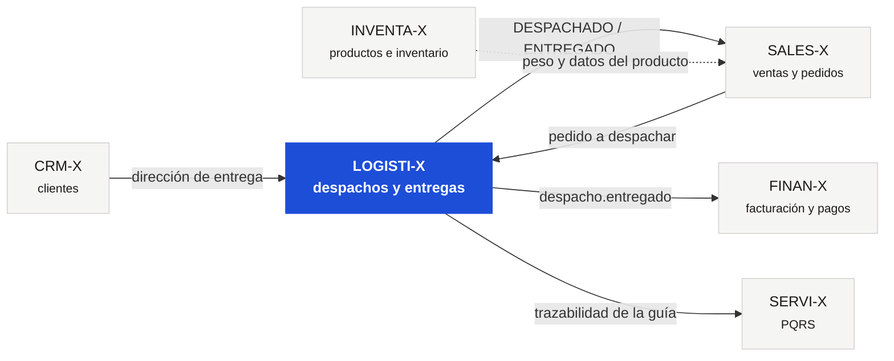

**Lo que se lee en este diagrama:** LOGISTI-X no le pide nada a INVENTA-X.
El peso y el nombre del producto llegan dentro del pedido de SALES-X, que es
quien ya los consultó. Un sistema menos al que llamar es un sistema menos que
puede estar caído.

---

## 2. Casos de uso

### 2.1 Diagrama general

El sistema tiene veinte casos de uso de negocio y cuatro de soporte técnico.
Aquí se presentan agrupados en dos diagramas para que se lean: primero **quién
hace qué** (actores humanos) y después **qué le pide LOGISTI-X a los otros
microproyectos y qué le piden a él**. Los cuatro casos de uso centrales están
detallados más abajo; **la especificación completa de los veinte, con flujos
alternos, excepciones y trazabilidad, está en
[`08-casos-de-uso.md`](08-casos-de-uso.md)**.

#### Actores humanos

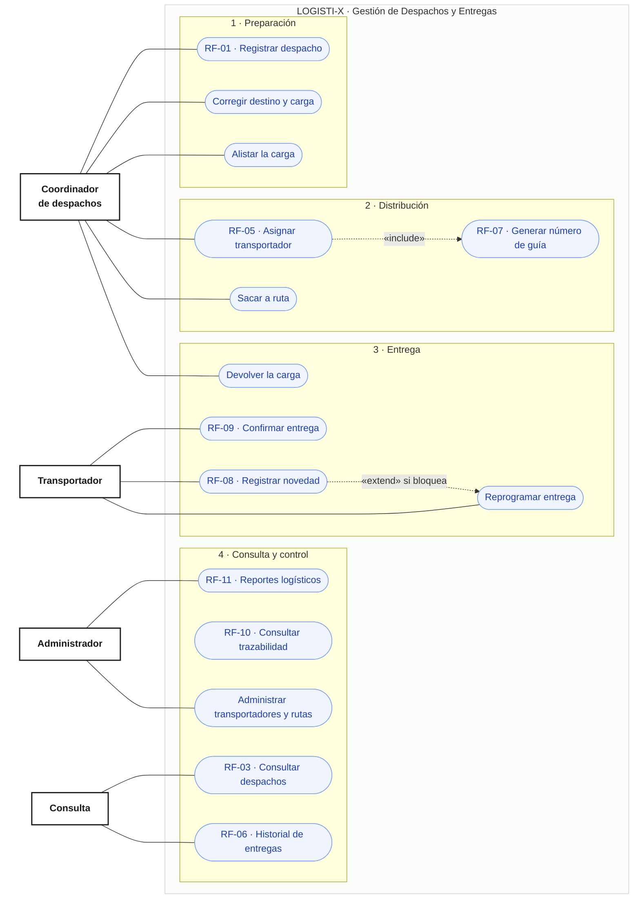

#### Sistemas que participan

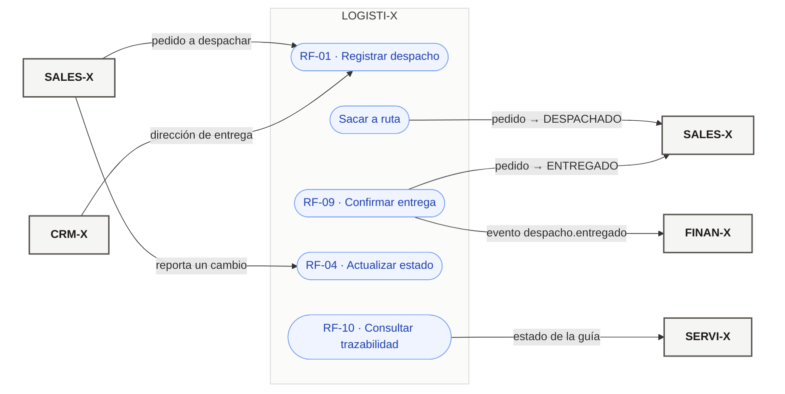

### 2.2 Caso de uso central: **Registrar despacho** (RF-01, RF-02)

| | |
|---|---|
| **Identificador** | CU-01 |
| **Actor principal** | Coordinador de despachos |
| **Actores de apoyo** | SALES-X, CRM-X |
| **Precondición** | El pedido existe en SALES-X y está CONFIRMADO o FACTURADO |
| **Postcondición** | Despacho en REGISTRADO, con la carga y la dirección copiadas, y evento `despacho.creado` en la bandeja de salida |

**Flujo principal**

1. El coordinador solicita `POST /api/v1/despachos` con el `pedidoId`.
2. LOGISTI-X pide el pedido a **SALES-X**.
3. Verifica que el estado del pedido admita despacho (RN-09).
4. Verifica que ese pedido no tenga ya un despacho vivo (RN-08).
5. Pide a **CRM-X** los datos de entrega del cliente del pedido.
6. Copia dirección, ciudad y teléfono como *snapshot*.
7. Copia la carga del pedido línea por línea y calcula peso, unidades y valor
   declarado en el servidor (RN-11).
8. Guarda el despacho con consecutivo `DES-2026-000001` y registra el primer
   movimiento del historial.
9. Inserta el evento `despacho.creado` en la bandeja de salida, **en la misma
   transacción**.
10. Responde 201 con la cabecera `Location` y el despacho creado.

**Flujos alternos**

| # | Situación | Respuesta |
|---|---|---|
| A1 | El pedido no existe en SALES-X | 502 `PEDIDO_NO_ENCONTRADO` |
| A2 | El pedido está CANCELADO o en BORRADOR | 409 `PEDIDO_NO_DESPACHABLE` |
| A3 | El pedido ya tiene un despacho vivo | 409 `DESPACHO_DUPLICADO` |
| A4 | El cliente no tiene dirección en CRM-X y tampoco viene en la solicitud | 409 `DIRECCION_REQUERIDA` |
| A5 | SALES-X o CRM-X no responden | 502, y **no se guarda nada** |
| A6 | Se pide despachar un producto ajeno al pedido | 409 `PRODUCTO_AJENO_AL_PEDIDO` |
| A7 | Se piden más unidades de las del pedido | 409 `CANTIDAD_SUPERA_PEDIDO` |

### 2.3 Caso de uso: **Asignar transportador y generar guía** (RF-05 + RF-07)

| | |
|---|---|
| **Identificador** | CU-02 |
| **Actor principal** | Coordinador de despachos |
| **Precondición** | El despacho está en EN_PREPARACION y tiene carga |
| **Postcondición** | Despacho ASIGNADO, con guía, ruta, fecha prometida y flete calculado |

**Flujo principal**

1. El coordinador solicita `POST /despachos/{id}/asignar` con el transportador.
2. LOGISTI-X verifica que el transportador esté activo (RN-14).
3. Verifica que la carga quepa en el vehículo (RN-12).
4. Si no se indicó ruta, elige la ruta activa más rápida hacia la ciudad de
   destino.
5. **Genera el número de guía** con dígito de verificación, si no tenía (RN-03).
6. Calcula la fecha prometida con los días estimados de la ruta.
7. Calcula el flete: tarifa base + tarifa de la ruta + costo por kilogramo.
8. Mueve el despacho a ASIGNADO y registra el movimiento.

**Flujos alternos**

| # | Situación | Respuesta |
|---|---|---|
| B1 | El transportador está inactivo | 409 `TRANSPORTADOR_INACTIVO` |
| B2 | La carga supera la capacidad del vehículo | 409 `CAPACIDAD_INSUFICIENTE` |
| B3 | El despacho ya está ASIGNADO | Se reasigna, **conservando la guía**, y queda en la trazabilidad |
| B4 | No hay ruta activa hacia esa ciudad | Se asigna sin ruta y la fecha queda a cargo del coordinador |

### 2.4 Caso de uso: **Confirmar entrega** (RF-09)

| | |
|---|---|
| **Identificador** | CU-03 |
| **Actor principal** | Transportador |
| **Precondición** | El despacho está EN_RUTA |
| **Postcondición** | Despacho ENTREGADO con evidencia; evento `despacho.entregado` en la bandeja de salida; SALES-X marca el pedido ENTREGADO |

**Flujo principal**

1. El transportador solicita `POST /despachos/{id}/entregar` con el nombre de
   quien recibió.
2. LOGISTI-X exige esa evidencia; sin ella rechaza (RN-05).
3. Mueve el despacho a ENTREGADO y guarda receptor, documento y hora.
4. Inserta el evento `despacho.entregado` en la bandeja de salida.
5. El publicador, **fuera de la transacción**, le reporta a SALES-X que el
   pedido quedó ENTREGADO y reintenta si SALES-X está caído.

**Flujos alternos**

| # | Situación | Respuesta |
|---|---|---|
| C1 | No se indica quién recibió | 400 `RECEPTOR_REQUERIDO` |
| C2 | El despacho no está EN_RUTA | 409 `TRANSICION_INVALIDA` |
| C3 | SALES-X está caído al reportar | La entrega **queda firme**; el aviso se reintenta solo |

### 2.5 Caso de uso: **Registrar novedad** (RF-08)

| | |
|---|---|
| **Identificador** | CU-04 |
| **Actor principal** | Transportador |
| **Precondición** | El despacho no está en un estado final |
| **Postcondición** | Novedad registrada; si es bloqueante y la carga iba en ruta, el despacho queda FALLIDO con un intento más |

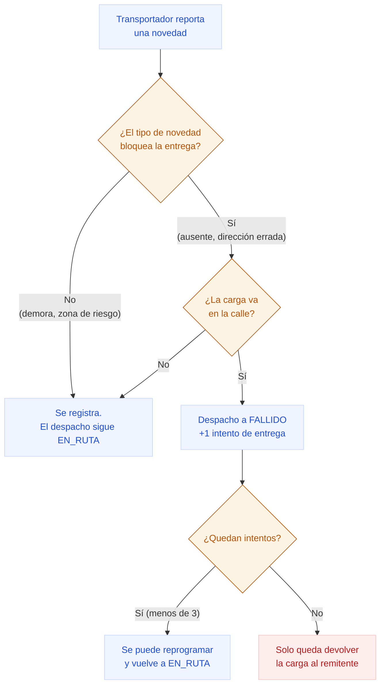

---

## 3. Modelo de dominio (diagrama de clases)

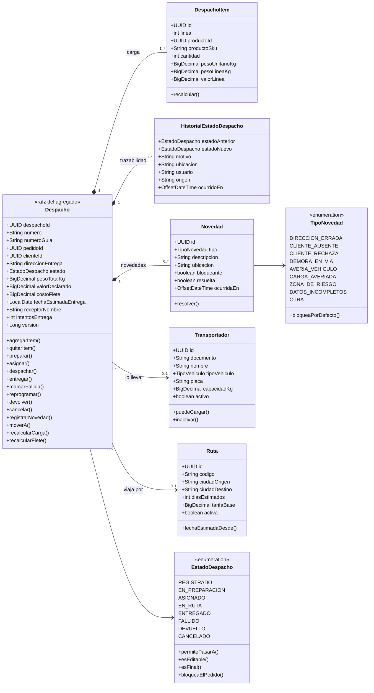

**Por qué `Despacho` es la raíz del agregado.** Nadie de afuera toca una línea
de carga ni una novedad directamente: se agregan, cambian o quitan *a través
del despacho*, y cada una de esas operaciones termina en `recalcularCarga()`.
Es imposible dejar el despacho con carga nueva y peso viejo, que es el bug
clásico de este dominio. Y una novedad bloqueante **tiene** que cambiar el
estado del despacho en el mismo acto: si se pudiera registrar suelta, el
sistema diría "en ruta" de algo que lleva dos días parado.

**Por qué `Transportador` y `Ruta` no son parte del agregado.** Viven más que
el despacho y se comparten entre miles: son entidades propias, con su propio
ciclo de vida, y por eso se referencian, no se contienen.

---

## 4. Modelo de datos

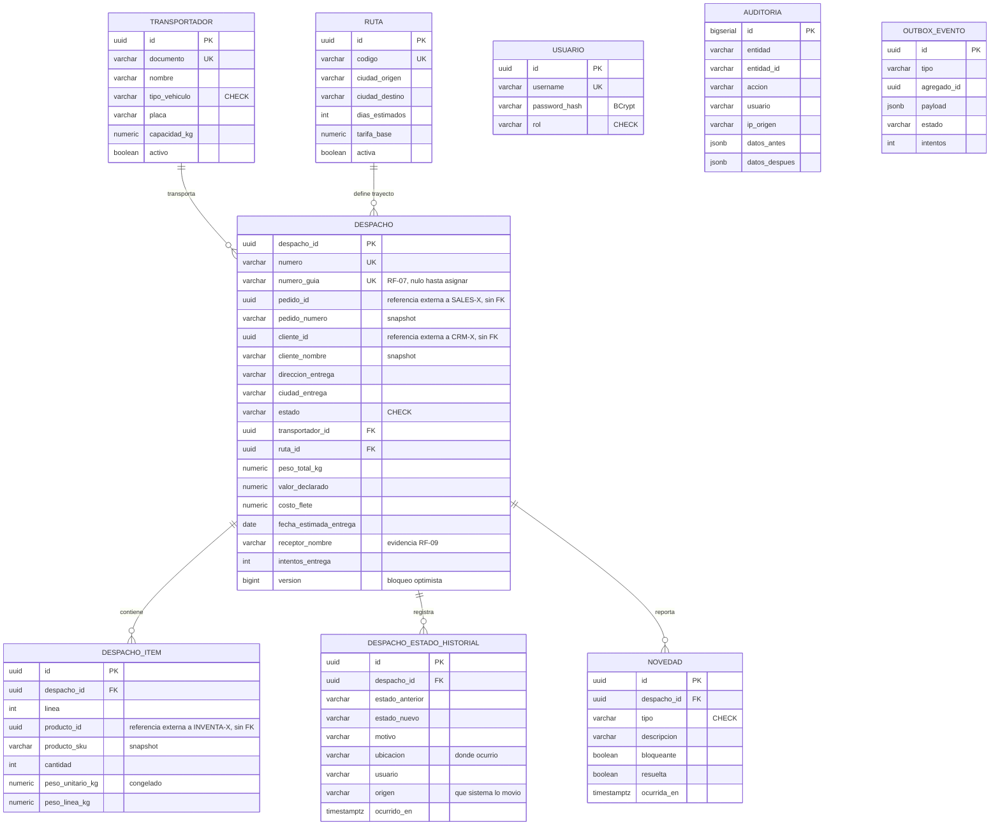

### Lo que NO está en este modelo, y es a propósito

No hay tabla `cliente`, ni `producto`, ni `pedido`. `cliente_id`, `producto_id`
y `pedido_id` son **referencias externas sin llave foránea**, porque esas
entidades viven en la base de datos de CRM-X, INVENTA-X y SALES-X. Ver
[ADR-002](adr/ADR-002-una-base-por-microproyecto.md) y
[ADR-003](adr/ADR-003-referencias-externas-sin-fk.md).

A cambio de perder la llave foránea se gana independencia, y se paga con dos
cosas que sí están implementadas: **validación por API** al registrar el
despacho y **copia local (snapshot)** de los datos que se usaron. Una guía ya
impresa no puede cambiar porque mañana corrijan un maestro ajeno.

`transportador` y `ruta` **sí** llevan llave foránea: son entidades de esta
casa.

### Decisiones de tipos

| Decisión | Motivo |
|---|---|
| `numeric(14,2)` para el dinero | `float`/`double` acumulan error; un flete descuadrado cuesta horas de conciliación |
| `numeric(10,3)` para el peso | La unidad comercial de la paquetería es el gramo: 0,250 kg × 800 unidades = 200 kg exactos |
| `timestamptz` y no `timestamp` | Guarda el instante real; evita el lío del horario cuando hay más de una zona |
| `varchar` + `CHECK` en vez de `ENUM` nativo | Agregar un estado nuevo no exige `ALTER TYPE`, y mapea directo al `enum` de Java |
| `jsonb` para auditoría y eventos | La forma del documento cambia con el tiempo; `jsonb` además es consultable |
| Identificador asignado por la aplicación | Un `Despacho` recién construido ya tiene identidad; se puede probar sin base de datos |
| Índice único **parcial** sobre `pedido_id` | Un pedido no puede tener dos despachos vivos, pero sí varios cerrados ([ADR-009](adr/ADR-009-un-despacho-vivo-por-pedido.md)) |

---

## 5. Máquina de estados

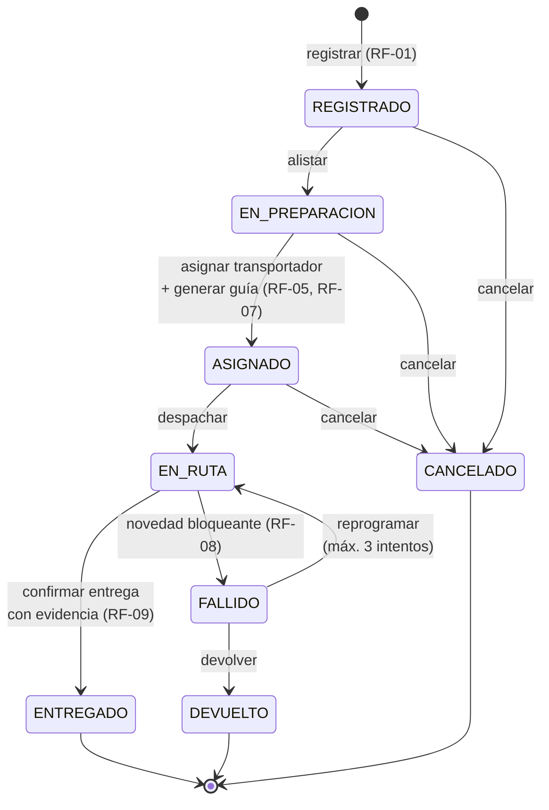

| Estado | Editable | Carga en poder del transportador | Quién lo produce |
|---|---|---|---|
| REGISTRADO | ✅ | — | Coordinador |
| EN_PREPARACION | ✅ | — | Coordinador (bodega) |
| ASIGNADO | ❌ | — | Coordinador |
| EN_RUTA | ❌ | ✅ | Coordinador (salida) |
| ENTREGADO | ❌ | — | Transportador |
| FALLIDO | ❌ | ✅ | Novedad bloqueante |
| DEVUELTO | ❌ | — | Coordinador |
| CANCELADO | ❌ | — | Coordinador |

**FALLIDO no es un estado final**, y ahí está la diferencia con un Excel de
despachos: "no se pudo entregar hoy" no es lo mismo que "se perdió la venta".
De FALLIDO se sale reprogramando —hasta tres intentos— o devolviendo.

La tabla vive en `EstadoDespacho.TRANSICIONES` y está probada movimiento por
movimiento en `MaquinaEstadosTest`, incluidos los que **no** se permiten
(cancelar algo que ya salió a ruta, entregar sin haber despachado, resucitar
un despacho cerrado).

---

## 6. Secuencia: registrar un despacho

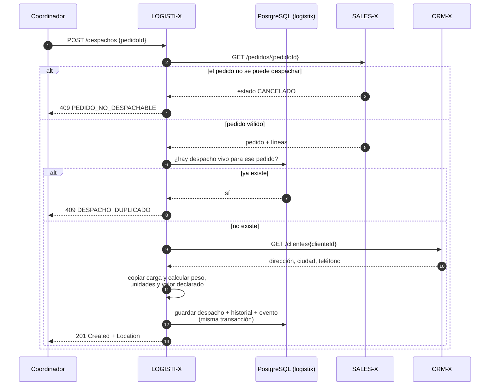

## 7. Secuencia: entrega y aviso a SALES-X

Esta es la secuencia que explica por qué el aviso va por bandeja de salida y
no por llamada directa.

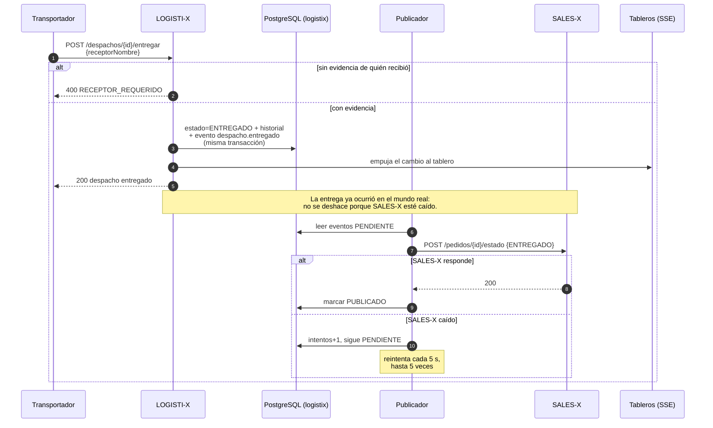

---

Anterior: [01 · Análisis y requisitos](01-analisis-y-requisitos.md) ·
Siguiente: [03 · Arquitectura](03-arquitectura.md)

# 03 · Arquitectura

**Semana 3** — cierre 4 de septiembre de 2026
Arquitectura, capas, integración, seguridad y rendimiento

---

## 1. Arquitectura por capas

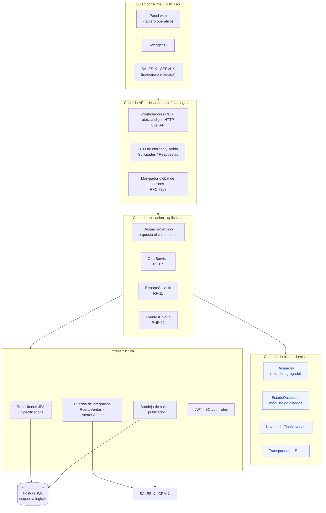

**La regla que sostiene el diagrama: las flechas van hacia adentro.** La API
conoce la aplicación, la aplicación conoce el dominio, y el dominio no conoce a
nadie. `Despacho` no sabe que existe HTTP, ni JSON, ni PostgreSQL. Por eso
`MaquinaEstadosTest` y `CalculoCargaTest` corren en milisegundos sin levantar
Spring: prueban clases que se construyen con `new`.

| Capa | Paquete | Qué decide | Qué NO hace |
|---|---|---|---|
| API | `despacho.api`, `catalogo.api` | Rutas, códigos HTTP, validación de forma, permisos por rol | Ninguna regla de negocio |
| Aplicación | `*.aplicacion` | Con quién hay que hablar, en qué orden, qué se audita y qué evento se publica | No calcula pesos ni valida transiciones |
| Dominio | `*.dominio` | Qué es válido: estados, carga, evidencia, capacidad | No sabe de HTTP ni de base de datos |
| Infraestructura | `*.repositorio`, `integracion`, `seguridad` | Cómo se persiste y cómo se habla con otros | No decide reglas |

## 2. Puertos y adaptadores

La integración con los demás microproyectos entra por **interfaces**, no por
clases concretas. Esa es la pieza que permite construir sin esperar a nadie.

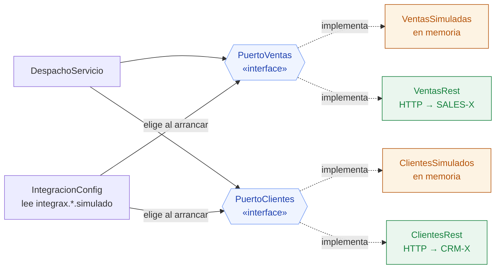

Pasar de los dobles a los sistemas reales es cambiar **una propiedad**:

```yaml
integrax:
  ventas:
    simulado: false
    url-base: https://sales-x.integrax.co
```

Ni una línea del dominio se toca. Ver
[ADR-006](adr/ADR-006-dobles-de-prueba.md).

## 3. Despliegue

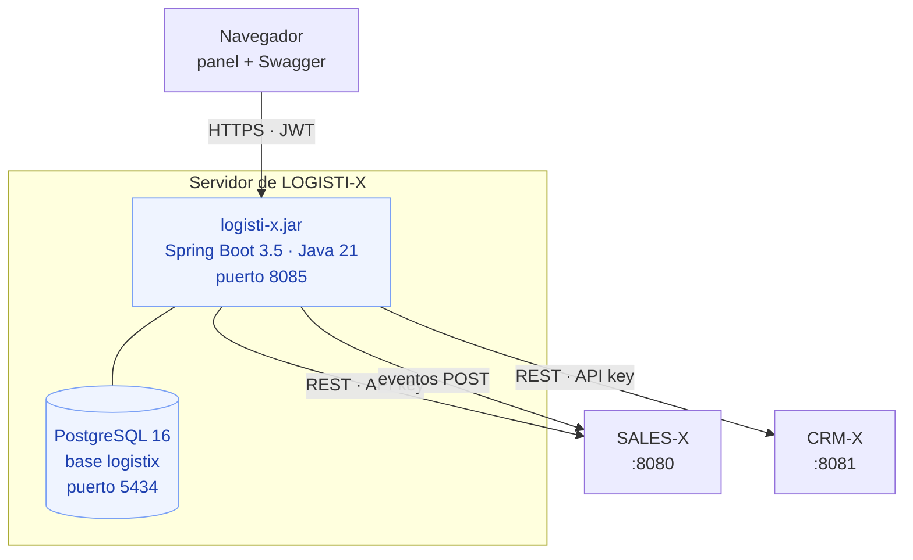

**Cada microproyecto tiene su propia base de datos** y ningún otro se conecta
a ella. Es la decisión que ordena todo el proyecto ([ADR-002](adr/ADR-002-una-base-por-microproyecto.md)):
si los seis compartieran una base, la asignatura perdería su objeto, que es
evaluar que los sistemas se hablen por servicios.

## 4. Cómo se comunican los sistemas

Hay dos caminos, y cada uno se usa donde corresponde:

| Camino | Cuándo | Ejemplo |
|---|---|---|
| **Llamada REST síncrona** | Se necesita el dato *ahora* para decidir | Registrar despacho: sin el pedido de SALES-X no hay nada que despachar |
| **Evento por bandeja de salida** | Hay que *avisar* de algo que ya pasó | La carga salió: SALES-X debe enterarse, pero el camión no vuelve si SALES-X está caído |

Esa distinción es la diferencia entre un sistema que se cae en cadena y uno
que aguanta. Detalle en [04 · Contratos de integración](04-contratos-integracion.md)
y en [ADR-008](adr/ADR-008-aviso-a-sales-x.md).

## 5. Manejo de errores

Todos los errores salen en **Problem Details (RFC 7807)**, con un campo
`codigo` estable que los otros equipos pueden usar en su lógica:

```json
{
  "type": "about:blank",
  "title": "Regla de negocio",
  "status": 409,
  "detail": "El pedido PED-2026-000001 ya tiene el despacho DES-2026-000001 en estado EN_RUTA.",
  "codigo": "DESPACHO_DUPLICADO",
  "instance": "/api/v1/despachos"
}
```

| Situación | HTTP | De dónde sale |
|---|---|---|
| Cuerpo inválido (falta un campo, cantidad en cero) | 400 | Validación de los DTO |
| No autenticado | 401 | Filtro JWT |
| Autenticado sin permiso | 403 | `@PreAuthorize` |
| No existe el despacho, la guía o el transportador | 404 | `RecursoNoEncontradoException` |
| Regla de negocio rota | 409 | `ReglaNegocioException` |
| Dos usuarios editando el mismo despacho | 409 | Bloqueo optimista de JPA |
| SALES-X o CRM-X caídos o rechazando | 502 | `IntegracionException` |

**El detalle que importa:** un fallo de otro microproyecto es **502**, no 500.
500 significaría "LOGISTI-X está roto"; 502 dice la verdad — "yo estoy bien,
el de al lado no responde" — y eso cambia a quién se llama a las 2 a. m.

## 6. Seguridad (RNF-05)

| Medida | Cómo |
|---|---|
| Autenticación | JWT firmado HS384, vigencia configurable |
| Contraseñas | BCrypt con factor 10; nunca en texto plano ni en migraciones |
| Autorización | Cinco roles + `@PreAuthorize` por operación |
| Todo cerrado por defecto | Se listan las rutas públicas; lo que no esté ahí exige token |
| Secretos | Solo por variable de entorno; la aplicación no arranca sin `LOGISTIX_JWT_SECRETO` |
| Inyección SQL | Consultas por parámetros y `Specification`; jamás concatenación |
| Fuga de información | Sin traza de error al cliente; el mismo mensaje para usuario inexistente y contraseña mala |
| Auditoría | Usuario e IP tomados del contexto, nunca del cuerpo de la petición |

| Rol | Puede |
|---|---|
| `ADMIN` | Todo, incluida la auditoría y el maestro |
| `COORDINADOR` | Registrar, alistar, asignar, despachar, cancelar, devolver |
| `TRANSPORTADOR` | Confirmar entregas, reportar novedades, reprogramar |
| `CONSULTA` | Solo lectura |
| `SISTEMA` | Integración máquina a máquina (cambios de estado desde otro sistema) |

**La excepción documentada:** el canal en vivo (`GET /despachos/eventos`)
acepta el token como parámetro `access_token`, porque el `EventSource` del
navegador no permite enviar cabeceras. Se limita a esa ruta a propósito: un
token en la URL queda en los registros del servidor, así que no se admite como
forma general de autenticación.

## 7. Rendimiento (RNF-04)

| Riesgo | Qué se hizo |
|---|---|
| Consultas N+1 al listar | `join fetch` en las cargas del despacho |
| Reportes lentos | Se agregan en SQL (`group by`), no en memoria |
| Filtros sin índice | Índices en estado, pedido, cliente, transportador, ciudad y fecha |
| Listados sin límite | Paginación obligatoria, máximo 100 por página |
| Un sistema externo colgado | Timeouts de 2 s (conexión) y 3 s (lectura) |
| Sondeo del tablero | Server-Sent Events: el servidor empuja, el navegador no pregunta |
| Concurrencia entre coordinador y transportador | Bloqueo optimista con `@Version` |

## 8. Decisiones de arquitectura (ADR)

| ADR | Decisión |
|---|---|
| [ADR-001](adr/ADR-001-java-spring-boot.md) | Java 21 + Spring Boot 3.5 |
| [ADR-002](adr/ADR-002-una-base-por-microproyecto.md) | Una base de datos por microproyecto |
| [ADR-003](adr/ADR-003-referencias-externas-sin-fk.md) | Referencias externas sin llave foránea + snapshot |
| [ADR-004](adr/ADR-004-dinero-y-peso.md) | `BigDecimal` para dinero (2 dec.) y peso (3 dec.) |
| [ADR-005](adr/ADR-005-maquina-de-estados.md) | Máquina de estados en el dominio |
| [ADR-006](adr/ADR-006-dobles-de-prueba.md) | Puertos con dobles de prueba |
| [ADR-007](adr/ADR-007-outbox-de-eventos.md) | Bandeja de salida transaccional |
| [ADR-008](adr/ADR-008-aviso-a-sales-x.md) | Avisar a SALES-X por outbox, no por compensación |
| [ADR-009](adr/ADR-009-un-despacho-vivo-por-pedido.md) | Índice único parcial por pedido |
| [ADR-010](adr/ADR-010-guia-con-digito-verificacion.md) | Guía con dígito de verificación |
| [ADR-011](adr/ADR-011-tiempo-real-con-sse.md) | Tiempo real con SSE y no con sondeo |

---

Anterior: [02 · Modelo de la solución](02-modelo-de-la-solucion.md) ·
Siguiente: [04 · Contratos de integración](04-contratos-integracion.md)

# 04 · Contratos de integración

**Semana 3** — cierre 4 de septiembre de 2026
Lo que LOGISTI-X **necesita** de otros equipos y lo que **ofrece** a cambio

> Este documento es el que hay que llevarle a los otros cinco equipos. Todo lo
> que aparece aquí ya está implementado en LOGISTI-X contra dobles de prueba;
> pasar a real es cambiar una propiedad de configuración.

---

## 1. Identificadores comunes

El enunciado obliga a compartir estos identificadores. LOGISTI-X los respeta
tal cual y aporta el suyo:

| Entidad | Identificador | Dueño |
|---|---|---|
| Cliente | `clienteId` | CRM-X |
| Producto | `productoId` | INVENTA-X |
| Pedido | `pedidoId` | SALES-X |
| Factura | `facturaId` | FINAN-X |
| **Despacho** | **`despachoId`** | **LOGISTI-X** |
| Caso de atención | `casoId` | SERVI-X |

Además, LOGISTI-X publica un identificador **legible para humanos**: el
`numeroGuia` (`LGX-2026-000001-4`). Es el que el cliente dice por teléfono y el
que SERVI-X debería pedirle al abrir una PQRS de entrega.

---

## 2. Lo que LOGISTI-X NECESITA

### 2.1 De SALES-X — consultar un pedido

```http
GET {sales-x}/api/v1/pedidos/{pedidoId}
Authorization: Bearer {token}   (o X-API-Key)
```

Respuesta esperada (200):

```json
{
  "pedidoId": "55555555-0001-4000-8000-000000000001",
  "numero": "PED-2026-000001",
  "clienteId": "11111111-1111-4111-8111-111111111111",
  "clienteNombre": "Almacenes La 14 S.A.S.",
  "clienteDocumento": "900123456-7",
  "estado": "FACTURADO",
  "total": 1174510.00,
  "items": [
    {
      "productoId": "aaaaaaaa-0001-4000-8000-000000000001",
      "productoSku": "CEM-50",
      "productoNombre": "Cemento gris 50 kg",
      "cantidad": 20,
      "precioUnitario": 32900.00,
      "pesoUnitarioKg": 50.000
    }
  ]
}
```

**Campos que LOGISTI-X usa y por qué:**

| Campo | Para qué | ¿Obligatorio? |
|---|---|---|
| `pedidoId`, `numero` | Identificar y mostrar el pedido | Sí |
| `clienteId` | Pedirle a CRM-X la dirección | Sí |
| `clienteNombre`, `clienteDocumento` | Snapshot para la guía | Sí |
| `estado` | Solo se despacha CONFIRMADO, FACTURADO o DESPACHADO (RN-09). **Si ustedes usan otras palabras, se configuran de este lado** | Sí |
| `items[]` | Armar la carga y validar cantidades (RN-13) | Sí |
| `pesoUnitarioKg` | Calcular peso, flete y capacidad | **No**: si no viene, LOGISTI-X lo pide al armar la carga |

> **Nota para el equipo de SALES-X:** el peso no es responsabilidad suya.
> Ustedes venden unidades. Si su modelo no lo tiene, envíen el campo en `null`
> o no lo envíen: LOGISTI-X lo resuelve. Lo que sí es indispensable es `estado`
> e `items[]`, porque de ahí salen dos reglas que impiden despachar de más.

Códigos que LOGISTI-X entiende: `200` (procede), `404` (el pedido no existe →
502 hacia el usuario), `5xx` (→ 502).

### 2.2 De CRM-X — consultar un cliente

```http
GET {crm-x}/api/v1/clientes/{clienteId}
```

```json
{
  "clienteId": "11111111-1111-4111-8111-111111111111",
  "tipo": "JURIDICA",
  "nombre": "Almacenes La 14 S.A.S.",
  "documento": "900123456-7",
  "telefono": "6045551414",
  "direccion": "Carrera 48 # 32-45, Bodega 3",
  "ciudad": "Medellin",
  "departamento": "Antioquia",
  "estado": "ACTIVO"
}
```

**Lo único que LOGISTI-X necesita de ustedes es la dirección de entrega.**
`direccion` y `ciudad` son los campos críticos: sin ellos el despacho no se
puede registrar (se responde 409 `DIRECCION_REQUERIDA`). `telefono` no bloquea,
pero sin él el transportador no tiene a quién llamar cuando nadie abre, y esa
es la causa número uno de entregas fallidas.

Se ignoran los campos que no estén en esta lista, así que pueden agregar los
suyos sin romper nada.

> **Y si sus campos se llaman distinto, tampoco pasa nada.** LOGISTI-X acepta
> varios nombres por campo (`direccion`, `direccionPrincipal`, `domicilio`…) y,
> si aparece uno que no está previsto, se agrega **en una sola clase de este
> lado**. No hay que pedirles que renombren su API ni que cambien su modelo:
> quien consume paga la traducción. Ver
> [07 · Plan de integración](07-plan-de-integracion.md).

---

## 3. Lo que LOGISTI-X OFRECE

### 3.1 Consultar el estado de una entrega

Tres formas de preguntar lo mismo, según lo que tenga a la mano quien pregunta:

```http
GET /api/v1/despachos/{despachoId}          por identificador común
GET /api/v1/despachos/guia/{numeroGuia}     por la guía (lo que dice el cliente)
GET /api/v1/despachos/pedido/{pedidoId}     todos los despachos de un pedido
```

Respuesta resumida:

```json
{
  "despachoId": "…",
  "numero": "DES-2026-000001",
  "numeroGuia": "LGX-2026-000001-4",
  "pedidoId": "55555555-0001-4000-8000-000000000001",
  "estado": "ENTREGADO",
  "transportadorNombre": "Jhon Alexander Ruiz",
  "ciudadEntrega": "Medellin",
  "fechaEstimadaEntrega": "2026-09-05",
  "entregadoEn": "2026-09-04T20:48:39-05:00",
  "receptorNombre": "Ana Maria Gil",
  "pesoTotalKg": 1010.000,
  "costoFlete": 878500.00
}
```

### 3.2 Trazabilidad — pensado para SERVI-X

```http
GET /api/v1/despachos/{despachoId}/trazabilidad
```

```json
[
  { "ocurridoEn": "2026-09-04T20:48:38-05:00", "clase": "ESTADO",
    "titulo": "Registrado como REGISTRADO",
    "detalle": "Registro del despacho para el pedido PED-2026-000001",
    "ubicacion": "Bodega", "usuario": "coordinador", "origen": "LOGISTI-X" },
  { "ocurridoEn": "2026-09-04T20:52:10-05:00", "clase": "NOVEDAD",
    "titulo": "Novedad: CLIENTE_AUSENTE",
    "detalle": "Timbré tres veces y nadie abrió",
    "ubicacion": "Bello", "usuario": "transportador", "origen": "LOGISTI-X" }
]
```

**Para el equipo de SERVI-X:** esta es la respuesta a "¿dónde va mi pedido?".
Mezcla movimientos de estado y novedades en una sola línea de tiempo ordenada,
así que se puede mostrar tal cual al cliente sin pegar dos consultas.

### 3.3 Reportar un cambio de estado (para otro sistema)

```http
POST /api/v1/despachos/{despachoId}/estado
{ "estado": "EN_RUTA", "motivo": "…", "ubicacion": "…", "origen": "SALES-X" }
```

Rol necesario: `SISTEMA` o `ADMIN`. Rechaza cualquier transición que la máquina
de estados no permita. **Entregar, cancelar y devolver no se aceptan por aquí**:
exigen evidencia o motivo y tienen endpoint propio.

### 3.4 Eventos publicados

LOGISTI-X entrega estos eventos por `POST` a los suscriptores configurados:

| Evento | Cuándo | A quién le importa |
|---|---|---|
| `despacho.creado` | Se registró el despacho | SERVI-X |
| `despacho.en-ruta` | La carga salió | **SALES-X** (pedido → DESPACHADO), SERVI-X |
| `despacho.entregado` | Entrega confirmada | **SALES-X** (pedido → ENTREGADO), FINAN-X, SERVI-X |
| `despacho.fallido` | No se pudo entregar | SERVI-X |
| `despacho.devuelto` | La carga regresó | SALES-X, FINAN-X |
| `despacho.cancelado` | Anulado antes de salir | SALES-X |

Formato del mensaje (contrato público, versionado):

```json
{
  "eventoId": "8f3c…",
  "tipo": "despacho.entregado",
  "version": 1,
  "origen": "LOGISTI-X",
  "ocurridoEn": "2026-09-04T20:48:39-05:00",
  "datos": {
    "despachoId": "…",
    "numero": "DES-2026-000001",
    "numeroGuia": "LGX-2026-000001-4",
    "pedidoId": "…",
    "clienteId": "…",
    "estado": "ENTREGADO",
    "ciudadEntrega": "Medellin",
    "transportador": "Jhon Alexander Ruiz",
    "entregadoEn": "2026-09-04T20:48:39-05:00",
    "receptorNombre": "Ana Maria Gil",
    "pesoTotalKg": 1010.000,
    "costoFlete": 878500.00,
    "items": [ … ]
  }
}
```

Cabeceras: `X-Evento-Id`, `X-Evento-Tipo`, `X-Sistema-Origen: LOGISTI-X`.

> **Advertencia que hay que decir en voz alta:** la entrega es *al menos una
> vez*, no *exactamente una vez*. Si un suscriptor responde tarde puede recibir
> el mismo evento dos veces. Por eso va el `eventoId`: **quien lo recibe debe
> descartar los repetidos**. Un consumidor que no lo haga terminará con
> facturas o casos duplicados, y no será culpa del que publica.

Configuración de suscriptores:

```yaml
integrax:
  eventos:
    habilitado: true
    max-intentos: 5
    suscriptores:
      - nombre: SERVI-X
        url: https://servi-x.integrax.co/api/v1/eventos/logistica
        api-key: ${SERVIX_API_KEY}
        tipos: [despacho.en-ruta, despacho.entregado, despacho.fallido]
```

### 3.5 Reporte para el otro extremo: SALES-X

Además del evento, LOGISTI-X **llama directamente** a SALES-X para cerrar el
ciclo del pedido:

```http
POST {sales-x}/api/v1/pedidos/{pedidoId}/estado
{ "estado": "DESPACHADO", "motivo": "…", "origen": "LOGISTI-X" }
```

Esa llamada sale del publicador de eventos, **nunca desde dentro de la
transacción del despacho**: la salida del camión ya ocurrió en el mundo real y
no se puede deshacer porque SALES-X esté caído (ver [ADR-008](adr/ADR-008-aviso-a-sales-x.md)).
Si falla, se reintenta hasta cinco veces.

> **Para el equipo de SALES-X:** este endpoint ya existe de su lado y por eso
> se eligió. Lo único que se les pide es que **acepte reintentos**: si el mismo
> pedido ya está en DESPACHADO y llega otra vez la misma orden, responder 200 o
> 409 con un código estable, no 500.

---

## 4. Petición concreta a cada equipo

| Equipo | Lo que LOGISTI-X necesita | Estado hoy |
|---|---|---|
| **SALES-X** | `GET /pedidos/{id}` con `estado` e `items[]`; que `POST /pedidos/{id}/estado` tolere reintentos | Doble de prueba funcionando |
| **CRM-X** | `GET /clientes/{id}` con `direccion`, `ciudad` y `telefono` | Doble de prueba funcionando |
| **INVENTA-X** | Nada. El peso llega por SALES-X | — |
| **FINAN-X** | Un endpoint que reciba `despacho.entregado` si quieren cerrar el cobro contra la entrega | Opcional |
| **SERVI-X** | Un endpoint que reciba los eventos; y usar `GET /despachos/guia/{guia}` al atender una PQRS | Listo del lado de LOGISTI-X |

## 4.1 Cómo comprobar si su API ya sirve (sin discutir)

Con el sistema de ustedes arriba, LOGISTI-X responde esto:

```http
GET /api/v1/integracion/diagnostico?pedidoId={un pedido real}
```

Devuelve, campo por campo, qué llegó y qué falta, con la razón de negocio de
cada cosa. Un **AVISO** no bloquea; una **FALLA** sí. Ese informe es lo que se
manda por el grupo en vez de "tu API no me sirve".

## 5. Qué pasa si un equipo no llega a tiempo

Nada se detiene. LOGISTI-X arranca con
`integrax.ventas.simulado: true` e `integrax.crm.simulado: true` y opera
completo contra dobles de prueba con datos coherentes entre sí. El día que el
otro equipo publique su API:

1. Se cambia la propiedad a `false` y se pone la URL.
2. Se reinicia.
3. No se toca una sola línea de código de negocio.

---

Anterior: [03 · Arquitectura](03-arquitectura.md) ·
Siguiente: [05 · Pruebas](05-pruebas.md)

# 05 · Pruebas

**Semana 4** — cierre 11 de septiembre de 2026
Estrategia, cobertura de reglas y cómo ejecutarlas

---

## 1. Resultado actual

```
Tests run: 99, Failures: 0, Errors: 0, Skipped: 0
BUILD SUCCESS
```

| Clase | Qué prueba | Casos | Necesita base de datos |
|---|---|---|---|
| `MaquinaEstadosTest` | Transiciones válidas e inválidas (RF-04) | 42 | No |
| `CalculoCargaTest` | Peso, valor, flete, capacidad, evidencia, intentos | 15 | No |
| `GuiaTest` | Formato, dígito de verificación y rótulo (RF-07) | 20 | No |
| `FlujoDespachoTest` | Flujo completo y reglas de integración | 14 | Sí |
| `ContratoVentasTest` | Que el JSON de SALES-X se entienda, venga como venga | 8 | No |
| **Total** | | **99** | |

## 2. Estrategia: dos niveles, cada uno con su trabajo

**Nivel 1 — dominio, sin Spring.** 85 de las 99 pruebas corren en menos de
medio segundo porque prueban clases que se construyen con `new`. Se puede
ejecutar la máquina de estados completa, el cálculo del flete y la generación
de guías sin levantar la aplicación ni tocar una base de datos. Eso es
consecuencia directa de haber puesto las reglas en el dominio y no en el
servicio: si `Despacho` necesitara Spring para validar una transición, cada
una de estas 85 pruebas tardaría segundos en vez de milisegundos.

**Nivel 2 — integración, contra PostgreSQL real.** Las 14 restantes levantan
la aplicación completa contra el **mismo motor de producción**. No se usa H2 en
memoria a propósito: H2 no tiene `jsonb`, ni `timestamptz` con la misma
semántica, ni índices únicos parciales — que es justamente donde vive la regla
RN-08. Una prueba verde en H2 puede quedar roja en PostgreSQL, y ahí las
pruebas dejan de servir para lo único que sirven: dar confianza.

Las pruebas de integración corren contra los **dobles** de SALES-X y CRM-X, así
que no salen a la red ni dependen de que otro equipo tenga su servicio arriba.

**Nivel 3 — contrato con el otro equipo.** `ContratoVentasTest` levanta un
SALES-X falso (con el `HttpServer` del JDK, sin dependencias nuevas) que
responde el JSON que ellos digan que van a responder, y comprueba que
LOGISTI-X lo entiende. Sirve para la fase de integración: se pega su JSON real
en una prueba nueva y en dos segundos se sabe si encaja, **sin necesidad de que
su servidor esté arriba**. Ver [07 · Plan de integración](07-plan-de-integracion.md).

## 3. Cobertura de las reglas de negocio

| Regla | Prueba que la cubre |
|---|---|
| RN-01 Solo se edita antes de asignar | `CalculoCargaTest.asignadoNoSeEdita` |
| RN-02 No se prepara sin carga | `CalculoCargaTest.sinCargaNoSePrepara` |
| RN-03 La guía es inmutable | `CalculoCargaTest.laGuiaEsInmutable` |
| RN-04 No se sale a ruta sin guía | `MaquinaEstadosTest` + restricción `ck_despacho_guia_obligatoria` |
| RN-05 No hay entrega sin evidencia | `CalculoCargaTest.entregaSinReceptorSeRechaza` |
| RN-06 Máximo 3 intentos | `CalculoCargaTest.intentosAgotados` |
| RN-07 Solo transiciones declaradas | `MaquinaEstadosTest` (42 casos) |
| RN-08 Un despacho vivo por pedido | `FlujoDespachoTest.noSeDespachaDosVecesElMismoPedido` y `cancelarLiberaElPedido` |
| RN-09 Solo pedidos despachables | `FlujoDespachoTest.pedidoCanceladoNoSeDespacha` |
| RN-10 Novedad bloqueante → FALLIDO | `CalculoCargaTest.novedadBloqueanteMarcaFallido`, `FlujoDespachoTest.novedadYReprogramacion` |
| RN-11 El servidor calcula la carga | `CalculoCargaTest.pesoTotalConGramos`, `calculoDelFlete` |
| RN-12 La carga cabe en el vehículo | `CalculoCargaTest.cargaQueNoCabeSeRechaza`, `FlujoDespachoTest.laCargaTieneQueCaberEnElVehiculo` |
| RN-13 No se despacha de más | `FlujoDespachoTest.noSeDespachaMasDeLoVendido`, `productoAjenoAlPedido` |
| RN-14 Transportador inactivo | `CalculoCargaTest.transportadorInactivoSeRechaza`, `FlujoDespachoTest.transportadorInactivo` |

## 4. Casos límite que se probaron a propósito

No basta con probar que el camino feliz funciona. Estos son los casos que se
escribieron **buscando romper el sistema**:

| Caso | Qué debe pasar | Prueba |
|---|---|---|
| Sumar 0,250 kg cuarenta veces | Exactamente 10,000 kg, no 9,999999998 | `pesoTotalConGramos` |
| Cancelar algo que ya salió a ruta | Se rechaza: el camión ya está afuera | `noSeCancelaLoQueYaSalio` |
| Entregar sin decir quién recibió | Se rechaza: sin evidencia no hay entrega | `entregaSinReceptorSeRechaza` |
| Entregar por el endpoint genérico de estado | Se rechaza y se indica el endpoint correcto | `entregarExigeSuEndpoint` |
| 3.000 kg de cemento en una moto | Se rechaza con el peso y la capacidad en el mensaje | `laCargaTieneQueCaberEnElVehiculo` |
| Reasignar el transportador | Se cambia el responsable pero **la guía no** | `laGuiaEsInmutable` |
| Cuarto intento de entrega | Se rechaza; solo queda devolver | `intentosAgotados` |
| Despachar dos veces el mismo pedido | Se rechaza con el número del despacho que ya existe | `noSeDespachaDosVecesElMismoPedido` |
| Cancelar y volver a despachar el pedido | **Sí se permite**: el índice parcial solo bloquea los vivos | `cancelarLiberaElPedido` |
| Despachar 25 unidades de un pedido de 10 | Se rechaza citando ambas cantidades | `noSeDespachaMasDeLoVendido` |
| Meter un producto que no estaba en el pedido | Se rechaza | `productoAjenoAlPedido` |
| Buscar la guía en minúsculas | La encuentra igual: se dicta por teléfono | `busquedaPorGuia` |
| Guía con un dígito cambiado | Se detecta como inválida | `GuiaTest.digitoEquivocado` |
| Guía con dos dígitos intercambiados | Se detecta: es el error típico al dictar | `GuiaTest.digitosIntercambiados` |
| SALES-X usa otros nombres de campo (`lineas`, `idProducto`) | Se entiende igual | `ContratoVentasTest.nombresDistintos` |
| SALES-X manda campos de más | Se ignoran | `ContratoVentasTest.camposDeMas` |
| SALES-X llama `APROBADO` a su estado despachable | Se resuelve por configuración, sin recompilar | `ContratoVentasTest.estadoConOtroNombre` |
| Su respuesta llega sin identificador | Falla rápido y con mensaje claro | `ContratoVentasTest.sinIdentificador` |
| Agregar un estado nuevo al enum y olvidar la tabla de transiciones | La prueba falla en vez de que explote en producción | `todoEstadoTieneTablaDeclarada` |
| La regla de Java y el índice de la base se separan | La prueba los amarra | `bloqueoDelPedidoCoincideConElIndiceParcial` |

## 5. Cómo ejecutarlas

```bash
# 1. Levantar PostgreSQL
docker compose up -d

# 2. Crear la base de pruebas (solo la primera vez)
docker exec logistix-postgres psql -U logistix -d postgres \
  -c "CREATE DATABASE logistix_pruebas OWNER logistix"

# 3. Ejecutar todo
mvnw test

# Solo las de dominio (sin base de datos, medio segundo)
mvnw test -Dtest='MaquinaEstadosTest,CalculoCargaTest,GuiaTest'
```

Flyway crea el esquema en la base de pruebas al arrancar, así que no hay pasos
manuales de preparación. Cada prueba de integración corre dentro de una
transacción que se revierte al terminar: el orden de ejecución no las afecta y
la base queda como estaba.

## 6. Prueba manual del recorrido completo

Además de las automatizadas, el flujo se verificó contra la aplicación en
marcha (los identificadores son los del doble de SALES-X):

```bash
T=$(curl -s -X POST localhost:8085/api/v1/auth/login \
    -H "Content-Type: application/json" \
    -d '{"username":"coordinador","password":"logistix2026"}' | jq -r .token)

# registrar → alistar → asignar (genera guía) → despachar → entregar
curl -s -X POST localhost:8085/api/v1/despachos -H "Authorization: Bearer $T" \
  -H "Content-Type: application/json" \
  -d '{"pedidoId":"55555555-0001-4000-8000-000000000001"}'
```

Resultado observado en el log de la aplicación:

```
Despacho DES-2026-000001 creado para el pedido PED-2026-000001 (1010.000 kg) por coordinador
Despacho DES-2026-000001 asignado a Jhon Alexander Ruiz con guia LGX-2026-000001-3
Despacho DES-2026-000001 entregado a Ana Maria Gil (a tiempo)
SALES-X (simulado): el pedido 55555555-… quedo en ENTREGADO por reporte de LOGISTI-X
```

Esa última línea es la que cierra el círculo de la integración: LOGISTI-X
recibió el pedido de SALES-X y le devolvió el resultado de la entrega.

## 7. Lo que NO se probó y por qué

Ser honesto con los límites es parte del trabajo:

- **Carga y concurrencia real.** No hay pruebas de rendimiento con miles de
  despachos simultáneos. El bloqueo optimista y el índice único parcial están
  puestos y probados en su lógica, pero no bajo carga.
- **El canal SSE.** Se verificó a mano en el navegador (el tablero se actualiza
  solo al mover un despacho desde otra pestaña), no con una prueba
  automatizada.
- **Los adaptadores REST reales** (`VentasRest`, `ClientesRest`). No se pueden
  probar de verdad hasta que los otros equipos publiquen su API; lo que sí está
  probado es que el sistema completo funciona a través del puerto, que es la
  parte que no cambia.

---

Anterior: [04 · Contratos de integración](04-contratos-integracion.md) ·
Siguiente: [06 · Demostración](06-demostracion.md) ·
Ver también: [07 · Plan de integración](07-plan-de-integracion.md)

# 06 · Demostración

**Semana 5** — entrega definitiva, 18 de septiembre de 2026
Guion para sustentar LOGISTI-X en doce minutos

---

## 1. Antes de empezar (dos minutos, en privado)

```bash
cd Proyectos/logisti-x
docker compose up -d
mvnw spring-boot:run -Dspring-boot.run.profiles=dev
```

Abrir en pestañas separadas:

| Pestaña | URL |
|---|---|
| Panel | http://localhost:8085 |
| API documentada | http://localhost:8085/swagger-ui.html |
| Salud | http://localhost:8085/actuator/health |

Usuarios de demostración (perfil `dev`, contraseña `logistix2026`):

| Usuario | Rol | Para mostrar |
|---|---|---|
| `coordinador` | COORDINADOR | El recorrido completo |
| `transportador` | TRANSPORTADOR | Entrega y novedades |
| `consulta` | CONSULTA | Que un rol de solo lectura no puede tocar nada |
| `admin` | ADMIN | Reportes y auditoría |

## 2. Guion (doce minutos)

### Minuto 0–1 · Qué problema resuelve

> "La empresa vende, factura y despacha. El despacho era el único de los tres
> sin sistema: el estado del envío vivía en un chat de WhatsApp. LOGISTI-X
> controla la distribución desde que el pedido sale de bodega hasta que el
> cliente firma."

Mostrar el tablero con despachos en distintos estados. Señalar el indicador
**en vivo** de la barra superior.

### Minuto 1–3 · Registrar un despacho (RF-01, RF-02)

Pulsar **Registrar despacho** y elegir un pedido de la lista.

> "Este pedido no lo tengo yo: se lo pido a SALES-X. Antes de guardar nada,
> LOGISTI-X comprueba tres cosas: que el pedido se pueda despachar, que no
> tenga ya un despacho vivo, y que el cliente tenga dirección en CRM-X."

Señalar en el detalle:
- La dirección la trajo **CRM-X**, no se escribió.
- La carga se copió del pedido y el **peso lo calculó el servidor**.

> **Prueba que lo demuestra:** intentar registrar el pedido `PED-2026-000005`,
> que está CANCELADO en SALES-X. Responde 409 `PEDIDO_NO_DESPACHABLE`.

### Minuto 3–5 · Asignar y generar la guía (RF-05, RF-07)

Alistar → **Asignar transportador**.

> "El sistema solo me ofrece los transportadores cuyo vehículo aguanta esta
> carga. Si intento meter tres toneladas de cemento en una moto, lo rechaza."

Mostrarlo: elegir el pedido pesado (3.000 kg) y ver el mensaje con el peso y la
capacidad. Después asignar el camión y señalar:

- El **número de guía** apareció: `LGX-2026-000001-4`.
- Ese `-4` final es un **dígito de verificación**: si alguien dicta mal la guía
  por teléfono, el sistema lo detecta en vez de mostrar el envío de otro.
- La **fecha prometida** la puso la ruta y el **flete** se calculó con el peso.

Pulsar **Ver rótulo** para mostrar lo que se imprime y se pega en la caja.

### Minuto 5–7 · La calle: novedades (RF-08)

Sacar a ruta y luego **Registrar novedad → Cliente ausente**.

> "Aquí está la diferencia con un Excel. Una novedad que impide entregar no es
> un comentario: el despacho pasa solo a FALLIDO y suma un intento. El estado
> del sistema corresponde a lo que de verdad pasó en la calle."

Señalar el contador de intentos. Reprogramar y volver a fallar dos veces más.

> "Al tercer intento el sistema ya no deja reprogramar: solo queda devolver.
> Un cuarto viaje cuesta más que la devolución."

### Minuto 7–9 · Entrega con evidencia (RF-09) y tiempo real (RNF-02)

**Antes de entregar**, abrir una segunda ventana del navegador con el tablero
al lado.

Confirmar la entrega con el nombre de quien recibe.

> "Sin el nombre de quien recibió no hay entrega. Es la única evidencia que
> queda cuando el cliente reclama que nunca le llegó."

Señalar la otra ventana: **la fila cambió sola**, sin refrescar.

> "Eso es Server-Sent Events. El servidor empuja el cambio. Con treinta
> tableros abiertos, preguntar cada cinco segundos serían veintiún mil
> consultas por hora; así son cero."

### Minuto 9–10 · Trazabilidad (RF-10)

Abrir el detalle del despacho entregado y bajar a la línea de tiempo.

> "Esta es la respuesta a '¿dónde va mi pedido?'. Movimientos de estado y
> novedades mezclados en orden, con quién, cuándo y dónde. Esto es lo que
> consume SERVI-X cuando el cliente abre una PQRS."

### Minuto 10–11 · La integración de verdad

Mostrar el log de la aplicación:

```
SALES-X (simulado): el pedido 55555555-… quedo en ENTREGADO por reporte de LOGISTI-X
```

> "Ahí se cierra el círculo: SALES-X me dijo qué despachar y yo le devolví cómo
> terminó. Y ese aviso **no** se manda dentro de la transacción de la entrega:
> se deja en una bandeja de salida y se entrega después con reintentos. El
> camión ya llegó; la entrega no se puede deshacer porque SALES-X esté caído."

Abrir `GET /api/v1/integracion/estado` y mostrar que dice si está contra los
sistemas reales o contra los dobles.

> "El día que SALES-X publique su API, cambio una propiedad y no toco una línea
> de código."

### Minuto 11–12 · Reportes y cierre

`GET /api/v1/reportes/logistica` desde Swagger, o el panel con `admin`.

> "Cuatro cortes que responden cuatro preguntas: en qué va la operación, quién
> responde, por qué se cae y si estamos cumpliendo. La efectividad por
> transportador es la que decide a quién se le sigue dando carga."

Cerrar con las pruebas:

```bash
mvnw test
# Tests run: 91, Failures: 0, Errors: 0
```

> "Noventa y una pruebas. Setenta y siete corren sin base de datos porque las
> reglas están en el dominio, no repartidas en el código."

## 3. Preguntas que pueden hacer, y la respuesta corta

| Pregunta | Respuesta |
|---|---|
| ¿Por qué no comparten la base de datos con los otros equipos? | Porque entonces no habría integración que evaluar. Cada microproyecto es dueño de su base y todo se comparte por REST (ADR-002). |
| ¿Y si SALES-X cambia su contrato? | El cambio se absorbe en `VentasRest`, que es una clase. El dominio no se entera (puertos y adaptadores). |
| ¿Por qué no hay llave foránea a `pedido`? | Porque esa tabla vive en otra base de datos. Se guarda el identificador y una copia de los datos usados (ADR-003). |
| ¿Qué pasa si se cae la conexión al confirmar la entrega? | La transacción no se confirma y el despacho queda EN_RUTA. Nada a medias. |
| ¿Y si SALES-X está caído cuando entrego? | La entrega queda firme y el aviso se reintenta solo, hasta cinco veces (ADR-008). |
| ¿Cómo evitan despachar dos veces el mismo pedido? | Comprobación en Java para el mensaje y un índice único **parcial** en la base para la garantía real (ADR-009). |
| ¿Por qué `BigDecimal` y no `double`? | Porque sumar 0,250 kg cuarenta veces con `double` no da 10. Hay una prueba de eso. |
| ¿El panel es el sistema? | No. El sistema es la API; el panel es una forma cómoda de operarla. Todo lo que hace el panel se puede hacer desde Swagger. |

## 4. Lo que falta y se sabe que falta

- Los adaptadores REST reales no se han probado contra los sistemas de los
  otros equipos, porque todavía no están publicados.
- No hay pruebas de carga.
- La reasignación masiva de despachos (cuando un transportador se vara con diez
  entregas encima) hoy se hace uno por uno.

---

Anterior: [05 · Pruebas](05-pruebas.md) · Volver al [índice](../README.md)

# 07 · Plan de integración

Cómo se conecta LOGISTI-X con los demás microproyectos **sin desarmar lo que
ya funciona** — de ninguno de los dos lados.

> El docente indicó que la integración se hace **después** de que cada equipo
> termine su parte. Este documento es el plan para esa fase.

---

## 1. El problema real de esta fase

Cuando seis sistemas que se construyeron por separado se juntan, aparecen tres
conversaciones, siempre las mismas:

| Lo que se dice | Lo que significa de verdad |
|---|---|
| «Tu API no me sirve» | Los campos se llaman distinto |
| «Cámbiame el modelo para que encaje con el mío» | Uno quiere que el otro pague el costo de la diferencia |
| «Mejor conectémonos a la misma base y ya» | Se rinden y matan el objeto de la asignatura |

Las tres tienen la misma raíz: **nadie definió dónde termina un sistema y
empieza el otro**. Aquí esa frontera está definida desde la semana 3, y por eso
la integración no debería costar más de una tarde.

## 2. La regla de oro

> **Nadie cambia su modelo por el modelo de otro. La diferencia se absorbe en
> la capa de traducción de quien consume.**

Si SALES-X llama `idPedido` a lo que LOGISTI-X llama `pedidoId`, **el que
consume traduce**. No se le pide al otro equipo que renombre su API, ni se
renombra el modelo propio.

En LOGISTI-X esa capa de traducción tiene nombre y apellido:
`VentasRest` y `ClientesRest`. Son las **únicas dos clases** de todo el
proyecto que saben cómo escribe SALES-X o CRM-X. El dominio —`Despacho`,
`EstadoDespacho`, las reglas— no sabe siquiera que existe HTTP.

```
        SALES-X real                 LOGISTI-X
    ┌──────────────────┐      ┌──────────────────────────────┐
    │ como ellos       │      │ VentasRest      │  Despacho  │
    │ decidan escribir ├─────►│ (traduce)       │  (dominio) │
    │ su JSON          │      │ ← aquí se paga  │  ← intacto │
    └──────────────────┘      └──────────────────────────────┘
```

**Consecuencia práctica:** cualquier cosa que ellos cambien cuesta, como
máximo, una línea en una clase. Nunca una migración de base de datos, nunca un
cambio de reglas, nunca volver a probar el dominio.

## 3. Lo que ya está blindado

| Lo que puede pasar en la integración | Qué pasa en LOGISTI-X |
|---|---|
| Sus campos se llaman distinto (`lineas` en vez de `items`, `idProducto` en vez de `productoId`) | Ya se aceptan varios nombres por campo (`@JsonAlias`). Si aparece uno nuevo, es **una línea** en `VentasRest` |
| Mandan campos de más (impuestos, vendedor, descuentos) | Se ignoran; no rompen nada |
| No mandan el peso de los productos | Se sigue: el peso lo pone LOGISTI-X al armar la carga |
| No mandan el consecutivo legible ni el nombre del cliente | Se sigue: son datos para mostrar, no para decidir |
| Llaman `APROBADO` a lo que aquí se espera como `CONFIRMADO` | Se agrega a `integrax.ventas.estados-despachables` en el YAML. **Sin recompilar** |
| Su servidor no está listo el día de la prueba | Se vuelve a `simulado: true` y todo sigue funcionando |
| Su servidor se cae en mitad de una entrega | La entrega **queda firme**; el aviso se reintenta solo (ADR-008) |
| Rechazan un aviso repetido con error 500 | Se reintenta hasta 5 veces y queda registrado; no se pierde |

Lo único **irrenunciable** de su respuesta son tres campos: `pedidoId`,
`clienteId` y `estado`. Sin esos tres no hay integración posible, y la razón es
del negocio, no del código: sin identificador no hay qué asociar, sin cliente
no hay a dónde llevar, y sin estado se despacharían pedidos cancelados.

## 4. El procedimiento, paso a paso

### Paso 1 — Antes de conectar nada: pedirles un ejemplo

No se pide "la API". Se pide **una respuesta de ejemplo**: el JSON exacto que
devuelve `GET /pedidos/{id}` para un pedido de verdad. Un pantallazo de Postman
sirve.

### Paso 2 — Probarlo sin que su servidor exista

Ese JSON se pega en una prueba nueva de `ContratoVentasTest` y se corre:

```bash
mvnw test -Dtest=ContratoVentasTest
```

En dos segundos se sabe si encaja. Si falla, el mensaje dice qué campo falta y
el arreglo es un alias más. **Esto se hace sin coordinar horarios con nadie.**

### Paso 3 — Apuntar al sistema real

```yaml
integrax:
  ventas:
    simulado: false
    url-base: http://<ip-del-compañero>:8080
    estados-despachables: [CONFIRMADO, FACTURADO, APROBADO]   # su vocabulario
  crm:
    simulado: false
    url-base: http://<ip-del-otro>:8081
```

Se reinicia. No se compila nada.

### Paso 4 — Diagnóstico en vivo

```http
GET /api/v1/integracion/diagnostico?pedidoId={un pedido real de ellos}
```

Devuelve un informe punto por punto:

```
listo para integrar: false
  [OK   ] SALES-X · responde
  [OK   ] SALES-X · campo pedidoId
  [FALLA] SALES-X · campo clienteId: Sin clienteId no se le puede pedir a
          CRM-X la dirección de entrega.
  [AVISO] SALES-X · peso de los productos: 2 de 2 líneas llegan sin peso.
```

**Esto es lo que reemplaza la discusión.** En vez de «no me sirve», se manda el
informe: dice exactamente qué campo falta y por qué se necesita. Un aviso no
bloquea; una falla sí, y explica la razón de negocio.

### Paso 5 — Prueba de ida y vuelta

Registrar un despacho con un pedido real de ellos, sacarlo a ruta y comprobar
que **su** pedido quedó en DESPACHADO. Ese es el momento en que la integración
está hecha: el dato dio la vuelta completa.

## 5. Qué se negocia y qué no

**Sí se negocia** (son acuerdos, no imposiciones):

- Los nombres de los campos: cada uno usa los suyos, el que consume traduce.
- El vocabulario de estados: se configura.
- Quién expone qué endpoint y con qué ruta.
- Las credenciales entre sistemas y las URL.

**No se negocia** (y conviene decirlo antes, no durante):

1. **Cada microproyecto tiene su propia base de datos.** Nadie se conecta a la
   base de otro. Si esto se rompe, no hay integración que evaluar y la
   asignatura pierde su objeto (ADR-002).
2. **Nadie cambia su modelo interno por el de otro.** La diferencia se traduce
   en la frontera.
3. **Los identificadores comunes** del enunciado (`pedidoId`, `clienteId`,
   `productoId`, `despachoId`) se respetan tal cual. Es lo único que el
   enunciado impone y es lo que hace posible cruzar los sistemas.
4. **Quien recibe un aviso repetido lo tolera.** La entrega de eventos es *al
   menos una vez*: por eso llevan `eventoId`.

## 6. Si un equipo no llega

LOGISTI-X vuelve a `simulado: true` y funciona completo: registra, asigna,
despacha, entrega, reporta. En la sustentación se muestra con los dobles y se
dice la verdad — «esta parte está lista y probada; falta que el equipo X
publique su endpoint». Eso es muy distinto a llegar sin nada.

**Lo que no se debe hacer:** copiar la base de datos del otro, o pedirle su
`.sql` para levantarlo localmente. Eso es exactamente el atajo que convierte
seis sistemas en uno solo.

## 7. Acta de acuerdo (para la reunión)

> Los equipos de INTEGRAX acordamos:
>
> 1. Cada microproyecto es dueño exclusivo de su base de datos. Ningún otro se
>    conecta a ella. La información se comparte por **API REST**.
> 2. Respetamos los identificadores comunes del enunciado: `clienteId`,
>    `productoId`, `pedidoId`, `facturaId`, `despachoId`, `casoId`.
> 3. Cada equipo publica **una respuesta de ejemplo** de sus endpoints antes de
>    la fecha de integración. Un JSON de ejemplo, no una promesa.
> 4. Los cambios de contrato se avisan; los nombres de campo son problema de
>    quien consume, no de quien publica.
> 5. Quien reciba un aviso de otro sistema tolera que llegue repetido.
>
> Fecha de integración acordada: ____________
> Responsable por equipo: ____________

---

Anterior: [06 · Demostración](06-demostracion.md) · Volver al [índice](../README.md)

# 08 · Especificación de casos de uso

**LOGISTI-X — Gestión de Despachos y Entregas** · microproyecto 2.5 de INTEGRAX

Electiva Profesional II · Integración de Aplicaciones y Sistemas — Corporación Universitaria Unisabaneta

Entrega definitiva: viernes 18 de septiembre de 2026

> Este documento amplía la sección 2 de `02-modelo-de-la-solucion.md`. Allí se
> presentaron los cuatro casos de uso centrales para explicar el modelo; aquí
> están **los veinte, completos**, cada uno con su flujo principal, sus flujos
> alternos, el servicio REST que lo realiza, los roles que lo pueden ejecutar,
> las reglas de negocio que lo gobiernan y la prueba automática que lo verifica.
>
> Regla que se siguió al escribirlo: **ningún caso de uso describe algo que el
> sistema no haga**. Cada uno se contrastó contra el código (`DespachoServicio`,
> `Despacho`, `CatalogoServicio`) y contra las 99 pruebas en verde.

---

## 1. Cómo se lee este documento

Cada caso de uso trae una ficha y tres bloques:

| Parte | Qué contiene |
|---|---|
| **Ficha** | Identificador, RF cubiertos, actores, disparador, precondiciones, postcondiciones, servicio REST, roles, reglas aplicadas, prioridad y prueba que lo verifica |
| **Flujo principal** | La secuencia cuando todo sale bien, numerada |
| **Flujos alternos** | Variantes válidas del camino feliz |
| **Excepciones** | Lo que el sistema rechaza, con el código de error y el HTTP que devuelve |

**Códigos de error.** LOGISTI-X no devuelve mensajes sueltos: cada rechazo trae
un código estable (`PEDIDO_NO_DESPACHABLE`, `RECEPTOR_REQUERIDO`, …) en una
respuesta *Problem Details* (RFC 7807). Ese código es lo que otro microproyecto
puede interpretar; el texto es para el humano.

**Cómo se traduce cada fallo a HTTP.** El manejador global de errores es uno
solo y siempre aplica la misma regla:

| Origen del fallo | HTTP | Código |
|---|---|---|
| El recurso no existe | 404 | `DESPACHO_NO_ENCONTRADO`, `GUIA_NO_ENCONTRADA`, `TRANSPORTADOR_NO_ENCONTRADO`, … |
| Una regla de negocio lo impide | 409 | El código de la regla (`TRANSICION_INVALIDA`, `CAPACIDAD_INSUFICIENTE`, …) |
| El cuerpo de la petición no cumple el contrato | 400 | `VALIDACION`, `CUERPO_ILEGIBLE`, `PARAMETRO_INVALIDO` |
| Otro microproyecto falla o no responde | 502 | `PEDIDO_NO_ENCONTRADO`, `VENTAS_INALCANZABLE`, `CRM_INALCANZABLE`, … |
| Falta token o el rol no alcanza | 401 / 403 | `NO_AUTENTICADO`, `ACCESO_DENEGADO` |
| Dos usuarios tocan el mismo despacho a la vez | 409 | `CONFLICTO_CONCURRENCIA` |

Un fallo de validación se detecta **antes** que la regla de negocio: si el campo
falta, la respuesta es 400 `VALIDACION`; si llega presente pero vacío, lo atrapa
el dominio y la respuesta es 409 con el código de la regla.

**Convención de estados.** REGISTRADO → EN_PREPARACION → ASIGNADO → EN_RUTA →
ENTREGADO, con las salidas FALLIDO, DEVUELTO y CANCELADO. La tabla completa de
transiciones está en `02-modelo-de-la-solucion.md`, sección 5.

---

## 2. Actores

### 2.1 Actores humanos

| Actor | Rol técnico (JWT) | Qué puede hacer |
|---|---|---|
| **Coordinador de despachos** | `COORDINADOR` | Registra, corrige, alista, asigna, saca a ruta, reprograma, devuelve y cancela |
| **Transportador** | `TRANSPORTADOR` | Confirma entregas, reporta novedades y reprograma su propia ruta |
| **Administrador** | `ADMIN` | Todo lo anterior + maestro de transportadores y rutas + auditoría |
| **Consulta** | `CONSULTA` | Solo lectura: despachos, historial, trazabilidad y reportes |

### 2.2 Actores de sistema

| Actor | Rol técnico | Relación con LOGISTI-X |
|---|---|---|
| **SALES-X** | `SISTEMA` | *Proveedor*: entrega el pedido y sus líneas. *Consumidor*: recibe DESPACHADO y ENTREGADO |
| **CRM-X** | — | *Proveedor*: dirección, ciudad y teléfono de entrega del cliente |
| **SERVI-X** | `SISTEMA` | *Consumidor*: consulta trazabilidad de la guía al atender una PQRS |
| **FINAN-X** | — | *Consumidor*: escucha el evento `despacho.entregado` para cerrar el ciclo de cobro |

**Por qué los sistemas también son actores.** El enunciado exige que cada
microproyecto sea «consumidor y/o proveedor de servicios de los demás». Si los
sistemas externos no aparecen como actores, los casos de uso describen un
programa aislado y la integración queda sin especificar — que es justo lo que
evalúa la asignatura.

---

## 3. Mapa de casos de uso

**El orden en que se encadenan** los casos de uso del ciclo de vida del
despacho. Las líneas punteadas son los caminos que solo se recorren cuando algo
sale mal en la calle.

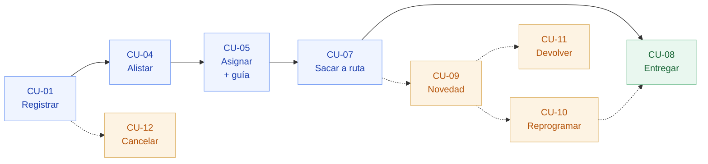

Los diagramas de casos de uso con actores —quién ejecuta cada uno y qué
microproyecto participa— están en `02-modelo-de-la-solucion.md`, sección 2.1, y
como imagen en `docs/diagramas/02` y `03`.

### 3.1 Índice de casos de uso

**Paquete 1 · Preparación del despacho**

| ID | Caso de uso | RF | Actor principal | Servicio REST |
|---|---|---|---|---|
| CU-01 | Registrar despacho | RF-01, RF-02 | Coordinador | `POST /despachos` |
| CU-02 | Corregir el destino del despacho | RF-01 | Coordinador | `PATCH /despachos/{id}` |
| CU-03 | Ajustar la carga del despacho | RF-01 | Coordinador | `POST/PUT/DELETE /despachos/{id}/items` |
| CU-04 | Alistar la carga | RF-04 | Coordinador | `POST /despachos/{id}/preparar` |

**Paquete 2 · Distribución**

| ID | Caso de uso | RF | Actor principal | Servicio REST |
|---|---|---|---|---|
| CU-05 | Asignar transportador y generar guía | RF-05, RF-07 | Coordinador | `POST /despachos/{id}/asignar` |
| CU-06 | Consultar e imprimir la guía | RF-07 | Coordinador | `GET /despachos/{id}/guia` |
| CU-07 | Sacar la carga a ruta | RF-04 | Coordinador | `POST /despachos/{id}/despachar` |

**Paquete 3 · Entrega en calle**

| ID | Caso de uso | RF | Actor principal | Servicio REST |
|---|---|---|---|---|
| CU-08 | Confirmar entrega | RF-09 | Transportador | `POST /despachos/{id}/entregar` |
| CU-09 | Registrar novedad de transporte | RF-08 | Transportador | `POST /despachos/{id}/novedades` |
| CU-10 | Reprogramar la entrega | RF-04 | Transportador | `POST /despachos/{id}/reprogramar` |
| CU-11 | Devolver la carga al remitente | RF-04 | Coordinador | `POST /despachos/{id}/devolver` |
| CU-12 | Cancelar el despacho | RF-04 | Coordinador | `POST /despachos/{id}/cancelar` |

**Paquete 4 · Consulta y control**

| ID | Caso de uso | RF | Actor principal | Servicio REST |
|---|---|---|---|---|
| CU-13 | Consultar despachos | RF-03 | Consulta | `GET /despachos` y variantes |
| CU-14 | Consultar trazabilidad | RF-10 | SERVI-X / Consulta | `GET /despachos/{id}/trazabilidad` |
| CU-15 | Consultar historial de entregas | RF-06 | Consulta | `GET /despachos/{id}/historial` |
| CU-16 | Generar reporte logístico | RF-11 | Administrador | `GET /reportes/logistica` |

**Paquete 5 · Administración e integración**

| ID | Caso de uso | RF | Actor principal | Servicio REST |
|---|---|---|---|---|
| CU-17 | Administrar transportadores | RF-05 | Administrador | `/transportadores` |
| CU-18 | Administrar rutas de entrega | RF-05 | Administrador | `/rutas` |
| CU-19 | Reportar cambio de estado desde otro sistema | RF-04 | SALES-X | `POST /despachos/{id}/estado` |
| CU-20 | Diagnosticar la integración | RNF-08 | Administrador | `GET /integracion/diagnostico` |

Los casos de uso de soporte técnico —autenticarse, seguir el tablero en vivo,
consultar la auditoría y cerrar una novedad— están en la sección 5.

---

## 4. Especificación de los casos de uso

### CU-01 · Registrar despacho

| Campo | Valor |
|---|---|
| **Identificador** | CU-01 |
| **Requisitos** | RF-01 (registrar despachos), RF-02 (asociar despachos a pedidos) |
| **Actor principal** | Coordinador de despachos |
| **Actores de apoyo** | SALES-X (pedido), CRM-X (dirección de entrega) |
| **Disparador** | Un pedido queda confirmado en SALES-X y hay que sacarlo de bodega |
| **Precondiciones** | El usuario está autenticado con rol ADMIN o COORDINADOR · El pedido existe en SALES-X en estado CONFIRMADO, FACTURADO o DESPACHADO · Ese pedido no tiene otro despacho vivo |
| **Postcondición de éxito** | Despacho creado en estado REGISTRADO con número interno `DES-2026-000001`, la carga copiada del pedido, la dirección congelada como *snapshot*, el primer movimiento en el historial y el evento `despacho.creado` en la bandeja de salida |
| **Postcondición de fallo** | **No se guarda nada**: la creación es una sola transacción |
| **Servicio REST** | `POST /api/v1/despachos` → 201 Created + cabecera `Location` |
| **Roles** | ADMIN, COORDINADOR |
| **Reglas aplicadas** | RN-08 (un despacho vivo por pedido), RN-09 (estados despachables), RN-11 (el servidor calcula la carga), RN-13 (no despachar más de lo vendido) |
| **Prioridad** | Alta — es el caso de uso que abre el ciclo |
| **Verificado en** | `FlujoDespachoTest.flujoCompleto`, `pedidoCanceladoNoSeDespacha`, `noSeDespachaDosVecesElMismoPedido`, `noSeDespachaMasDeLoVendido`, `productoAjenoAlPedido` |

**Flujo principal**

1. El coordinador envía `POST /api/v1/despachos` con el `pedidoId` y, si quiere, una dirección distinta a la del cliente y las líneas a despachar.
2. LOGISTI-X pide el pedido a **SALES-X** por `PuertoVentas`.
3. Comprueba que el estado del pedido esté en la lista de estados despachables, que llega de configuración (`integrax.ventas.estados-despachables`) y no del código.
4. Comprueba que ese pedido no tenga ya un despacho vivo.
5. Pide a **CRM-X** los datos del cliente del pedido.
6. Resuelve el destino: lo que venga en la solicitud manda sobre lo de CRM-X, y lo copia como *snapshot* (dirección, ciudad, departamento, teléfono).
7. Copia la carga: si la solicitud no trae líneas, copia el pedido completo; si las trae, valida cada una contra el pedido.
8. Calcula en el servidor el peso total (escala de gramos), las unidades y el valor declarado.
9. Asigna el consecutivo interno `DES-<año>-<6 dígitos>` y registra el primer movimiento del historial.
10. Inserta el evento `despacho.creado` en la bandeja de salida, **dentro de la misma transacción**.
11. Responde `201 Created` con el despacho y la cabecera `Location`.

**Flujos alternos**

| # | Situación | Comportamiento |
|---|---|---|
| A1 | La solicitud no trae líneas de carga | Se despacha el pedido completo — es el caso normal y evita transcribir a mano lo que ya está en SALES-X |
| A2 | La solicitud trae dirección de entrega propia | Esa dirección manda sobre la de CRM-X (entrega a una sucursal, obra o punto distinto) |
| A3 | La solicitud trae solo algunas líneas | Se registra un despacho parcial; las unidades restantes quedan para otro despacho posterior del mismo pedido |
| A4 | La línea trae peso unitario | Ese peso manda sobre el del pedido (verificado en `pesoDeLaSolicitud`): en bodega se pesa la caja real |

**Excepciones**

| # | Situación | Código | HTTP |
|---|---|---|---|
| E1 | El pedido no existe en SALES-X | `PEDIDO_NO_ENCONTRADO` | 502 |
| E2 | El pedido está CANCELADO o en BORRADOR | `PEDIDO_NO_DESPACHABLE` | 409 |
| E3 | El pedido ya tiene un despacho vivo | `DESPACHO_DUPLICADO` | 409 |
| E4 | El cliente no tiene dirección en CRM-X ni viene en la solicitud | `DIRECCION_REQUERIDA` | 409 |
| E5 | SALES-X o CRM-X no responden dentro del *timeout* | `VENTAS_INALCANZABLE` / `CRM_INALCANZABLE` | 502 |
| E5b | El cliente del pedido no existe en CRM-X | `CLIENTE_NO_ENCONTRADO` | 502 |
| E6 | Se pide despachar un producto que no está en el pedido | `PRODUCTO_AJENO_AL_PEDIDO` | 409 |
| E7 | Se piden más unidades de las que tiene el pedido | `CANTIDAD_SUPERA_PEDIDO` | 409 |

---

### CU-02 · Corregir el destino del despacho

| Campo | Valor |
|---|---|
| **Identificador** | CU-02 |
| **Requisitos** | RF-01 |
| **Actor principal** | Coordinador de despachos |
| **Disparador** | El cliente llama a corregir la dirección o a dejar un punto de referencia antes de que salga el camión |
| **Precondiciones** | El despacho está en REGISTRADO o EN_PREPARACION |
| **Postcondición de éxito** | Destino actualizado y el cambio registrado en auditoría con el antes y el después |
| **Servicio REST** | `PATCH /api/v1/despachos/{despachoId}` |
| **Roles** | ADMIN, COORDINADOR |
| **Reglas aplicadas** | RN-01 (solo se modifica lo que no tiene guía impresa) |
| **Prioridad** | Media |
| **Verificado en** | `CalculoCargaTest.asignadoNoSeEdita` |

**Flujo principal**

1. El coordinador envía los campos que cambian: dirección, ciudad, departamento, referencia, teléfono u observaciones.
2. LOGISTI-X verifica que el despacho siga siendo editable.
3. Actualiza solo los campos enviados y guarda el estado anterior y el nuevo en la tabla de auditoría.
4. Devuelve el despacho actualizado.

**Excepciones**

| # | Situación | Código | HTTP |
|---|---|---|---|
| E1 | El despacho ya está ASIGNADO, EN_RUTA o cerrado | `DESPACHO_NO_EDITABLE` | 409 |
| E2 | El despacho no existe | `DESPACHO_NO_ENCONTRADO` | 404 |

> **Por qué no se puede corregir después.** Desde ASIGNADO existe una guía
> impresa y un rótulo pegado en la caja. Cambiar la dirección en la base de
> datos y no en el rótulo es peor que no poder cambiarla: la carga llega a un
> lado y el sistema dice otro. Si la dirección cambió de verdad, el camino es
> cancelar y registrar un despacho nuevo.

---

### CU-03 · Ajustar la carga del despacho

| Campo | Valor |
|---|---|
| **Identificador** | CU-03 |
| **Requisitos** | RF-01 |
| **Actor principal** | Coordinador de despachos |
| **Actor de apoyo** | SALES-X (para validar contra el pedido) |
| **Disparador** | En bodega falta una referencia, sobra otra, o hay que partir el envío |
| **Precondiciones** | El despacho está en REGISTRADO o EN_PREPARACION |
| **Postcondición de éxito** | Carga modificada y peso, unidades y valor declarado **recalculados por el servidor** |
| **Servicios REST** | `POST /despachos/{id}/items` · `PUT /despachos/{id}/items/{itemId}` · `DELETE /despachos/{id}/items/{itemId}` |
| **Roles** | ADMIN, COORDINADOR |
| **Reglas aplicadas** | RN-01, RN-11, RN-13 |
| **Prioridad** | Media |
| **Verificado en** | `CalculoCargaTest.variasLineas`, `productoRepetidoSeSuma`, `quitarLineaRecalcula`, `pesoTotalConGramos` |

**Flujo principal (agregar una línea)**

1. El coordinador envía el `productoId` y la cantidad.
2. LOGISTI-X pide el pedido a SALES-X y busca ese producto entre sus líneas.
3. Suma lo que ya está cargado de ese producto y comprueba que el total no supere lo vendido.
4. Agrega la línea —o suma la cantidad si el producto ya estaba— y renumera.
5. Recalcula peso total, unidades y valor declarado.

**Flujos alternos**

| # | Situación | Comportamiento |
|---|---|---|
| A1 | El producto ya está en la carga | No se duplica la línea: se suma la cantidad |
| A2 | Se cambia la cantidad de una línea (`PUT`) | Se recalcula la carga completa |
| A3 | Se quita una línea (`DELETE`) | Se recalcula y se renumeran las líneas restantes |

**Excepciones**

| # | Situación | Código | HTTP |
|---|---|---|---|
| E1 | El despacho ya no es editable | `DESPACHO_NO_EDITABLE` | 409 |
| E2 | El producto no pertenece al pedido | `PRODUCTO_AJENO_AL_PEDIDO` | 409 |
| E3 | La cantidad total supera la vendida | `CANTIDAD_SUPERA_PEDIDO` | 409 |
| E4 | La cantidad es cero o negativa | `VALIDACION` (la API la rechaza antes de llegar al dominio) | 400 |
| E5 | La línea indicada no existe | `ITEM_NO_ENCONTRADO` | 409 |

---

### CU-04 · Alistar la carga

| Campo | Valor |
|---|---|
| **Identificador** | CU-04 |
| **Requisitos** | RF-04 |
| **Actor principal** | Coordinador de despachos (bodega) |
| **Disparador** | La bodega empieza a separar y empacar la mercancía |
| **Precondiciones** | El despacho está en REGISTRADO y **tiene al menos una línea de carga** |
| **Postcondición de éxito** | Despacho en EN_PREPARACION, movimiento en el historial y aviso a los tableros en vivo |
| **Servicio REST** | `POST /api/v1/despachos/{despachoId}/preparar` |
| **Roles** | ADMIN, COORDINADOR |
| **Reglas aplicadas** | RN-02 (no se prepara un despacho sin carga), RN-07 (transiciones declaradas) |
| **Prioridad** | Alta |
| **Verificado en** | `CalculoCargaTest.sinCargaNoSePrepara`, `FlujoDespachoTest.flujoCompleto` |

**Flujo principal**

1. El coordinador solicita pasar el despacho a alistamiento.
2. LOGISTI-X comprueba que la carga no esté vacía.
3. Comprueba que la transición REGISTRADO → EN_PREPARACION esté permitida.
4. Mueve el estado, registra el movimiento con ubicación «Bodega» y empuja el cambio a los tableros abiertos por SSE.

**Excepciones**

| # | Situación | Código | HTTP |
|---|---|---|---|
| E1 | El despacho no tiene líneas de carga | `DESPACHO_SIN_CARGA` | 409 |
| E2 | El despacho no está en REGISTRADO | `TRANSICION_INVALIDA` | 409 |
| E3 | Ya está en EN_PREPARACION | `ESTADO_REPETIDO` | 409 |

---

### CU-05 · Asignar transportador y generar guía

| Campo | Valor |
|---|---|
| **Identificador** | CU-05 |
| **Requisitos** | RF-05 (asignar transportadores), RF-07 (generar número de guía) |
| **Actor principal** | Coordinador de despachos |
| **Disparador** | La carga está lista y hay que decidir quién la lleva |
| **Precondiciones** | El despacho está en EN_PREPARACION (o en ASIGNADO, si se reasigna) · Hay transportadores activos en el maestro |
| **Postcondición de éxito** | Despacho en ASIGNADO con transportador, ruta, **número de guía con dígito de verificación**, fecha prometida y flete calculado |
| **Servicio REST** | `POST /api/v1/despachos/{despachoId}/asignar` |
| **Roles** | ADMIN, COORDINADOR |
| **Reglas aplicadas** | RN-03 (la guía es inmutable), RN-12 (la carga cabe en el vehículo), RN-14 (transportador activo) |
| **Prioridad** | Alta |
| **Verificado en** | `FlujoDespachoTest.laCargaTieneQueCaberEnElVehiculo`, `transportadorInactivo`, `CalculoCargaTest.laGuiaEsInmutable`, `calculoDelFlete`, `GuiaTest` (20 casos) |

**Flujo principal**

1. El coordinador envía el `transportadorId` y, opcionalmente, la ruta y la fecha estimada.
2. LOGISTI-X busca el transportador en el maestro y comprueba que esté activo.
3. Comprueba que el peso de la carga quepa en la capacidad del vehículo.
4. Si no se indicó ruta, elige **la ruta activa más rápida** hacia la ciudad de destino.
5. Genera el número de guía `LGX-2026-000001-4` —consecutivo de seis dígitos y dígito de verificación módulo 11— **solo si el despacho todavía no tenía guía**.
6. Fija la fecha prometida: la indicada, o la que resulte de los días estimados de la ruta.
7. Calcula el flete: tarifa base de operación + tarifa de la ruta + costo por kilogramo × peso.
8. Mueve el despacho a ASIGNADO, registra el movimiento y avisa a los tableros.

**Flujos alternos**

| # | Situación | Comportamiento |
|---|---|---|
| B1 | El despacho ya estaba ASIGNADO (reasignación) | Se cambia el transportador **conservando la guía**; no hay cambio de estado, pero queda un movimiento de «Reasignación» en la trazabilidad |
| B2 | No hay ruta activa hacia esa ciudad | Se asigna sin ruta; la fecha prometida queda a cargo del coordinador y el flete solo lleva la tarifa base |
| B3 | Se indica una ruta concreta | Se usa esa, sin buscar la más rápida |

**Excepciones**

| # | Situación | Código | HTTP |
|---|---|---|---|
| E1 | No se indica transportador | `VALIDACION` / `TRANSPORTADOR_REQUERIDO` | 400 / 409 |
| E2 | El transportador está inactivo | `TRANSPORTADOR_INACTIVO` | 409 |
| E3 | La carga supera la capacidad del vehículo | `CAPACIDAD_INSUFICIENTE` | 409 |
| E4 | La ruta indicada está inactiva | `RUTA_INACTIVA` | 409 |
| E5 | El transportador o la ruta no existen | `TRANSPORTADOR_NO_ENCONTRADO` / `RUTA_NO_ENCONTRADA` | 404 |
| E6 | El despacho no está en EN_PREPARACION ni ASIGNADO | `TRANSICION_INVALIDA` | 409 |

> **Por qué el dígito de verificación.** La guía se dicta por teléfono y se
> teclea en una bodega ruidosa. Con módulo 11, un dígito mal tecleado o dos
> cifras transpuestas se detectan al instante en vez de terminar en una
> consulta que «no encuentra» un despacho que sí existe (`GuiaTest.digitosIntercambiados`).

---

### CU-06 · Consultar e imprimir la guía

| Campo | Valor |
|---|---|
| **Identificador** | CU-06 |
| **Requisitos** | RF-07 |
| **Actor principal** | Coordinador de despachos |
| **Disparador** | Hay que pegar el rótulo en la caja antes de cargar el vehículo |
| **Precondiciones** | El despacho tiene guía generada (está en ASIGNADO o posterior) |
| **Postcondición de éxito** | Se devuelve el número de guía, el transportador, la fecha prometida y el **rótulo listo para imprimir** |
| **Servicio REST** | `GET /api/v1/despachos/{despachoId}/guia` |
| **Roles** | Cualquier usuario autenticado |
| **Reglas aplicadas** | RN-03 |
| **Prioridad** | Media |
| **Verificado en** | `GuiaTest.rotulo`, `rotuloSinTransportador` |

**Flujo principal**

1. Se consulta la guía del despacho.
2. LOGISTI-X comprueba que ya exista guía.
3. Arma el rótulo con guía, cliente, dirección, ciudad y transportador, y lo devuelve.

**Excepciones**

| # | Situación | Código | HTTP |
|---|---|---|---|
| E1 | El despacho todavía no tiene guía | `SIN_GUIA` | 409 |
| E2 | El despacho no existe | `DESPACHO_NO_ENCONTRADO` | 404 |

---

### CU-07 · Sacar la carga a ruta

| Campo | Valor |
|---|---|
| **Identificador** | CU-07 |
| **Requisitos** | RF-04 |
| **Actor principal** | Coordinador de despachos |
| **Actor de apoyo** | SALES-X (recibe el aviso) |
| **Disparador** | El vehículo sale del centro de distribución |
| **Precondiciones** | El despacho está en ASIGNADO, con transportador y guía |
| **Postcondición de éxito** | Despacho en EN_RUTA, hora de salida registrada y evento `despacho.en_ruta` en la bandeja de salida para que SALES-X marque el pedido como DESPACHADO |
| **Servicio REST** | `POST /api/v1/despachos/{despachoId}/despachar` |
| **Roles** | ADMIN, COORDINADOR |
| **Reglas aplicadas** | RN-04 (no se sale a ruta sin guía ni transportador), RN-07 |
| **Prioridad** | Alta |
| **Verificado en** | `FlujoDespachoTest.flujoCompleto`, `noSeCancelaLoQueYaSalio` |

**Flujo principal**

1. El coordinador confirma la salida, indicando la ubicación si no es el centro de distribución.
2. LOGISTI-X comprueba que haya guía y transportador.
3. Mueve el despacho a EN_RUTA y guarda la hora de salida.
4. Inserta el evento `despacho.en_ruta` en la bandeja de salida **dentro de la transacción**.
5. Fuera de la transacción, el publicador le reporta a SALES-X que el pedido quedó DESPACHADO, con reintentos si SALES-X no responde.
6. El cambio se empuja a los tableros abiertos.

**Excepciones**

| # | Situación | Código | HTTP |
|---|---|---|---|
| E1 | El despacho no tiene guía o transportador | `DESPACHO_SIN_GUIA` | 409 |
| E2 | El despacho no está en ASIGNADO | `TRANSICION_INVALIDA` | 409 |
| E3 | SALES-X está caído al reportar | La salida **queda firme**; el aviso se reintenta solo desde la bandeja de salida |

---
### CU-08 · Confirmar entrega

| Campo | Valor |
|---|---|
| **Identificador** | CU-08 |
| **Requisitos** | RF-09 |
| **Actor principal** | Transportador |
| **Actores de apoyo** | SALES-X y FINAN-X (reciben el aviso) |
| **Disparador** | El cliente recibe la mercancía y firma |
| **Precondiciones** | El despacho está en EN_RUTA · Se conoce el nombre de quien recibe |
| **Postcondición de éxito** | Despacho en ENTREGADO con receptor, documento, observación y hora; evento `despacho.entregado` en la bandeja de salida; SALES-X marca el pedido ENTREGADO y FINAN-X cierra el ciclo de cobro |
| **Postcondición de fallo** | El despacho sigue EN_RUTA; no se registra entrega parcial |
| **Servicio REST** | `POST /api/v1/despachos/{despachoId}/entregar` |
| **Roles** | ADMIN, COORDINADOR, TRANSPORTADOR |
| **Reglas aplicadas** | RN-05 (no hay entrega sin evidencia), RN-07 |
| **Prioridad** | Alta — es el caso de uso que cierra el ciclo del pedido |
| **Verificado en** | `CalculoCargaTest.entregaSinReceptorSeRechaza`, `FlujoDespachoTest.flujoCompleto`, `entregarExigeSuEndpoint` |

**Flujo principal**

1. El transportador envía el nombre de quien recibió y, si los tiene, documento, observación y ubicación.
2. LOGISTI-X exige el nombre del receptor: sin esa evidencia rechaza la operación.
3. Mueve el despacho a ENTREGADO y guarda receptor, documento, observación y hora de entrega.
4. Registra el movimiento en el historial y calcula si la entrega fue dentro de la fecha prometida.
5. Inserta el evento `despacho.entregado` en la bandeja de salida, dentro de la transacción.
6. Fuera de la transacción, el publicador avisa a SALES-X (pedido → ENTREGADO) y deja el evento disponible para FINAN-X, con reintentos.
7. El cambio se empuja a los tableros en vivo.

**Flujos alternos**

| # | Situación | Comportamiento |
|---|---|---|
| C1 | Recibe un tercero (portería, vecino) | Se registra ese nombre y su documento: la evidencia es de quien firmó, no de quien compró |
| C2 | La entrega llega después de la fecha prometida | Se registra igual; el incumplimiento se refleja en el indicador de cumplimiento del reporte (CU-16) |
| C3 | La entrega ocurre en el segundo o tercer intento | Se registra normalmente; los intentos quedan en la trazabilidad |

**Excepciones**

| # | Situación | Código | HTTP |
|---|---|---|---|
| E1 | No se indica quién recibió | `VALIDACION` (campo ausente) / `RECEPTOR_REQUERIDO` (llega en blanco) | 400 / 409 |
| E2 | El despacho no está EN_RUTA | `TRANSICION_INVALIDA` | 409 |
| E3 | Se intenta entregar por el endpoint genérico de estado | `USE_ENDPOINT_ENTREGA` | 409 |
| E4 | SALES-X está caído al reportar | La entrega **queda firme**; el aviso se reintenta |

> **Por qué la entrega no se compensa.** En SALES-X una reserva de inventario se
> puede liberar; aquí una entrega firmada **no se puede deshacer**. Por eso el
> aviso sale por bandeja de salida con reintentos y no por una saga con
> compensación: primero se confirma lo que ya pasó en el mundo real, después se
> avisa (ADR-008).

---

### CU-09 · Registrar novedad de transporte

| Campo | Valor |
|---|---|
| **Identificador** | CU-09 |
| **Requisitos** | RF-08 |
| **Actor principal** | Transportador |
| **Disparador** | Algo impide o retrasa la entrega en la calle |
| **Precondiciones** | El despacho **no** está en un estado final (ENTREGADO, DEVUELTO, CANCELADO) |
| **Postcondición de éxito** | Novedad registrada y visible en la trazabilidad. Si es bloqueante y la carga iba en ruta: despacho en FALLIDO, un intento más contado y evento `despacho.fallido` |
| **Servicio REST** | `POST /api/v1/despachos/{despachoId}/novedades` |
| **Roles** | ADMIN, COORDINADOR, TRANSPORTADOR |
| **Reglas aplicadas** | RN-10 (una novedad bloqueante mueve el estado sola) |
| **Prioridad** | Alta |
| **Verificado en** | `CalculoCargaTest.novedadBloqueanteMarcaFallido`, `novedadNoBloqueanteNoCambiaEstado`, `FlujoDespachoTest.novedadYReprogramacion`, `novedadInformativa` |

**Tipos de novedad** (lista cerrada, para que el reporte de causas se pueda agrupar)

| Tipo | ¿Bloquea por defecto? |
|---|---|
| `DIRECCION_ERRADA` | Sí |
| `CLIENTE_AUSENTE` | Sí |
| `CLIENTE_RECHAZA` | Sí |
| `AVERIA_VEHICULO` | Sí |
| `CARGA_AVERIADA` | Sí |
| `DEMORA_EN_VIA` | No |
| `ZONA_DE_RIESGO` | No |
| `DATOS_INCOMPLETOS` | No |
| `OTRA` | No |

**Flujo principal**

1. El transportador reporta el tipo de novedad, la descripción y la ubicación.
2. LOGISTI-X comprueba que el despacho no esté cerrado.
3. Registra la novedad con el usuario y la hora. Si no se indicó, la bandera de bloqueo la pone el tipo.
4. Si la novedad **bloquea** y el despacho está EN_RUTA: lo pasa a FALLIDO, suma un intento de entrega y emite el evento `despacho.fallido`.
5. Si no bloquea, o la carga no iba en la calle: el estado no cambia y la novedad queda como información de la trazabilidad.
6. El cambio se empuja a los tableros.

**Flujos alternos**

| # | Situación | Comportamiento |
|---|---|---|
| D1 | Novedad informativa (demora en vía) | Se registra y el despacho sigue EN_RUTA |
| D2 | Novedad bloqueante sobre un despacho que aún no salió | Se registra sin cambiar el estado: no hay entrega fallida si nadie intentó entregar |
| D3 | El coordinador marca como no bloqueante un tipo que sí lo es | Se respeta la bandera explícita: quien está en la calle sabe si puede seguir |
| D4 | La novedad se resuelve después | Se cierra con `POST /novedades/{id}/resolver` (CU-S4) |

**Excepciones**

| # | Situación | Código | HTTP |
|---|---|---|---|
| E1 | El despacho ya está cerrado | `DESPACHO_CERRADO` | 409 |
| E2 | El tipo de novedad no está en la lista cerrada | `CUERPO_ILEGIBLE` | 400 |
| E3 | Falta el tipo o la descripción | `VALIDACION` | 400 |

---

### CU-10 · Reprogramar la entrega

| Campo | Valor |
|---|---|
| **Identificador** | CU-10 |
| **Requisitos** | RF-04 |
| **Actor principal** | Transportador (o coordinador) |
| **Disparador** | Una entrega falló y se acuerda un nuevo intento |
| **Precondiciones** | El despacho está en FALLIDO y **le quedan intentos** (máximo 3) |
| **Postcondición de éxito** | Despacho de vuelta en EN_RUTA con nueva fecha prometida y el movimiento en la trazabilidad |
| **Servicio REST** | `POST /api/v1/despachos/{despachoId}/reprogramar` |
| **Roles** | ADMIN, COORDINADOR, TRANSPORTADOR |
| **Reglas aplicadas** | RN-06 (máximo 3 intentos) |
| **Prioridad** | Media |
| **Verificado en** | `FlujoDespachoTest.novedadYReprogramacion`, `CalculoCargaTest` (tercer intento agotado) |

**Flujo principal**

1. Se solicita reprogramar, con la nueva fecha si ya está acordada.
2. LOGISTI-X comprueba que los intentos no estén agotados (tope configurable, por defecto 3).
3. Mueve el despacho de FALLIDO a EN_RUTA y actualiza la fecha prometida.
4. Registra el movimiento y avisa a los tableros.

**Flujos alternos**

| # | Situación | Comportamiento |
|---|---|---|
| E1 | No se indica fecha | Queda «próximo día hábil» y la fecha prometida no cambia |

**Excepciones**

| # | Situación | Código | HTTP |
|---|---|---|---|
| E1 | Ya se hicieron 3 intentos | `INTENTOS_AGOTADOS` | 409 |
| E2 | El despacho no está FALLIDO | `TRANSICION_INVALIDA` | 409 |

> **FALLIDO no es un estado final**, y ahí está la diferencia con un Excel de
> despachos: «no se pudo entregar hoy» no es lo mismo que «se perdió la venta».

---

### CU-11 · Devolver la carga al remitente

| Campo | Valor |
|---|---|
| **Identificador** | CU-11 |
| **Requisitos** | RF-04 |
| **Actor principal** | Coordinador de despachos |
| **Disparador** | Se agotaron los intentos o el cliente rechaza definitivamente la mercancía |
| **Precondiciones** | El despacho está en FALLIDO |
| **Postcondición de éxito** | Despacho en DEVUELTO con el motivo, y evento `despacho.devuelto` para que SALES-X y FINAN-X lo sepan |
| **Servicio REST** | `POST /api/v1/despachos/{despachoId}/devolver` |
| **Roles** | ADMIN, COORDINADOR |
| **Reglas aplicadas** | RN-06, RN-07 |
| **Prioridad** | Media |
| **Verificado en** | `MaquinaEstadosTest` (transiciones desde FALLIDO) |

**Flujo principal**

1. El coordinador indica el motivo de la devolución.
2. LOGISTI-X mueve el despacho a DEVUELTO y registra el movimiento con ubicación «Centro de distribución».
3. Inserta el evento `despacho.devuelto` en la bandeja de salida.
4. El pedido queda libre para un despacho nuevo si el área comercial lo decide.

**Excepciones**

| # | Situación | Código | HTTP |
|---|---|---|---|
| E1 | El despacho no está FALLIDO | `TRANSICION_INVALIDA` | 409 |
| E2 | Se intenta devolver por el endpoint genérico de estado | `USE_ENDPOINT_ESPECIFICO` | 409 |

---

### CU-12 · Cancelar el despacho

| Campo | Valor |
|---|---|
| **Identificador** | CU-12 |
| **Requisitos** | RF-04 |
| **Actor principal** | Coordinador de despachos |
| **Actor de apoyo** | SALES-X (puede ser el origen de la solicitud) |
| **Disparador** | El pedido se anula o se detecta un error antes de que la carga salga |
| **Precondiciones** | El despacho está en REGISTRADO, EN_PREPARACION o ASIGNADO — **nunca después de salir a ruta** |
| **Postcondición de éxito** | Despacho en CANCELADO con motivo y hora; evento `despacho.cancelado`; el pedido queda libre para un despacho nuevo |
| **Servicio REST** | `POST /api/v1/despachos/{despachoId}/cancelar` |
| **Roles** | ADMIN, COORDINADOR |
| **Reglas aplicadas** | RN-07, RN-08 (al cancelar deja de ser un despacho vivo) |
| **Prioridad** | Media |
| **Verificado en** | `FlujoDespachoTest.noSeCancelaLoQueYaSalio`, `cancelarLiberaElPedido` |

**Flujo principal**

1. Se envía el motivo de cancelación y, si viene de otro sistema, su identificación como origen.
2. LOGISTI-X comprueba que la carga no haya salido.
3. Mueve el despacho a CANCELADO, guarda motivo y hora, y registra el movimiento con el origen.
4. Inserta el evento `despacho.cancelado` en la bandeja de salida.
5. El índice único parcial deja de contar ese despacho: el pedido puede volver a despacharse.

**Excepciones**

| # | Situación | Código | HTTP |
|---|---|---|---|
| E1 | El despacho ya salió a ruta o está cerrado | `TRANSICION_INVALIDA` | 409 |

> **Por qué no se cancela lo que ya salió.** La carga está físicamente en un
> camión. Lo que corresponde en ese punto es registrar una novedad y devolver
> (CU-09, CU-11), que es lo que de verdad pasa en la calle. Cancelar sería
> decirle a SALES-X y a FINAN-X que el envío nunca existió.

---

### CU-13 · Consultar despachos

| Campo | Valor |
|---|---|
| **Identificador** | CU-13 |
| **Requisitos** | RF-03 |
| **Actor principal** | Usuario de consulta (gerencia, servicio al cliente) |
| **Actores de apoyo** | Coordinador, administrador, SERVI-X |
| **Disparador** | «¿Dónde va la guía LGX-2026-000018-7?», «¿qué hay pendiente para Envigado?» |
| **Precondiciones** | Usuario autenticado |
| **Postcondición de éxito** | Se devuelve la información sin modificar nada |
| **Servicios REST** | `GET /despachos` (filtros combinables y paginación) · `GET /despachos/{id}` · `GET /despachos/numero/{numero}` · `GET /despachos/guia/{numeroGuia}` · `GET /despachos/pedido/{pedidoId}` |
| **Roles** | Cualquier usuario autenticado |
| **Prioridad** | Alta |
| **Verificado en** | `FlujoDespachoTest.busquedaPorGuia`, `flujoCompleto` |

**Filtros disponibles**: estado, pedido, cliente, transportador, ciudad, rango de fechas y texto libre (número, guía, cliente o dirección), combinables entre sí y con paginación y ordenamiento.

**Flujo principal**

1. El usuario consulta con los filtros que necesite.
2. LOGISTI-X arma la consulta con especificaciones JPA y apoya los filtros en índices.
3. Devuelve una página de resultados en formato resumen, o el detalle completo si se pidió uno solo.

**Flujos alternos**

| # | Situación | Comportamiento |
|---|---|---|
| F1 | Se consulta por número de guía | Se normaliza a mayúsculas antes de buscar: el cliente la dicta como la lee |
| F2 | Se consulta por pedido | Devuelve **todos** los despachos de ese pedido, incluidos los cerrados: así se ve el histórico de intentos |
| F3 | Ningún resultado coincide | Página vacía con total 0, no un error |

**Excepciones**

| # | Situación | Código | HTTP |
|---|---|---|---|
| E1 | El despacho, número o guía no existe | `DESPACHO_NO_ENCONTRADO` / `GUIA_NO_ENCONTRADA` | 404 |

---

### CU-14 · Consultar trazabilidad

| Campo | Valor |
|---|---|
| **Identificador** | CU-14 |
| **Requisitos** | RF-10 |
| **Actor principal** | SERVI-X (atención de PQRS) |
| **Actores de apoyo** | Usuario de consulta, coordinador |
| **Disparador** | Un cliente pregunta dónde va su pedido y por qué se demoró |
| **Precondiciones** | El despacho existe |
| **Postcondición de éxito** | Línea de tiempo única con movimientos de estado **y** novedades, ordenada cronológicamente |
| **Servicio REST** | `GET /api/v1/despachos/{despachoId}/trazabilidad` |
| **Roles** | Cualquier usuario autenticado (incluido el rol SISTEMA de SERVI-X) |
| **Reglas aplicadas** | RNF-06 (registro histórico de movimientos) |
| **Prioridad** | Alta — es el servicio que consume otro microproyecto |
| **Verificado en** | `FlujoDespachoTest.flujoCompleto` |

**Flujo principal**

1. SERVI-X consulta la trazabilidad por el identificador del despacho (o lo resuelve antes por guía, CU-13).
2. LOGISTI-X carga el historial de estados y las novedades del despacho.
3. Mezcla ambas fuentes en una sola línea de tiempo ordenada por fecha.
4. Devuelve cada evento con tipo, descripción, ubicación, usuario y hora.

**Flujos alternos**

| # | Situación | Comportamiento |
|---|---|---|
| G1 | El despacho no tiene novedades | La línea de tiempo trae solo los movimientos de estado |

**Excepciones**

| # | Situación | Código | HTTP |
|---|---|---|---|
| E1 | El despacho no existe | `DESPACHO_NO_ENCONTRADO` | 404 |

---

### CU-15 · Consultar historial de entregas

| Campo | Valor |
|---|---|
| **Identificador** | CU-15 |
| **Requisitos** | RF-06 |
| **Actor principal** | Usuario de consulta |
| **Disparador** | Auditoría interna o reclamo: «¿quién movió este despacho y cuándo?» |
| **Precondiciones** | El despacho existe |
| **Postcondición de éxito** | Lista de movimientos con estado anterior, estado nuevo, motivo, ubicación, usuario, origen y hora |
| **Servicio REST** | `GET /api/v1/despachos/{despachoId}/historial` |
| **Roles** | Cualquier usuario autenticado |
| **Reglas aplicadas** | RNF-06 |
| **Prioridad** | Media |
| **Verificado en** | `FlujoDespachoTest.flujoCompleto` |

**Flujo principal**

1. Se consulta el historial del despacho.
2. LOGISTI-X devuelve la tabla `despacho_estado_historial`, que **solo admite inserciones**: ningún movimiento se edita ni se borra.

**Diferencia con CU-14.** El historial son los movimientos de estado; la
trazabilidad es el historial **más** las novedades. El primero sirve para
auditar, el segundo para responderle al cliente.

---

### CU-16 · Generar reporte logístico

| Campo | Valor |
|---|---|
| **Identificador** | CU-16 |
| **Requisitos** | RF-11 |
| **Actor principal** | Administrador |
| **Actor de apoyo** | Gerencia (usuario de consulta) |
| **Disparador** | Cierre de mes, comité de operaciones, evaluación de transportadores |
| **Precondiciones** | Usuario autenticado |
| **Postcondición de éxito** | Reporte del periodo con cuatro respuestas: en qué va la operación, quién responde, por qué se cae y si se está cumpliendo |
| **Servicio REST** | `GET /api/v1/reportes/logistica?desde=&hasta=` |
| **Roles** | Cualquier usuario autenticado |
| **Prioridad** | Media |
| **Verificado en** | `ReporteServicio` (agregaciones en SQL) |

**Contenido del reporte**

| Bloque | Qué responde |
|---|---|
| Totales del periodo | Despachos, entregados, carga en calle (EN_RUTA + FALLIDO), peso total y flete total |
| Resumen por estado | En qué va la operación |
| Desempeño por transportador | Despachos, entregados, fallidos, peso y **efectividad** calculada |
| Causas de no entrega | Por qué se cae: agrupadas por tipo de novedad |
| Cumplimiento | Porcentaje de entregas dentro de la fecha prometida |

**Flujo principal**

1. El administrador pide el reporte con un rango de fechas.
2. Si no se indica rango, se toma del primer día del mes en curso hasta hoy.
3. LOGISTI-X ejecuta las agregaciones **en SQL** —no en memoria— sobre el rango, con el límite superior exclusivo (se suma un día) para no dejar por fuera los despachos de la última tarde.
4. Calcula totales y efectividades y devuelve el reporte en JSON.

**Flujos alternos**

| # | Situación | Comportamiento |
|---|---|---|
| H1 | No hay despachos en el periodo | Reporte con totales en cero, no un error |
| H2 | Solo se indica `desde` | `hasta` es hoy |

---

### CU-17 · Administrar transportadores

| Campo | Valor |
|---|---|
| **Identificador** | CU-17 |
| **Requisitos** | RF-05 |
| **Actor principal** | Administrador |
| **Disparador** | Entra un transportador nuevo, cambia de vehículo o deja de prestar el servicio |
| **Precondiciones** | Usuario con rol ADMIN (crear y actualizar también lo puede el COORDINADOR) |
| **Postcondición de éxito** | Maestro de transportadores actualizado, con su documento único, tipo de vehículo, capacidad y zona |
| **Servicios REST** | `GET /transportadores` · `GET /transportadores/{id}` · `POST /transportadores` · `PUT /transportadores/{id}` · `DELETE /transportadores/{id}` (inactiva) · `POST /transportadores/{id}/activar` |
| **Roles** | ADMIN (baja y reactivación) · ADMIN o COORDINADOR (alta y edición) |
| **Reglas aplicadas** | RN-14 (no se borra, se inactiva; y no se inactiva con carga en la calle) |
| **Prioridad** | Media |
| **Verificado en** | `FlujoDespachoTest.transportadorInactivo`, `elMaestroLogisticoEstaCargado` |

**Flujo principal (dar de baja)**

1. El administrador solicita dar de baja a un transportador.
2. LOGISTI-X comprueba que no tenga despachos vivos en la calle.
3. Marca el transportador como inactivo — **nunca lo borra**.

**Excepciones**

| # | Situación | Código | HTTP |
|---|---|---|---|
| E1 | Ya existe un transportador con ese documento | `TRANSPORTADOR_DUPLICADO` | 409 |
| E2 | Tiene despachos activos asignados | `TRANSPORTADOR_CON_CARGA` | 409 |
| E3 | No existe | `TRANSPORTADOR_NO_ENCONTRADO` | 404 |

> **Por qué no se borra.** Un transportador borrado deja despachos históricos
> sin responsable, y la trazabilidad de una entrega de hace seis meses tiene que
> seguir diciendo quién la llevó.

---

### CU-18 · Administrar rutas de entrega

| Campo | Valor |
|---|---|
| **Identificador** | CU-18 |
| **Requisitos** | RF-05 |
| **Actor principal** | Administrador |
| **Disparador** | Se abre una ciudad nueva, cambia una tarifa o se suspende una ruta |
| **Precondiciones** | Usuario con rol ADMIN (alta y edición también el COORDINADOR) |
| **Postcondición de éxito** | Maestro de rutas actualizado con código único, origen, destino, días estimados y tarifa base |
| **Servicios REST** | `GET /rutas` · `GET /rutas/{id}` · `POST /rutas` · `PUT /rutas/{id}` · `DELETE /rutas/{id}` (inactiva) |
| **Roles** | ADMIN · ADMIN o COORDINADOR para alta y edición |
| **Prioridad** | Media |
| **Verificado en** | `FlujoDespachoTest.elMaestroLogisticoEstaCargado` |

**Para qué sirve la ruta.** No es un catálogo decorativo: de ella salen **la
fecha que se le promete al cliente** (días estimados) y **parte del flete**
(tarifa base). Cuando el coordinador no indica ruta al asignar, el sistema elige
la ruta activa más rápida hacia la ciudad de destino (CU-05, paso 4).

**Excepciones**

| # | Situación | Código | HTTP |
|---|---|---|---|
| E1 | Ya existe una ruta con ese código | `RUTA_DUPLICADA` | 409 |
| E2 | No existe | `RUTA_NO_ENCONTRADA` | 404 |

---

### CU-19 · Reportar cambio de estado desde otro sistema

| Campo | Valor |
|---|---|
| **Identificador** | CU-19 |
| **Requisitos** | RF-04 |
| **Actor principal** | SALES-X (rol técnico `SISTEMA`) |
| **Disparador** | Otro microproyecto conoce un hecho que cambia el despacho |
| **Precondiciones** | El sistema externo está autenticado con un usuario de rol SISTEMA · La transición pedida está permitida desde el estado actual |
| **Postcondición de éxito** | Despacho movido al estado pedido, con el **origen** registrado en el historial (queda escrito que el cambio no lo hizo un humano de LOGISTI-X) |
| **Servicio REST** | `POST /api/v1/despachos/{despachoId}/estado` |
| **Roles** | ADMIN, SISTEMA |
| **Reglas aplicadas** | RN-07 |
| **Prioridad** | Media — es la puerta de entrada de la integración |
| **Verificado en** | `FlujoDespachoTest.entregarExigeSuEndpoint` |

**Flujo principal**

1. El sistema externo envía el estado destino, el motivo, la ubicación y su identificación como origen.
2. LOGISTI-X interpreta el estado y rechaza los que exigen evidencia o motivo propio.
3. Comprueba que la transición esté permitida.
4. Mueve el despacho, registra el movimiento con el origen y, si el destino es EN_RUTA, emite el evento correspondiente.

**Excepciones**

| # | Situación | Código | HTTP |
|---|---|---|---|
| E1 | Se pide ENTREGADO por esta puerta | `USE_ENDPOINT_ENTREGA` | 409 |
| E2 | Se pide CANCELADO o DEVUELTO por esta puerta | `USE_ENDPOINT_ESPECIFICO` | 409 |
| E3 | El estado enviado no existe | `ESTADO_DESCONOCIDO` | 409 |
| E4 | La transición no está permitida | `TRANSICION_INVALIDA` | 409 |
| E5 | El despacho ya está en ese estado | `ESTADO_REPETIDO` | 409 |

> **Por qué hay una puerta genérica y aun así se cierran tres estados.** La
> integración necesita un endpoint uniforme para reportar cambios, pero entregar
> exige evidencia de quién recibió y cancelar o devolver exigen motivo. Un
> endpoint que aceptara todo permitiría marcar entregas sin firma desde otro
> sistema — y esa firma es la única defensa ante un reclamo.

---

### CU-20 · Diagnosticar la integración

| Campo | Valor |
|---|---|
| **Identificador** | CU-20 |
| **Requisitos** | RNF-08 (documentación de interfaces de integración) |
| **Actor principal** | Administrador (o el responsable de LOGISTI-X en la reunión de integración) |
| **Disparador** | El JSON de otro equipo no encaja y hay que saber exactamente qué falta |
| **Precondiciones** | Usuario con rol ADMIN o COORDINADOR |
| **Postcondición de éxito** | Informe campo por campo de lo que llegó de SALES-X y CRM-X, lo que falta y por qué se necesita |
| **Servicios REST** | `GET /api/v1/integracion/diagnostico?pedidoId=` · `GET /api/v1/integracion/estado` |
| **Roles** | ADMIN, COORDINADOR |
| **Prioridad** | Alta durante la fase de integración |
| **Verificado en** | `ContratoVentasTest` (prueba el JSON del compañero sin que su servidor exista) |

**Flujo principal**

1. Se consulta el diagnóstico con un `pedidoId` real del otro equipo.
2. LOGISTI-X llama a SALES-X y CRM-X **como lo haría al despachar**.
3. Reporta campo por campo: qué llegó, qué falta y qué regla de negocio lo exige.
4. `GET /integracion/estado` complementa diciendo con quién está hablando el sistema: puertos simulados o URLs reales.

**Para qué sirve en la práctica.** Es lo que se le manda al grupo en vez de «tu
API no me sirve»: un informe que dice *falta `items[].pesoUnitarioKg`, y se
necesita para calcular el peso del despacho y validar la capacidad del
vehículo*.

---

## 5. Casos de uso de soporte técnico

No cubren un RF del enunciado, pero el sistema no funciona sin ellos.

| ID | Caso de uso | Actor | Servicio REST | Para qué |
|---|---|---|---|---|
| CU-S1 | Autenticarse | Todos | `POST /api/v1/auth/login` · `GET /api/v1/auth/yo` | Obtener el token JWT (HS384) que exige todo lo demás. Sin token, 401 |
| CU-S2 | Seguir el tablero en vivo | Coordinador | `GET /api/v1/despachos/eventos` (SSE) | Cumplir RNF-02: el servidor **empuja** cada cambio al tablero en vez de que el navegador pregunte cada cinco segundos |
| CU-S3 | Consultar la auditoría de un despacho | Administrador | `GET /api/v1/auditoria/despachos/{despachoId}` | Ver el antes y el después de cada operación en JSONB (RNF-06) |
| CU-S4 | Cerrar una novedad | Coordinador | `POST /api/v1/novedades/{novedadId}/resolver` · `GET /api/v1/novedades/abiertas` | Que una novedad no quede abierta para siempre después de resolverse |

**Nota de seguridad sobre CU-S2.** `EventSource` no admite cabeceras HTTP, así
que el canal SSE acepta el token por parámetro de consulta — y **solo esa ruta**.
Queda documentado porque un token en la URL aparece en los registros del
servidor; el alcance se limitó a la ruta del tablero a propósito.

---
## 6. Matriz de trazabilidad RF → caso de uso → servicio → prueba

Esta es la tabla que responde a «¿dónde quedó cada requerimiento del enunciado?».

| RF del enunciado | Caso(s) de uso | Servicio REST | Prueba que lo verifica |
|---|---|---|---|
| RF-01 Registrar despachos | CU-01, CU-02, CU-03 | `POST /despachos`, `PATCH /despachos/{id}`, `/items` | `FlujoDespachoTest.flujoCompleto`, `CalculoCargaTest` |
| RF-02 Asociar despachos a pedidos | CU-01, CU-13 | `POST /despachos`, `GET /despachos/pedido/{id}` | `pedidoCanceladoNoSeDespacha`, `noSeDespachaDosVecesElMismoPedido` |
| RF-03 Consultar información de despachos | CU-13 | `GET /despachos` y variantes | `busquedaPorGuia` |
| RF-04 Actualizar estado de entrega | CU-04, CU-07, CU-10, CU-11, CU-12, CU-19 | acciones con nombre propio + `POST /despachos/{id}/estado` | `MaquinaEstadosTest` (42 casos) |
| RF-05 Asignar transportadores | CU-05, CU-17, CU-18 | `POST /despachos/{id}/asignar`, `/transportadores`, `/rutas` | `laCargaTieneQueCaberEnElVehiculo`, `transportadorInactivo` |
| RF-06 Consultar historial de entregas | CU-15 | `GET /despachos/{id}/historial` | `flujoCompleto` |
| RF-07 Generar número de guía | CU-05, CU-06 | `POST /despachos/{id}/asignar`, `GET /despachos/{id}/guia` | `GuiaTest` (20 casos) |
| RF-08 Registrar novedades de transporte | CU-09 | `POST /despachos/{id}/novedades` | `novedadYReprogramacion`, `novedadInformativa`, `novedadBloqueanteMarcaFallido` |
| RF-09 Confirmar entregas realizadas | CU-08 | `POST /despachos/{id}/entregar` | `entregaSinReceptorSeRechaza` |
| RF-10 Consultar trazabilidad de despachos | CU-14 | `GET /despachos/{id}/trazabilidad` | `flujoCompleto` |
| RF-11 Generar reportes logísticos | CU-16 | `GET /reportes/logistica` | `ReporteServicio` (agregaciones SQL) |

**Los once requerimientos funcionales del enunciado están cubiertos.** Los casos
de uso CU-02, CU-03, CU-06, CU-10, CU-11, CU-12, CU-17, CU-18, CU-19 y CU-20 no
aparecen literalmente en el enunciado: salieron de hacer que el ciclo funcione de
verdad (corregir antes de imprimir, reprogramar, devolver, cancelar, mantener el
maestro y dejar entrar a otro sistema).

---

## 7. Matriz caso de uso → regla de negocio

| Regla | Qué exige | Casos de uso donde se aplica |
|---|---|---|
| RN-01 | Solo se modifica un despacho REGISTRADO o EN_PREPARACION | CU-02, CU-03 |
| RN-02 | No se prepara un despacho sin carga | CU-04 |
| RN-03 | El número de guía es inmutable | CU-05, CU-06 |
| RN-04 | No se sale a ruta sin guía ni transportador | CU-07 |
| RN-05 | No hay entrega sin nombre de quien recibió | CU-08 |
| RN-06 | Máximo 3 intentos de entrega | CU-10, CU-11 |
| RN-07 | Solo se permiten las transiciones declaradas | CU-04, CU-07, CU-08, CU-10, CU-11, CU-12, CU-19 |
| RN-08 | Un pedido no puede tener dos despachos vivos | CU-01, CU-12 |
| RN-09 | Solo se despacha un pedido en estado despachable | CU-01 |
| RN-10 | Una novedad bloqueante pasa el despacho a FALLIDO | CU-09 |
| RN-11 | El peso, el valor declarado y el flete los calcula el servidor | CU-01, CU-03, CU-05 |
| RN-12 | La carga tiene que caber en el vehículo | CU-05 |
| RN-13 | No se despacha más de lo que tiene el pedido | CU-01, CU-03 |
| RN-14 | Un transportador no se borra, se inactiva | CU-17 |

---

## 8. Matriz actor × caso de uso

| Caso de uso | Coordinador | Transportador | Administrador | Consulta | SALES-X | CRM-X | SERVI-X | FINAN-X |
|---|:--:|:--:|:--:|:--:|:--:|:--:|:--:|:--:|
| CU-01 Registrar despacho | **E** | | **E** | | P | P | | |
| CU-02 Corregir destino | **E** | | **E** | | | | | |
| CU-03 Ajustar la carga | **E** | | **E** | | P | | | |
| CU-04 Alistar la carga | **E** | | **E** | | | | | |
| CU-05 Asignar y generar guía | **E** | | **E** | | | | | |
| CU-06 Consultar la guía | **E** | L | **E** | L | | | | |
| CU-07 Sacar a ruta | **E** | | **E** | | C | | | |
| CU-08 Confirmar entrega | **E** | **E** | **E** | | C | | | C |
| CU-09 Registrar novedad | **E** | **E** | **E** | | | | | |
| CU-10 Reprogramar | **E** | **E** | **E** | | | | | |
| CU-11 Devolver la carga | **E** | | **E** | | C | | | C |
| CU-12 Cancelar despacho | **E** | | **E** | | C | | | |
| CU-13 Consultar despachos | L | L | L | **L** | | | L | |
| CU-14 Consultar trazabilidad | L | L | L | L | | | **L** | |
| CU-15 Consultar historial | L | L | L | **L** | | | | |
| CU-16 Reporte logístico | L | | **E** | L | | | | |
| CU-17 Administrar transportadores | E | | **E** | | | | | |
| CU-18 Administrar rutas | E | | **E** | | | | | |
| CU-19 Reportar cambio de estado | | | **E** | | **E** | | | |
| CU-20 Diagnosticar integración | E | | **E** | | | | | |

**E** = ejecuta · **L** = solo lectura · **P** = provee datos · **C** = consume el resultado. En negrita, el actor principal.

---

## 9. Cobertura de los requerimientos no funcionales

Los RNF no son casos de uso, pero se ejercen dentro de ellos. Aquí queda dicho dónde.

| RNF | Dónde se cumple |
|---|---|
| RNF-01 Disponibilidad ≥ 95 % | Un fallo de SALES-X o CRM-X en CU-01 devuelve 502 sin tumbar LOGISTI-X; sondas *liveness* y *readiness* en `/actuator/health` |
| RNF-02 Estados en tiempo real | CU-S2: cada cambio de CU-04, CU-05, CU-07, CU-08 y CU-09 se empuja por SSE al tablero |
| RNF-03 Arquitectura orientada a servicios | Todos los casos de uso se realizan por `/api/v1/...` con JSON, verbos y códigos HTTP estándar |
| RNF-04 Respuesta < 3 s | CU-13 y CU-16 con índices y agregaciones en SQL; *timeouts* de 2 s y 3 s hacia los otros sistemas en CU-01 |
| RNF-05 Seguridad de acceso | CU-S1 más los roles declarados en cada ficha; todo cerrado por defecto |
| RNF-06 Registro histórico | CU-14, CU-15 y CU-S3: historial que solo inserta + auditoría con antes y después |
| RNF-07 Compatibilidad móvil | El panel que realiza estos casos de uso se verificó en iPhone emulado, sin desborde horizontal |
| RNF-08 Documentación de interfaces | OpenAPI generado del código + CU-20 + `04-contratos-integracion.md` |

---

## 10. Escenarios de aceptación

Tres recorridos que atraviesan varios casos de uso. Son los que se muestran en la
demostración y los que están automatizados de punta a punta.

### Escenario 1 — Entrega normal *(camino feliz)*

CU-01 → CU-04 → CU-05 → CU-07 → CU-08

1. Llega el pedido `PED-2026-000012`, CONFIRMADO en SALES-X.
2. Se registra el despacho: se copian tres líneas, 42,500 kg, dirección tomada de CRM-X.
3. Bodega alista la carga.
4. Se asigna el transportador: guía `LGX-2026-000018-7`, ruta Medellín–Envigado, dos días, flete calculado.
5. Sale a ruta; SALES-X recibe DESPACHADO.
6. Se entrega a «María Restrepo, c.c. 43.xxx»; SALES-X recibe ENTREGADO y FINAN-X el evento de entrega.

*Automatizado en* `FlujoDespachoTest.flujoCompleto`.

### Escenario 2 — Cliente ausente y segundo intento

CU-07 → CU-09 → CU-10 → CU-08

1. El despacho va EN_RUTA.
2. El transportador reporta `CLIENTE_AUSENTE`: es bloqueante y la carga está en la calle, así que el despacho pasa solo a FALLIDO y suma el intento 1.
3. Se acuerda nueva fecha: reprogramación, vuelve a EN_RUTA.
4. Se entrega en el segundo intento. La trazabilidad muestra los dos intentos y la novedad.

*Automatizado en* `FlujoDespachoTest.novedadYReprogramacion`.

### Escenario 3 — Lo que el sistema no deja hacer

1. Despachar un pedido CANCELADO en SALES-X → `PEDIDO_NO_DESPACHABLE`.
2. Registrar un segundo despacho vivo del mismo pedido → `DESPACHO_DUPLICADO`.
3. Asignar 3.000 kg a una moto → `CAPACIDAD_INSUFICIENTE`.
4. Entregar sin decir quién recibió → `RECEPTOR_REQUERIDO`.
5. Cancelar un despacho que ya salió a ruta → `TRANSICION_INVALIDA`.
6. Marcar ENTREGADO por el endpoint genérico de estado → `USE_ENDPOINT_ENTREGA`.
7. Reprogramar un cuarto intento → `INTENTOS_AGOTADOS`.

*Automatizado en* `FlujoDespachoTest` y `MaquinaEstadosTest` (incluidas las transiciones prohibidas).

---

## 11. Glosario

| Término | Significado en LOGISTI-X |
|---|---|
| **Despacho** | Envío físico de la mercancía de un pedido. Un pedido puede tener varios despachos a lo largo del tiempo, pero **solo uno vivo** |
| **Despacho vivo** | El que no está ENTREGADO, DEVUELTO ni CANCELADO |
| **Guía** | Identificador externo del envío (`LGX-2026-000001-4`), el que se le da al cliente y va impreso en el rótulo |
| **Número interno** | Consecutivo administrativo `DES-2026-000001`, distinto de la guía |
| **Carga** | Las líneas de producto que van en el despacho, con cantidad, peso unitario y precio |
| **Snapshot** | Copia local de datos de otro sistema (dirección, nombre del producto) que **no cambia** si el maestro ajeno cambia después |
| **Novedad** | Hecho ocurrido en el transporte; puede bloquear o no la entrega |
| **Bandeja de salida** | Tabla donde se insertan los eventos en la misma transacción del cambio, y desde la que se publican después con reintentos |
| **Puerto** | Interfaz por la que LOGISTI-X habla con otro microproyecto (`PuertoVentas`, `PuertoClientes`), con implementación simulada o real |
| **Intento de entrega** | Cada vez que la carga se presentó en la dirección y no se pudo entregar. Máximo tres |

---

## 12. Trazabilidad con el resto de la documentación

| Documento | Qué aporta a estos casos de uso |
|---|---|
| `01-analisis-y-requisitos.md` | RF, RNF, actores y las 14 reglas de negocio que se citan aquí |
| `02-modelo-de-la-solucion.md` | Modelo de dominio, modelo de datos, máquina de estados y diagramas de secuencia |
| `03-arquitectura.md` | Capas, puertos y adaptadores, decisiones de despliegue |
| `04-contratos-integracion.md` | El JSON exacto que LOGISTI-X espera de SALES-X y CRM-X, y el que entrega |
| `05-pruebas.md` | Las 99 pruebas: qué prueba cada una y por qué |
| `06-demostracion.md` | Guion de la sustentación, apoyado en los escenarios de la sección 10 |
| `07-plan-de-integracion.md` | Cómo se conecta con los otros equipos sin desarmar el modelo |
| `adr/` | Las once decisiones de arquitectura, con su contexto y sus consecuencias |

---

*LOGISTI-X · Microproyecto 2.5 de INTEGRAX · Electiva Profesional II — Integración de Aplicaciones y Sistemas · Corporación Universitaria Unisabaneta · 2026-2*

# Anexo A · Decisiones de arquitectura (ADR)

## ADR-001 · Java 21 con Spring Boot 3.5

**Estado:** aceptada · 21 de agosto de 2026

## Contexto

El docente exige Java. Dentro de Java hay que elegir con que construir una API
REST con persistencia, seguridad y documentacion en cinco semanas.

## Decision

Java 21 (LTS) + Spring Boot 3.5, con PostgreSQL 16, Flyway, JPA/Hibernate,
Spring Security con JWT y springdoc-openapi.

## Por que

- Es el estandar de facto para servicios REST en Java: lo que se aprende aqui
  se usa igual en una empresa.
- Trae resueltas cosas que en cinco semanas no daria tiempo de escribir:
  validacion, manejo de errores, seguridad, documentacion automatica, sondas de
  salud.
- Java 21 aporta *records* (los DTO quedan en una linea), *pattern matching* en
  `switch` e hilos virtuales.
- springdoc genera el OpenAPI **del codigo**: la documentacion no se puede
  desactualizar.

## Consecuencias

- El arranque tarda unos 20 segundos: es lo que cuesta el marco.
- Hay que conocer las anotaciones; a cambio, el codigo propio es poco y
  concreto.

## ADR-002 · Una base de datos por microproyecto

**Estado:** aceptada · 21 de agosto de 2026

## Contexto

Los seis microproyectos de INTEGRAX manejan datos relacionados: clientes,
productos, pedidos, facturas, despachos y casos. La pregunta que se hizo el
grupo fue si armar **una sola base compartida** para los seis o una por equipo.

## Decision

**Una base de datos por microproyecto.** LOGISTI-X es dueno exclusivo del
esquema `logistix`; ningun otro sistema se conecta ahi. Todo lo que otro
equipo necesite se pide por API REST.

## Por que

1. **Es el objeto de la asignatura.** Se llama Integracion de Aplicaciones y
   Sistemas. Si los seis comparten tablas, no hay integracion que evaluar: hay
   un solo sistema con seis carpetas.
2. **Independencia real.** LOGISTI-X puede cambiar su esquema, migrar o
   desplegarse sin coordinar con cinco equipos.
3. **La frontera obliga a pensar.** Al no poder hacer `join` con `pedido`, hay
   que decidir explicitamente que se copia y que se consulta. Ese ejercicio es
   el aprendizaje.

## Consecuencias

- No hay integridad referencial entre sistemas: se resuelve con validacion por
  API y snapshot (ADR-003).
- Un reporte que cruce datos de dos sistemas exige dos llamadas, no un `join`.
- Cada equipo tiene que exponer y documentar su API de verdad, no confiar en
  que el otro "lea la tabla".

## ADR-003 · Referencias externas sin llave foranea, con snapshot

**Estado:** aceptada · 28 de agosto de 2026

## Contexto

`despacho` necesita saber a que pedido corresponde (`pedidoId`, de SALES-X), a
que cliente (`clienteId`, de CRM-X) y que productos lleva (`productoId`, de
INVENTA-X). Esas tablas no existen en esta base de datos (ADR-002).

## Decision

Guardar el identificador **sin llave foranea**, y ademas una **copia local
(snapshot)** de los datos que se usaron: nombre y documento del cliente,
direccion de entrega, SKU y nombre del producto, numero del pedido.

## Por que

**Sin FK** porque no se puede: la tabla referenciada esta en otra base de datos.

**Con snapshot** por una razon que no es tecnica sino documental: una guia
impresa dice "Almacenes La 14 S.A.S., Carrera 48 # 32-45". Si manana CRM-X
corrige la razon social o el cliente se muda, el despacho de la semana pasada
**no puede cambiar**: describe algo que ya ocurrio en el mundo fisico.

## Consecuencias

- La base no impide guardar un `pedidoId` inexistente: por eso se valida contra
  SALES-X antes de crear el despacho.
- El snapshot puede quedar viejo respecto al maestro. Es intencional.
- Para el dato de hoy se consulta al otro sistema; el snapshot es historia.

## ADR-004 · BigDecimal para dinero y para peso

**Estado:** aceptada · 28 de agosto de 2026

## Contexto

LOGISTI-X maneja dos magnitudes que no admiten error: el **peso** (decide el
flete y si la carga cabe en el vehiculo) y el **dinero** (flete y valor
declarado del seguro).

## Decision

- Dinero: `BigDecimal` con escala **2** y redondeo `HALF_UP`, en `Dinero`.
- Peso: `BigDecimal` con escala **3** (el gramo) y `HALF_UP`, en `Peso`.
- En la base: `numeric(14,2)` y `numeric(10,3)`.
- El redondeo se aplica **por linea**, no al final.

## Por que

Con `double`, `0.1 + 0.2` no da `0.3`. En peso es peor que en dinero: 0,250 kg
de guantes por 800 unidades deberian ser 200 kg exactos, y con coma flotante
salen 199,99999999999997. Ese error se propaga al flete y a la comprobacion de
capacidad del vehiculo.

Tres decimales en el peso y no dos porque la unidad comercial de la paqueteria
es el gramo: redondear a dos por linea desviaria la liquidacion del flete.

## Consecuencias

- Nunca se usa `==` para comparar: siempre `compareTo`.
- Las pruebas comparan con `isEqualByComparingTo`, no con `isEqualTo`, porque
  `10.000` y `10.00` son el mismo numero con distinta escala.

## ADR-005 · La maquina de estados vive en el dominio

**Estado:** aceptada · 28 de agosto de 2026

## Contexto

Un despacho pasa por ocho estados y no todos los movimientos son legales. Esa
logica podia quedar en tres sitios: en `if` dentro de los controladores, en el
servicio de aplicacion, o en el dominio.

## Decision

Una tabla de transiciones dentro del `enum EstadoDespacho`, y un unico metodo
`Despacho.moverA(...)` por el que pasan todos los cambios de estado.

## Por que

1. **Una sola verdad.** Cualquiera que pregunte "se puede cancelar esto?"
   obtiene la misma respuesta, venga del panel, de la API o de otro
   microproyecto.
2. **Se prueba sin levantar nada.** `MaquinaEstadosTest` ejercita 42 casos en
   centesimas de segundo porque no necesita Spring ni base de datos.
3. **Un estado nuevo se agrega en un solo lugar**, y hay una prueba que falla
   si alguien lo agrega al enum y olvida declarar sus transiciones.

## Consecuencias

- Los controladores no deciden nada sobre estados: solo traducen a HTTP.
- La restriccion `CHECK` de la base repite la lista de estados. Es duplicacion
  a proposito: ni la aplicacion ni un `INSERT` hecho a mano pueden meter un
  estado que el otro no conozca.

## ADR-006 · Puertos con dobles de prueba

**Estado:** aceptada · 4 de septiembre de 2026

## Contexto

LOGISTI-X necesita SALES-X (el pedido) y CRM-X (la direccion) para funcionar.
Los seis equipos trabajan en paralelo y ninguno tenia su API publicada al
empezar la semana 3.

## Decision

Definir dos interfaces —`PuertoVentas` y `PuertoClientes`— y dos
implementaciones de cada una: la real por HTTP y un doble en memoria. Cual se
usa lo decide una propiedad al arrancar.

## Por que

Esperar habria costado semanas de las cinco disponibles. Con los puertos,
LOGISTI-X se construyo y se probo completo desde el primer dia.

Los dobles **no** son objetos vacios: `VentasSimuladas` guarda el estado que
LOGISTI-X le reporta, de modo que en la demostracion se ve el pedido pasar a
DESPACHADO y luego a ENTREGADO del otro lado. Y traen datos escogidos para
probar reglas: un pedido cancelado, uno de 3.000 kg, un cliente sin direccion.

## Consecuencias

- Pasar a los sistemas reales es cambiar `integrax.ventas.simulado: false`.
- Los adaptadores REST no se pueden probar de verdad hasta que exista el otro
  sistema; lo que si esta probado es todo lo que pasa a traves del puerto.
- Hay que mantener los dobles coherentes entre si (los mismos `clienteId` en
  ambos), o la demostracion se cae en la primera pantalla.

## ADR-007 · Bandeja de salida transaccional

**Estado:** aceptada · 4 de septiembre de 2026

## Contexto

Cuando un despacho sale a ruta o se entrega hay que avisarle a SALES-X, a
FINAN-X y a SERVI-X. La forma ingenua es llamar su API dentro de la transaccion
que guarda el cambio.

## Decision

Patron **Transactional Outbox**: en la misma transaccion que cambia el
despacho se inserta una fila en `outbox_evento`. Un publicador aparte
(`PublicadorEventos`) lee las pendientes cada cinco segundos y las entrega con
reintentos.

## Por que

Llamar al otro sistema dentro de la transaccion tiene dos finales, los dos
malos:

1. El otro sistema esta caido y su excepcion **tumba la operacion local**: el
   camion salio de verdad, pero el sistema dice que no.
2. Se atrapa la excepcion y se sigue: el aviso se pierde en silencio y los dos
   sistemas quedan desalineados sin que nadie se entere.

Con la bandeja de salida, el evento y el cambio se guardan juntos o no se
guarda ninguno de los dos, y la entrega al otro sistema se reintenta sola.

## Consecuencias

- La entrega es **al menos una vez**, no exactamente una vez. Por eso el
  mensaje lleva `eventoId` estable y el consumidor debe descartar repetidos.
- Hay un retardo de segundos entre el cambio y el aviso. En logistica eso no
  cambia nada.
- Un evento que agota los reintentos queda FALLIDO y hay que revisarlo a mano;
  el log lo dice con nivel ERROR.

## ADR-008 · Avisarle a SALES-X por outbox, no por compensacion

**Estado:** aceptada · 4 de septiembre de 2026

## Contexto

Cuando LOGISTI-X entrega, SALES-X tiene que mover su pedido a ENTREGADO. La
duda era si hacerlo de forma sincrona dentro de la operacion —con una
compensacion tipo saga si algo falla— o de forma asincrona.

## Decision

**Asincrona, por la bandeja de salida.** La operacion local se confirma sola y
el aviso sale despues, con reintentos.

## Por que

Una saga con compensacion exige que la accion se pueda **deshacer**. Aqui no se
puede: si LOGISTI-X le dice a SALES-X "entregado" y despues el commit local
falla, no existe "des-entregar" — el cliente ya firmo y el paquete esta
adentro. Una compensacion que no puede compensar es peor que no tenerla, porque
da una falsa sensacion de seguridad.

El orden correcto es el inverso al de un sistema de reservas: **primero se
confirma lo que ya paso en el mundo real**, y despues se avisa, insistiendo
hasta que el otro conteste.

## Consecuencias

- Durante unos segundos, LOGISTI-X dice ENTREGADO y SALES-X todavia dice
  DESPACHADO. Es consistencia eventual, y es correcta: refleja que el aviso va
  en camino.
- SALES-X debe **tolerar reintentos** del mismo cambio. Esta escrito en el
  contrato de integracion.
- Si SALES-X estuvo caido una hora, al volver recibe los avisos pendientes.

## ADR-009 · Un solo despacho vivo por pedido (indice unico parcial)

**Estado:** aceptada · 4 de septiembre de 2026

## Contexto

Despachar dos veces el mismo pedido es uno de los errores mas caros de la
operacion: sale un segundo camion con mercancia que ya se entrego. Pero un
pedido **si** puede tener varios despachos a lo largo del tiempo: si el primero
se devolvio o se cancelo, hay que poder volver a despacharlo.

## Decision

Un **indice unico parcial** en PostgreSQL:

```sql
CREATE UNIQUE INDEX uk_despacho_pedido_activo
    ON despacho (pedido_id)
    WHERE estado NOT IN ('ENTREGADO', 'DEVUELTO', 'CANCELADO');
```

Mas una comprobacion en Java que da el mensaje claro citando el despacho que ya
existe.

## Por que

La comprobacion en Java sola no basta: entre el `SELECT` que no encuentra nada
y el `INSERT`, otro coordinador puede haber insertado. Solo la base de datos
puede garantizar unicidad bajo concurrencia.

El indice solo tampoco basta: daria un error tecnico de violacion de
restriccion en vez de "el pedido PED-2026-000001 ya tiene el despacho
DES-2026-000001 en estado EN_RUTA".

Y es **parcial** porque la regla no es "un despacho por pedido", sino "un
despacho **vivo** por pedido". Un indice unico normal impediria volver a
despachar algo devuelto.

## Consecuencias

- Hay una prueba (`bloqueoDelPedidoCoincideConElIndiceParcial`) que amarra la
  regla de Java con la definicion del indice: si una cambia sin la otra, falla.
- La condicion del indice y el metodo `EstadoDespacho.bloqueaElPedido()` tienen
  que decir lo mismo.

## ADR-010 · Numero de guia con digito de verificacion

**Estado:** aceptada · 4 de septiembre de 2026

## Contexto

El RF-07 pide "generar numero de guia". Lo minimo seria un consecutivo o un
UUID. La pregunta era para que se usa realmente una guia.

## Decision

Formato `LGX-AAAA-NNNNNN-D`, donde el consecutivo lo entrega una **secuencia de
PostgreSQL** y `D` es un digito de verificacion modulo 11 con pesos ciclicos
(el mismo esquema del NIT en Colombia).

## Por que

- **Un UUID no sirve** para lo que sirve una guia: nadie dicta
  `8f3c1a2e-...` por telefono.
- **Un consecutivo pelado se teclea mal.** Transponer dos cifras es el error
  tipico, y sin digito de control el sistema mostraria alegremente el envio de
  otro cliente. Con modulo 11 y pesos por posicion, esa transposicion se
  detecta.
- **La secuencia la da la base**, no un `max(numero)+1`: dos coordinadores
  asignando a la vez generarian la misma guia con la segunda opcion.
- El ano en el numero permite reiniciar el consecutivo cada ano sin colisiones
  historicas.

## Consecuencias

- La guia es inmutable una vez generada (RN-03): esta impresa en el rotulo.
- `GuiaServicio.esValida()` permite rechazar una guia mal escrita antes de ir
  a la base de datos.
- Hay 20 pruebas sobre esto, incluidas las de digito cambiado y digitos
  intercambiados.

## ADR-011 · Tiempo real con Server-Sent Events

**Estado:** aceptada · 4 de septiembre de 2026

## Contexto

El RNF-02 pide "actualizacion de estados en tiempo real". Habia tres caminos:
sondeo desde el navegador, WebSocket o Server-Sent Events.

## Decision

**Server-Sent Events** en `GET /api/v1/despachos/eventos`. El servidor
mantiene la conexion abierta y empuja cada cambio de despacho.

## Por que

- **Contra el sondeo:** con treinta tableros abiertos, preguntar cada cinco
  segundos son 21.600 consultas por hora que casi siempre responden "nada
  nuevo". Con SSE son cero.
- **Contra WebSocket:** el trafico va en un solo sentido, del servidor al
  tablero. WebSocket es bidireccional y trae su propio protocolo, su
  negociacion y sus problemas con proxies. SSE es HTTP normal: atraviesa
  cualquier infraestructura y el navegador reconecta solo.

## Consecuencias

- El `EventSource` del navegador **no admite cabeceras**, asi que esa ruta
  —y solo esa— acepta el token como parametro `access_token`. Queda
  documentado en el filtro y en el documento de arquitectura: un token en la
  URL aparece en los registros del servidor, de modo que no se admite como
  forma general de autenticacion.
- Los emisores se guardan en memoria: si hubiera varias instancias de
  LOGISTI-X, cada una avisaria solo a sus propios tableros. Con una instancia
  no es problema; con varias habria que pasar por un canal comun.
- Que el aviso al tablero falle no puede tumbar la operacion: se captura y se
  sigue.

# Anexo B · El sistema funcionando

Capturas del panel operativo tomadas de la aplicación en ejecución. La última es el panel en un teléfono emulado, que es como se verificó el RNF-07.

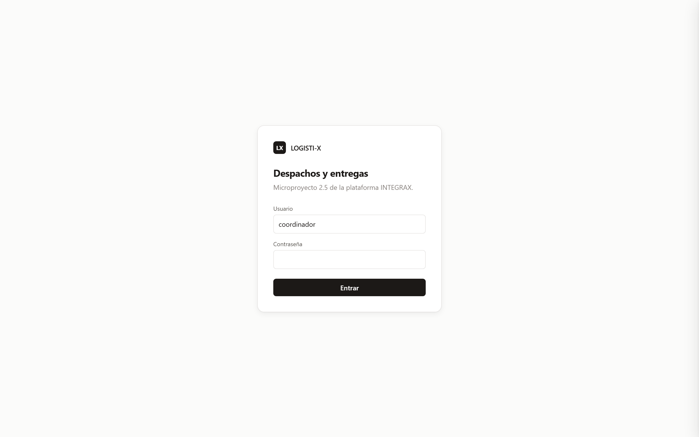

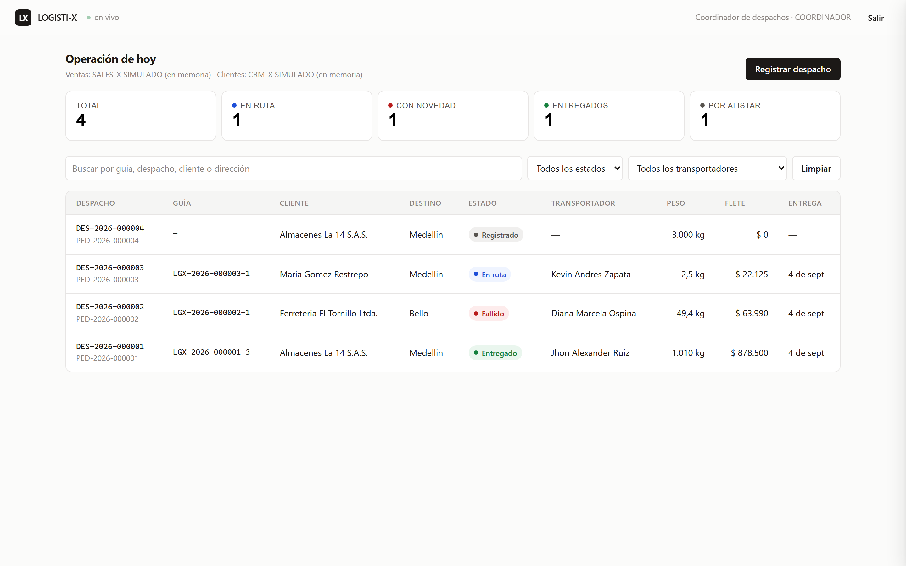

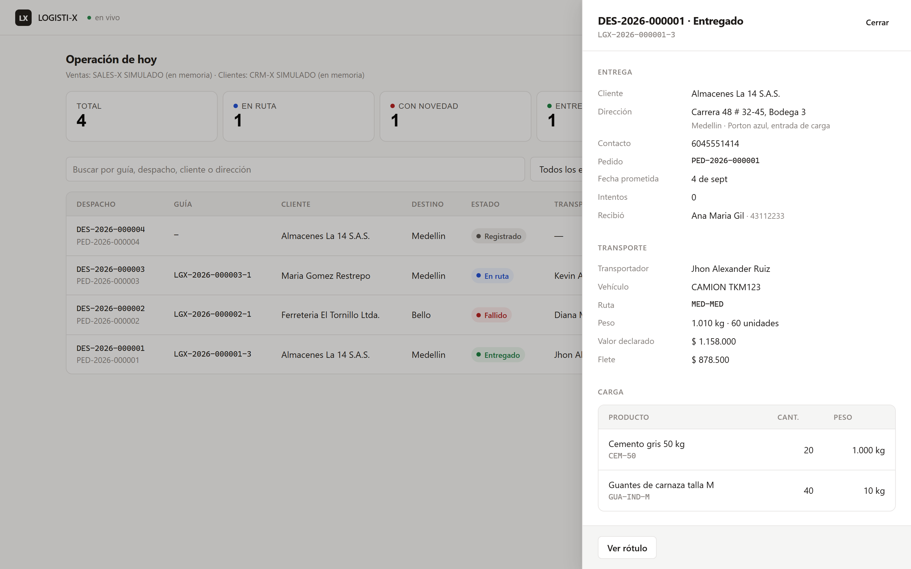

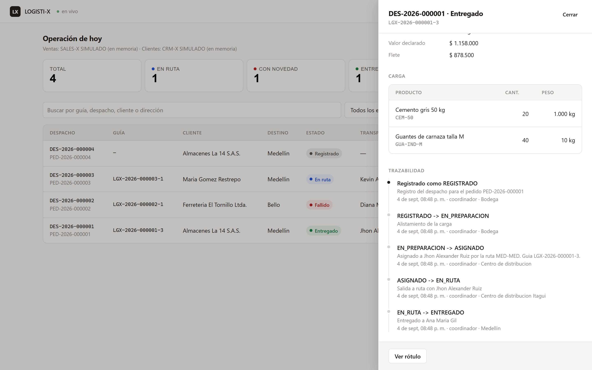

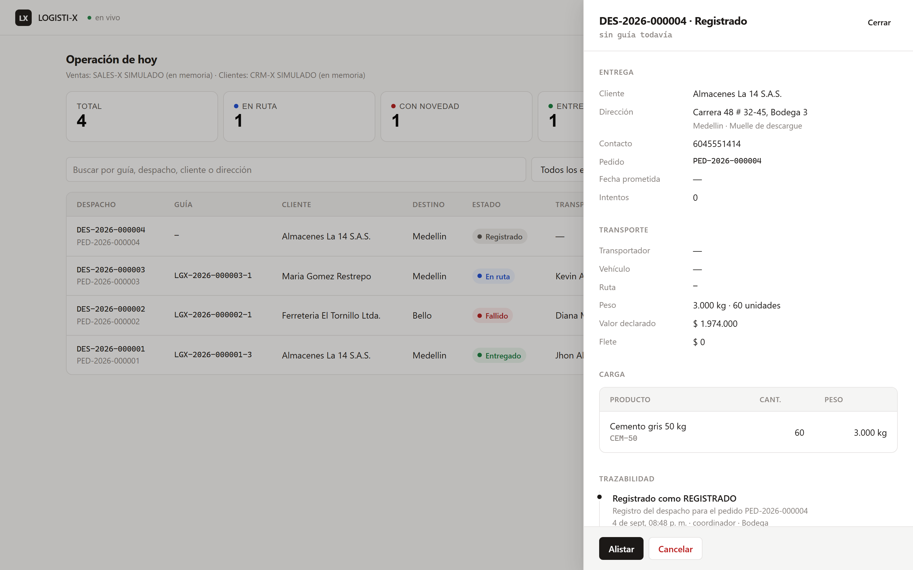

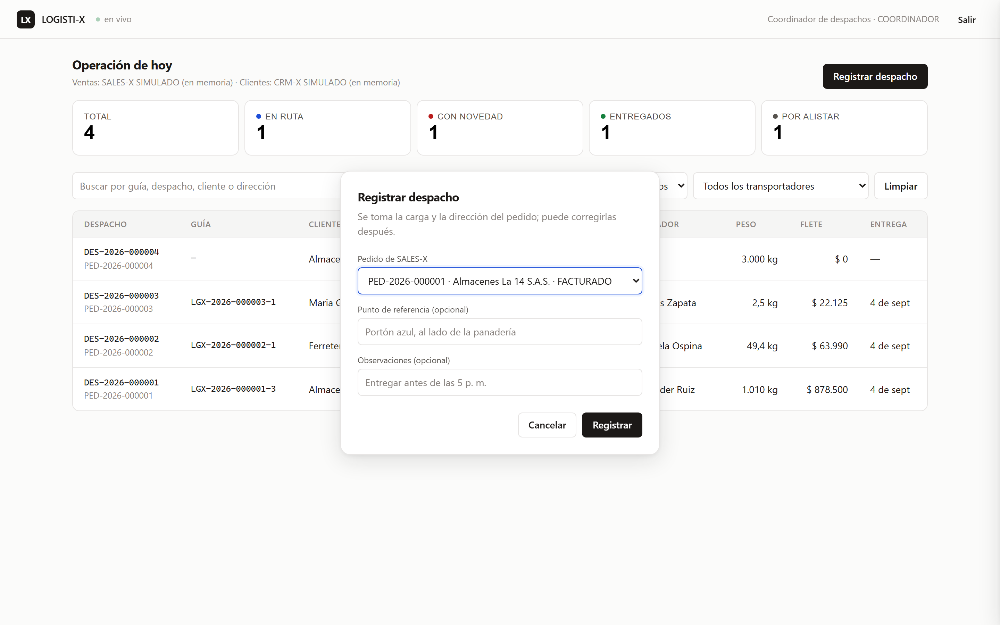

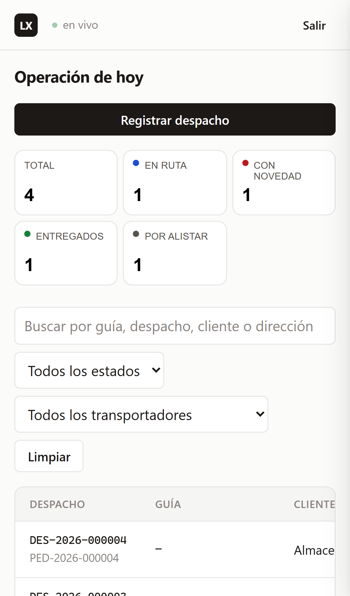